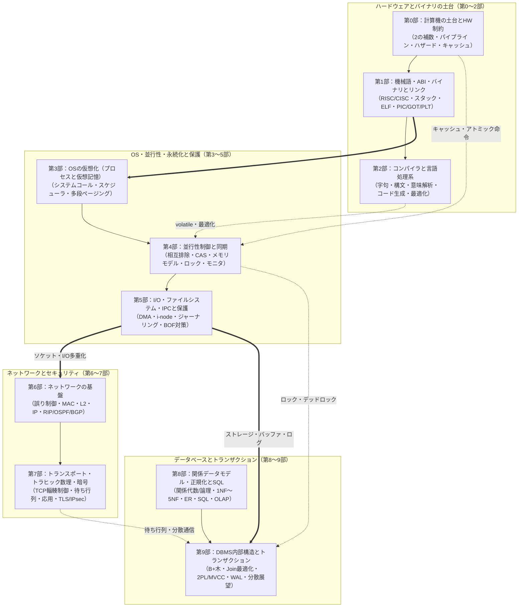

# 現代の計算機システムを読み解くための構造と設計（全10部）

## このノートは何を目指すのか

プログラムが1行のソースコードから電気信号としてCPU上で実行され、メモリやディスクを安全に共有し、ネットワークを越えてデータベースに永続化されるまでには、ハードウェア設計、機械語・バイナリ、コンパイラ、OS、並行性制御、ネットワーク、データベースといった複数の階層が関わります。

本ノートは、これらを個別の科目や特定製品の仕様暗記として分断せず、次の3つの視点から横断的に読み解く学習ノートです。

1. **階層をまたぐ共通の構造：** キャッシュと局所性（CPUキャッシュ・TLB・OSバッファキャッシュ・DBバッファプール）、間接参照（多段ページテーブル・GOT/PLT・i-node・DBのスロット配列）、ログによる原子性と永続性（ファイルシステムのジャーナリング・DBのWAL）など、階層をまたいで繰り返し現れる設計パターンを重視します。
2. **抽象化と実装上の工夫：** APIやプロトコルの仕様だけでなく、「なぜその抽象化が必要なのか」「ハードウェアやネットワークの物理的制約の中で、現実のシステムがどう工夫して実装しているのか」を押さえます。
3. **限界と補正の仕組み：** 素朴な設計や理論モデルが現実の負荷・並列実行・障害で破綻する条件（ハザード、断片化、競合状態、輻輳、クラッシュ、更新時異常など）と、それに対するハードウェア・OS・プロトコル・DBMS上の補正を確認します。

各節は「1節＝1テーマ」の流れで読めるよう設計しています。待ち行列理論や暗号の基礎、関係代数・正規化理論といった数理的な道具は第0部に詰め込まず、**実際に使う直前の部・節で導入する**構成をとります。

| 対象 | 領域 | 主な内容 |
| --- | --- | --- |
| **第0〜1部** | ハードウェアの制約とバイナリ・ABI | 2進数・2の補数・アラインメント、組合せ／順序回路とクリティカルパス、5段パイプラインとハザード、記憶階層とCPUキャッシュを基礎から整理。続けてRISC/CISCの対比、スタックフレームとABI、ELF構造・再配置、静的／動的リンク（PIC・GOT/PLT）、デバッグ情報とデバッガ原理を押さえる。 |
| **第2部** | コンパイラと言語処理系 | コンパイルの全体構造と中間表現（IR）、字句解析（正規表現・NFA/DFA最小化）、構文解析（CFG・AST・再帰下降と $\text{LL}(1)$・$\text{SLR}(1)/\text{LR}(1)/\text{LALR}(1)$）、意味解析（スコープ・記号表・型システム）、コード生成、最適化（のぞき穴・CFG/データフロー解析・`volatile`・グラフ彩色によるレジスタ割当）を整理する。 |
| **第3〜5部** | OS・並行性・I/Oとシステム保護 | 抽象化と保護、特権モード・割り込み・トラップ・システムコール、プロセスとスケジューリング、物理メモリ管理と仮想記憶（多段ページテーブル・TLB・CoW）を整理。続けてソフトウェア相互排除からアトミック命令・メモリモデル・ロック・セマフォ・モニタ・シグナルまでの並行性制御、さらにDMA・ファイルシステム（i-node・ジャーナリング）・アクセス制御・メモリ破壊攻撃と防御・形式手法の入口までを扱う。 |
| **第6〜7部** | ネットワークの基盤・トラヒック数理と暗号 | 回線交換とパケット交換、階層化、通信路容量と誤り制御（ハミング符号・CRC）、MAC制御（ALOHA・CSMA/CD・無線LAN）、L2スイッチ・STP・VLAN、IPv4/IPv6と周辺プロトコル（ARP・ICMP・DHCP・NAT）、動的ルーティング（RIP・OSPF・BGP・MPLS）を整理。続けてTCP/UDPとARQ効率・輻輳制御・QUIC、待ち行列理論（$M/M/1$・リトルの公式・アーランB式）、応用プロトコル、暗号と認証（AES・RSA・DH・TLS・IPsec）を扱う。 |
| **第8〜9部** | 関係データモデル・DBMS内部構造とトランザクション | 関係モデル・関係代数・関係論理（関係完備）、正規化理論（FD・MVD・JD・1NF〜5NFと非正規化）、ERモデリングとSQL、OLAP・グラフDBを整理。続けてページ編成・バッファプール、$\text{B}^+$木とLSM-Tree、外部ソート・各種Joinと問合せ最適化、ACID・直列化可能性・2PL/TO/OCC/MVCC、WALとCLRによる障害回復、最後に分散システム（2相コミット・CAP定理の入口）への展望と全10部の総括を行う。 |

---

### 扱う主な理論と実装のプレビュー

※ここでは全体像のみを示します。第0部〜第9部を通じて、以下の項目を具体例・仕組み・前提と限界の観点から順に整理します。

1. **ハードウェア・コンパイラ・OSの接続**

    CPUの動作性能を規定する $\text{Performance} = f \times \text{IPC}$ と5段パイプラインのフォワーディング、キャッシュ局所性とアラインメント制約、コンパイラの干渉グラフによるレジスタ割当（$k$-彩色問題）、そしてOSにおける多段ページテーブル・TLB・トラップ時の空間切替（trampoline／trapframe）とコピーオンライトを、1つの計算機の上で噛み合う仕組みとして説明します。

2. **並行性制御・ネットワークの数理とプロトコル設計**

    マルチコア・マルチスレッド環境での安全性と活性（デッドロック・飢餓）、ハードウェアのアトミック命令とメモリモデル、ネットワークの限界通信路容量を与える **Shannon-Hartley の定理**

    $$C = B \log_2\left(1 + \frac{S}{N}\right)$$

    および待ち行列システムにおける平均系内数 $N$・到着率 $\lambda$・平均遅延時間 $D$ の普遍関係である **リトルの公式** $N = \lambda D$ と $M/M/1$ の平均遅延 $D = \dfrac{1}{\mu(1-\rho)}$ を導出します。あわせて、信頼性のない通信路では完全合意ができない「二つの軍隊問題」に対し、TCPがタイムアウトと3-way handshake・AIMD輻輳制御でどう実用解を構成しているかを整理します。

3. **関係データモデルとDBMSのトランザクション・障害回復**

    関数従属性・多値従属性・結合従属性に基づく無損失分解（$\text{5NF} \subset \text{4NF} \subset \text{BCNF} \subset \text{3NF} \subset \text{2NF} \subset \text{1NF}$）を経て、ページバッファ上のダーティページとディスクI/Oの非対称性のもとで、**先行グラフによる競合直列化可能性**、2PL・MVCCによる同時実行制御、および **WAL（Write-Ahead Logging）と補償ログレコード（CLR）** によるべき等なクラッシュリカバリがどう実現されるかを整理します。

---

### 本ノートの読み進め方と編集方針

#### 学習の順序

第0部（計算機の土台）〜第1部（機械語・ABI・バイナリ）が共通の土台です。ここから、言語処理系の内部へ進む第2部（コンパイラ）、計算資源の仮想化と並行・永続化を扱う第3〜5部（OS・並行性・I/Oとファイルシステム）、マシン間の通信を扱う第6〜7部（ネットワークと暗号）、そしてデータ管理の集大成となる第8〜9部（データベース）へと積み上げます。

OSとDBを中心に読みたい場合は、第0〜1部から第2部（コンパイラ）を飛ばして第3部へ進むこともできます（ただし、4-3節のメモリモデルや5-8節のスタック保護で2-7節のコンパイラ最適化・`volatile`を、9-4節の問合せ最適化で2-8節のNP完全な最適化問題の視点を軽く参照する箇所があります）。また、第6〜7部（ネットワーク）は第5部（5-3節のソケット）から自然に接続しますが、単独で読み進めることも可能です。

#### 各節の構成

各節は次の5項目で統一し、節末の確認問題（トレース・計算・設計判定）の解答を次節冒頭に置くことで、前後の繋がりを保ちます。

1. **動機（Why）：** 素朴な設計では遅くなる・壊れる・扱えない点や、その仕組みが導入された背景を確認します。
2. **具体例・動作イメージ（Toy Model・図解）：** 抽象的な仕様や形式定義の前に、手計算や短いコード・パケット列で最後まで追える小さな例と図解を置きます。
3. **構造・アルゴリズム・実装（What）：** 原理・データ構造・プロトコル・アルゴリズムを飛躍を抑えて整理し、代表的な実装上の工夫を解説します（適宜、歴史的背景や設計の道草コラムを配置します）。
4. **限界と補正（Critique & Adaptation）：** モデルの前提が現実のハードウェア・並列実行・障害・攻撃で崩れる条件と、それに対する実システム上の補正・拡張を検証します。
5. **接続と展望（Bridge）：** 本節の内容が他の部・節のどの仕組みにどう繋がるかを示します。

#### 記述の原則

* 初出の専門用語には平易な言い換えや直感的な補足を添え、専門用語を別の専門用語だけで言い換える記述を避けます。
* 各節の本論（1〜4）では、**まだ解説していない後半の部の専門用語を先出ししない**ことを原則とし、後半分野との具体的な接続は「5. 接続と展望（Bridge）」に集約します。

#### ISAの役割分担と扱う範囲の線引き

* **ISA（命令セットアーキテクチャ）の役割分担：** 基本原理は特定のCPUに依存しない抽象モデルで説明します。具体的な実装例を示す際は、構造が整理されておりハードウェアやOSの仕組みを見通しやすい **RISC-V（RV32I / RV64GC）** を第0部（CPUパイプライン）と第3〜5部（OSカーネル：教育用OSの設計をモデル化）に用い、現実のLinuxバイナリやCISCならではの工夫が見えやすい **x86-64（System V AMD64 ABI / ELF）** を第1部（ABI・リンク）と第2部（コンパイラのコード生成）に用います。第1部冒頭（1-1節）で両者の設計思想とレジスタの対応表を明示し、対比そのものを学びの軸にします。
* **抽象モデルと実システムの線引き：** LinuxカーネルやPostgreSQL・InnoDBなどの特定バージョンに固有の細かなチューニング項目や設定書式は本論の対象外とし、汎用的な設計原理と代表的な実装パターンを主軸にします（特定製品の実装例はコラムや補足として位置づけます）。
* **範囲外の領域：** 論理ゲートの最小化（カルノー図等）やVerilog HDLの文法・FPGA固有の配置配線ツール（Vivado・LUT制約等）、物理層の変調方式の数式展開、および個別言語のライブラリAPI網羅は対象外とします。

---

### 想定する前提知識と基本記号の早見表

**前提知識：** C言語またはそれに類する手続き型言語の基本構文（変数・配列・構造体・ポインタ・関数呼び出し・再帰）と、高校〜大学初年級レベルの離散数学・初等確率論（集合・グラフ・漸化式・微積分の初歩）を前提とします。ハードウェア、アセンブリ、コンパイラ、OS、ネットワーク、データベースの前提知識は不要とします。

| 記号・略語 | 読み方・意味 | 初出・詳細 |
| --- | --- | --- |
| $\text{IPC},\; f$ | 1サイクルあたり完了命令数（Instructions Per Cycle）、クロック周波数 | [0-3](0/0-3.md)・[0-4](0/0-4.md) |
| $\text{PC},\; \text{SP},\; \text{FP}$ | プログラムカウンタ、スタックポインタ、フレーム（ベース）ポインタ | [0-4](0/0-4.md)・[1-3](1/1-3.md) |
| $\text{VA},\; \text{PA},\; \text{PTE},\; \text{TLB}$ | 仮想アドレス、物理アドレス、ページテーブルエントリ、アドレス変換キャッシュ | [3-5](3/3-5.md) |
| $\text{CFG},\; \text{AST},\; \text{IR}$ | 文脈自由文法／制御フローグラフ（文脈で明示）、抽象構文木、中間表現 | [2-1](2/2-1.md)・[2-3](2/2-3.md)・[2-7](2/2-7.md) |
| $\text{RTT},\; \text{MTU},\; \text{MSS}$ | 往復伝搬遅延時間、最大転送単位、最大セグメント長 | [6-6](6/6-6.md)・[7-1](7/7-1.md)・[7-2](7/7-2.md) |
| $\lambda,\; \mu,\; \rho = \lambda / \mu$ | 到着率、処理率、利用率（待ち行列理論・トラヒック解析） | [7-4](7/7-4.md) |
| $\sigma_P(R),\; \pi_A(R),\; R \bowtie S$ | 関係代数の選択演算、射影演算、自然結合演算 | [8-2](8/8-2.md) |
| $X \to Y,\; X \twoheadrightarrow Y,\; X^+$ | 関数従属性（FD）、多値従属性（MVD）、属性集合 $X$ の推移的閉包 | [8-4](8/8-4.md)・[8-5](8/8-5.md) |
| $R_i(A),\; W_i(A),\; C_i,\; A_i$ | トランザクション $T_i$ によるデータ $A$ の読出し・書込み・コミット・アボート | [9-5](9/9-5.md) |
| $\text{WAL},\; \text{LSN},\; \text{CLR}$ | 先行書き込みログ、ログシーケンス番号、補償ログレコード | [9-8](9/9-8.md) |

---

## 全体の見取り図（第0部〜第9部の繋がり）

※第0〜1部から第2部（コンパイラ）を経由せず直接第3部（OS）へ進むルートや、第6〜7部（ネットワーク）を独立して読むルートも可能です。

---

## 各部の構成と目次（全10部・全76節）

### 第0部：計算機の土台とハードウェアの制約（全7節） { #part-0 }

> **立ち位置：** ソフトウェアが動作する物理的な器であるCPUとメモリの制約を、ビット表現からパイプライン・キャッシュまで1本の流れで整理します。ここでの「ゲート遅延」「ハザード」「局所性」が、後半のコンパイラ・OS・DBのあらゆる最適化の動機になります。

* [0-1. 2進数・2の補数・オーバーフローとデータ表現](0/0-1.md)
* [0-2. バイトオーダ（エンディアン）・アラインメントとパディング](0/0-2.md)
* [0-3. 組合せ回路・順序回路とクリティカルパス](0/0-3.md)
* [0-4. 命令実行サイクルとシングル／マルチサイクルプロセッサ](0/0-4.md)
* [0-5. 5段パイプラインと構造・制御ハザード（分岐予測の直感）](0/0-5.md)
* [0-6. データハザードの解決（バイパス・フォワーディング・ストール）](0/0-6.md)
* [0-7. 記憶階層とCPUキャッシュ（局所性・セット連想・コヒーレンシ）](0/0-7.md)

第0部の各節の詳細（概要・限界と補正・補足話題）を開く

#### [0-1. 2進数・2の補数・オーバーフローとデータ表現](0/0-1.md)

コンピュータ内部では命令も文字も数値もすべて0と1の列であり、解釈の規則（符号化）によって意味が決まることを確認する。位取り記数法、文字コード（ASCIIとUTF-8の可変長設計）、符号なし整数と**2の補数**による符号あり整数（加算器をそのまま減算に共用できる仕組み）、ゼロ拡張・符号拡張・切り詰めを整理する。

* **限界と補正：** 有限ビット長によるオーバーフロー（符号なしの法 $2^n$ 演算とキャリーフラグ、符号ありのオーバーフローフラグとC言語の未定義動作、最小値の絶対値が表現できない問題、符号あり／なし混在の暗黙変換）と、固定長整数では扱えない実数に対する浮動小数点数（IEEE 754の直感と丸め誤差）。
* **補足話題：** ASCII制御文字 `Delete` が `127`（全ビット `1`）であるパンチカード時代の由来と、2038年問題。

#### [0-2. バイトオーダ（エンディアン）・アラインメントとパディング](0/0-2.md)

バイトアドレッシングのメモリ上で多バイトデータを配置する2つの順序（リトルエンディアン vs ビッグエンディアン）を整理する。さらに、メモリバスの幅やキャッシュライン境界に由来する**アラインメント制約**と、構造体のメンバ間・末尾に自動挿入される**パディング**（配列との違いを含む）を具体例で確かめる。

* **限界と補正：** アラインメント違反が招く性能劣化やクラッシュ（SIMD命令等）、構造体メンバの宣言順序によるメモリ消費量の差、および異機種間・ネットワーク通信でのエンディアン不一致を吸収するネットワークバイトオーダ変換。
* **補足話題：** 「エンディアン」という名称の『ガリバー旅行記』由来の語源と、構造体のメンバを大きい型から並べる実務上の工夫。

#### [0-3. 組合せ回路・順序回路とクリティカルパス](0/0-3.md)

MOSトランジスタ（CMOS）による論理ゲートから出発し、現在の入力のみで出力が決まる**組合せ回路**（マルチプレクサ・半加算器・全加算器・リップルキャリー加算器）と、クロック同期で状態を保持する**順序回路（レジスタ）**の役割を対比する。回路内の最大遅延経路である**クリティカルパス**がクロック周波数の上限（$f \le 1 / \text{遅延}$）を決める構造を確認する。

* **限界と補正：** リップルキャリー加算器ではビット幅 $n$ に比例してキャリー伝播遅延が増大する限界と、桁上げ先見（キャリールックアヘッド）や専用キャリーチェイン・パイプライン分割による高速化。また、2003年以降のクロック周波数頭打ち（電力・発熱の壁）がマルチコア化へ舵を切らせた背景。
* **補足話題：** ムーアの法則の推移と、ASICとFPGA（LUTによる再構成可能性）のトレードオフ。

#### [0-4. 命令実行サイクルとシングル／マルチサイクルプロセッサ](0/0-4.md)

RISC-V（RV32I）の最小命令セット（`add`/`addi`/`lw`/`sw`/`beq`）を題材に、命令実行の5ステップ（**IF → ID → EX → MEM → WB**）とデータパス（PC・命令メモリ・レジスタファイル・即値生成器・ALU・データメモリ）を組み立てる。1命令を1サイクルで終える**シングルサイクル**と、ステージごとにサイクルを分ける**マルチサイクル**を $\text{Performance} = f \times \text{IPC}$ の式で比較する。

* **限界と補正：** シングルサイクルでは最も遅い `lw` 命令に全命令のクロック周期が引きずられる非効率があり、単純なマルチサイクルでは周波数 $f$ が上がっても $\text{IPC}$ が $1/5$ に落ちてスループットが伸びない限界（次節のパイプライン処理への動機）。
* **補足話題：** 常に `0` を返すハードワイヤード・ゼロレジスタ `x0` が命令セットと回路を大幅に簡潔にする仕組み。

#### [0-5. 5段パイプラインと構造・制御ハザード（分岐予測の直感）](0/0-5.md)

各ステージ間にパイプラインレジスタ（`IfId`・`IdEx`・`ExMe`・`MeWb`）を挟み、複数命令をステージ単位で重ねて実行することで、高周波数と理想 $\text{IPC} \approx 1$ を両立させる**5段パイプライン**を構成する。その上で、並列実行を阻害する3種のハザードのうち、**構造ハザード**（命令・データメモリの分離による回避）と**制御ハザード**（分岐条件がEXで確定するまでの後続2命令の扱い）を整理する。

* **限界と補正：** 分岐不成立仮定＋成立時の2ステージ同時フラッシュ（NOP置換）では分岐ペナルティが避けられない点と、これを緩和する**分岐予測**（静的予測・2ビット飽和カウンタによる動的予測・分岐ターゲットバッファ）および投機実行の考え方。
* **補足話題：** パイプラインを深くするほど周波数上限は上がる一方、分岐予測ミス時のフラッシュ損失が増大する最適段数のトレードオフ。

#### [0-6. データハザードの解決（バイパス・フォワーディング・ストール）](0/0-6.md)

先行命令の演算結果を後続命令が参照する**データハザード**（RAW依存）について、命令間の距離（間に挟まる命令数）ごとに4ケースを分類する。WBとIDが重なる場合の**レジスタバイパス**、WB→EXおよびMEM→EXへ直接値を届ける**フォワーディング**（より新しいMEM側を優先するMUX制御）をパイプラインチャートで追う。

* **限界と補正：** ロード命令（`lw`）の直後にロード結果を使う**ロード・ユースハザード**はMEM終了まで値が確定せずフォワーディングだけでは解決できない点と、ハードウェアによる1サイクルの**ストール（バブル挿入）**またはコンパイラによる命令スケジューリングでの補正。
* **補足話題：** 命令列の順序を動的に並べ替えて空きサイクルを埋めるアウトオブオーダ実行（Out-of-Order Execution）の直感。

#### [0-7. 記憶階層とCPUキャッシュ（局所性・セット連想・コヒーレンシ）](0/0-7.md)

レジスタ（$< 0.5\text{ ns}$）からL1/L2/L3キャッシュ、主記憶DRAM（$\approx 100\text{ ns}$）、SSD/HDDに至る**記憶階層**の速度差（プロセッサとメモリの速度ギャップ）を数値で確認する。プログラムが持つ**時間的局所性・空間的局所性**を活用する**CPUキャッシュ**の構造（キャッシュライン、直接写像・セット連想・タグ比較、ライトバック vs ライトスルー）を整理する。

* **限界と補正：** キャッシュミス（強制・容量・競合ミス）と行列走査順序による性能差、マルチコア環境で各コアのキャッシュ内容が食い違う問題に対する**キャッシュコヒーレンシ（MESIプロトコル等）**、および異なる変数が同一キャッシュラインに載ることで起きる **False Sharing（偽共有）** とパディングによる回避。
* **補足話題：** 2次元配列の行優先走査と列優先走査で実行時間が桁違いに変わる理由（空間的局所性の実験）。

---

### 第1部：機械語・ABI・バイナリとリンク（全6節） { #part-1 }

> **立ち位置：** ハードウェアの命令セットとソフトウェア（C言語等）の境界を埋める「バイナリの仕組み」を整理します。RISC-Vとx86-64を対比しつつ、関数呼び出し規約（ABI）、ELFの構造、再配置、動的リンク、デバッガの原理までを具体的に追います。

* [1-1. ISAの設計思想（RISC vs CISC）と2つのアーキテクチャの対応](1/1-1.md)
* [1-2. レジスタ・アドレッシングモードと制御フローの機械語表現](1/1-2.md)
* [1-3. スタックフレームと関数呼び出し規約（ABI）](1/1-3.md)
* [1-4. ELFバイナリ構造・セクションと記号表・再配置](1/1-4.md)
* [1-5. 静的リンクと動的リンク（PIC・PIE・GOT/PLT）](1/1-5.md)
* [1-6. デバッグ情報（DWARF）・デバッガの動作原理とインラインアセンブラ](1/1-6.md)

第1部の各節の詳細（概要・限界と補正・補足話題）を開く

#### [1-1. ISAの設計思想（RISC vs CISC）と2つのアーキテクチャの対応](1/1-1.md)

ハードウェアとソフトウェアの契約である**命令セットアーキテクチャ（ISA）**の役割を整理し、固定長命令・ロードストア型の **RISC（RISC-V）** と、可変長命令・豊富なアドレッシングを持つ **CISC（x86-64）** の設計思想を対比する。本ノート全体で参照する両アーキテクチャのレジスタ対応表（`sp`/`%rsp`、`ra`/スタック戻り番地、`a0-a7`/`%rdi,%rsi,...` 等）を整備する。

* **限界と補正：** 現代のx86-64プロセッサ内部では複雑なCISC命令をRISC風のマイクロオペレーション（$\mu\text{op}$）へ分解して実行しており、RISC側もコードサイズ削減のため圧縮命令（RV64C）を取り入れるなど、両者の境界が実務上で収斂している構造。
* **補足話題：** 機械語命令の符号化（RISC-Vの固定ビット位置とx86-64のREX・ModR/M・SIBバイトの対比）とAT&T記法／Intel記法の違い。

#### [1-2. レジスタ・アドレッシングモードと制御フローの機械語表現](1/1-2.md)

x86-64の汎用レジスタと別名（`%rax`/`%eax`/`%ax`/`%al`、32ビット演算による上位32ビットゼロクリア）、ステータスフラグ（`CF`/`OF`/`SF`/`ZF`）、4つのアドレッシングモード（即値・レジスタ・直接・間接および `%rip` 相対・SIBによる配列アクセス）を整理する。比較命令（`cmp`/`test`）と条件分岐（符号あり `jg`/`jl` vs 符号なし `ja`/`jb`）、`switch` 文の単純比較とジャンプテーブルによる $O(1)$ 化を確認する。

* **限界と補正：** ジャンプテーブルは `case` 値が疎な場合にメモリを浪費する制約（コンパイラによる二分探索や比較列との使い分け）、および間接ジャンプが脆弱性の標的になる問題に対する `endbr64`（Intel CET）などのハードウェア保護。
* **補足話題：** 本来はアドレス計算命令である `lea` が、フラグを汚さない高速な「積和算」としてコンパイラに流用される理由。

#### [1-3. スタックフレームと関数呼び出し規約（ABI）](1/1-3.md)

異なるファイルや言語でコンパイルされた関数同士が正しく連携するための約束事である **ABI（Application Binary Interface）** とAPIの違いを整理する。`call`/`ret` による戻り番地の退避、関数プロローグ・エピローグによる**スタックフレーム**の構築、System V AMD64 ABI の引数渡し（第1〜6引数はレジスタ、第7引数以降はスタック）、**caller-saved / callee-saved レジスタ**の役割分担を確認する。

* **限界と補正：** `call` 時の16バイト境界アラインメント制約に違反した場合のクラッシュ、フレームポインタ省略（`-fomit-frame-pointer`）によるバックトレースの難化、葉関数でスタック調整を省く **red zone** の前提条件（カーネルや割り込み処理では使えない理由）。
* **補足話題：** `enter` 命令が遅いためにコンパイラが使わない歴史的経緯と、末尾コール最適化（TCO）で戻り番地が変化する仕組み。

#### [1-4. ELFバイナリ構造・セクションと記号表・再配置](1/1-4.md)

Cソースコードから実行可能ファイルに至る広義のコンパイル（前処理 → コンパイル → アセンブル → リンク）の流れと、Linuxの **ELF** 形式（`.text`・`.data`・`.bss`・`.rodata` の4基本セクション、リンク単位のセクションとロード単位のセグメント）を整理する。分割コンパイルされたオブジェクトファイル（`*.o`）中の未確定アドレスを、**記号表**と**再配置情報（Relocation）**を用いてリンク時に埋める仕組みを具体的なアドレス計算で追う。

* **限界と補正：** 未初期化の静的配列をファイルにそのまま書くとバイナリが肥大化する問題に対する `.bss` セクション（ファイルサイズ0・ロード時ゼロ初期化）の工夫、およびシンボルの多重定義を避けるローカル／グローバル／weakシンボルの使い分け。
* **補足話題：** 同じビット列 `01010101` がASCIIでは文字 `U`、x86-64機械語では `pushq %rbp` になる「データと命令の無区別性」。

#### [1-5. 静的リンクと動的リンク（PIC・PIE・GOT/PLT）](1/1-5.md)

すべてのライブラリをバイナリに含める**静的リンク（`lib*.a`）**と、実行時に共有ライブラリ（`lib*.so`）をメモリ上で共有する**動的リンク**のファイルサイズ・メモリ効率・配布性のトレードオフを比較する。どの仮想アドレスにロードされても動作する**位置独立コード（PIC / PIE）**の仕組み（`%rip` 相対アドレッシング）と、初回呼び出し時までアドレス解決を遅延する **GOT / PLT** の2段階ジャンプ構造を追う。

* **限界と補正：** 動的リンクに伴う起動・初回呼び出しのオーバーヘッド、依存ライブラリのバージョン不整合（いわゆるDLL地獄）と静的リンクやコンテナによる再評価、および `LD_LIBRARY_PATH` の悪用やGOT書き換え攻撃に対する **RELRO**（GOTの読み取り専用化）。
* **補足話題：** システムコールのオーバーヘッドを避けるため、カーネルがユーザ空間へ仮想的な共有ライブラリをマップする `vDSO`（`linux-vdso.so.1`）の仕組み。

#### [1-6. デバッグ情報（DWARF）・デバッガの動作原理とインラインアセンブラ](1/1-6.md)

バイナリの機械語アドレスとソースコードの行番号・型情報を結びつける **DWARF デバッグ情報**（DIEの木構造・可変長整数符号化 LEB128）の仕組みを確認する。さらに、デバッガが `ptrace` と **トラップ命令（`int 3`）の書き換え・復元** によってブレークポイントを実現する原理、およびC言語内に機械語を埋め込む**インラインアセンブラ**（入出力制約・早期破壊 `&`・破壊レジスタ列・`"memory"`）の仕組みを整理する。

* **限界と補正：** 最適化されたバイナリ（`-O2` 等）では命令の並べ替えや変数消去によりソース行と機械語の対応が崩れる点（`-Og` の役割）、インラインアセンブラで制約や `volatile` を誤った際の最適化による破壊、およびソフトウェア・ウォッチポイントの低速さとハードウェア支援の個数制限。
* **補足話題：** バイナリ形式「ELF」に対してデバッグ情報形式が「DWARF」と名付けられた由来と、コアダンプによる事後デバッグ。

---

### 第2部：コンパイラと言語処理系（全8節） { #part-2 }

> **立ち位置：** 人間が書く高級言語が、どのように解析され、型を検査され、最適化された機械語へ翻訳されるかを1本のパイプラインとして辿ります。形式言語・オートマトン・グラフ理論がそのまま実用ソフトウェアの設計に落ちる構造を確認します。

* [2-1. コンパイラの全体構造・中間表現（IR）と実行方式（VM・JIT）](2/2-1.md)
* [2-2. 字句解析の理論と実装（正規表現・NFA/DFA・最小化DFA）](2/2-2.md)
* [2-3. 構文解析①：文脈自由文法（CFG）・ASTと再帰下降（$\text{LL}(1)$）](2/2-3.md)
* [2-4. 構文解析②：上向き解析（$\text{SLR}(1)$・$\text{LR}(1)$・$\text{LALR}(1)$）](2/2-4.md)
* [2-5. 意味解析：静的スコープ・記号表と型システム・暗黙変換](2/2-5.md)
* [2-6. コード生成：スタック機械・制御文・短絡評価と関数呼び出し](2/2-6.md)
* [2-7. コード最適化①：のぞき穴最適化・CFG/データフロー解析と `volatile`](2/2-7.md)
* [2-8. コード最適化②：生存解析・干渉グラフとグラフ彩色によるレジスタ割当](2/2-8.md)

第2部の各節の詳細（概要・限界と補正・補足話題）を開く

#### [2-1. コンパイラの全体構造・中間表現（IR）と実行方式（VM・JIT）](2/2-1.md)

ソースコードから機械語までのフェーズ分割（フロントエンド：字句・構文・意味解析・IR生成 ／ バックエンド：最適化・コード生成）を整理する。共通の**中間表現（IR）**を挟むことで、$M$ 言語 $\times$ $N$ ターゲットの開発量を $M \times N$ から $M + N$ へ削減する設計、およびコンパイラ・インタプリタ・仮想機械（バイトコード）・**JITコンパイラ**の4つの実行方式を比較する。

* **限界と補正：** 事前コンパイル（AOT）は実行時の具体的な型や分岐頻度を知らないため最適化に限界がある点と、実行時プロファイルをもとにホットスポットを機械語化するJITの補完関係（およびJITのウォームアップ遅延・メモリ消費）。
* **補足話題：** コンパイラをその言語自身で記述して育て上げる「ブートストラップ（セルフホスティング）」の仕組み。

#### [2-2. 字句解析の理論と実装（正規表現・NFA/DFA・最小化DFA）](2/2-2.md)

文字列をトークン列へ切り出す**字句解析**の役割と、チョムスキー階層における正規文法の立ち位置を整理する。正規表現から **NFA（Thompson構成法）** → **DFA（部分集合構成法）** → **最小化DFA** → 状態遷移表による $O(n)$ 実装への機械的変換手順を、具体例（`(0|1)*01` 等）で最後まで辿る。

* **限界と補正：** 正規表現（有限オートマトン）では任意の深さの括弧の対応を認識できない限界（次節のCFGへの動機）、予約語と識別子の衝突、最長マッチと貪欲マッチの差異、およびバックトラック型正規表現エンジンで起きる指数時間遅延（ReDoS）。
* **補足話題：** `mmap` でソースファイル全体を仮想メモリへマップして字句解析器を簡潔に書く実装上の工夫。

#### [2-3. 構文解析①：文脈自由文法（CFG）・ASTと再帰下降（$\text{LL}(1)$）](2/2-3.md)

トークン列から階層構造（構文木・**抽象構文木 AST**）を組み立てる**文脈自由文法（CFG）**の定義と、導出・あいまいさ（優先順位・結合性・ぶらぶら `else`）・BNF/EBNFの等価変換を整理する。非終端記号ごとに関数を対応させる**再帰下降構文解析**と、1トークン先読みで一意に展開できる **$\text{LL}(1)$ 文法**の判定条件（$\text{first}$・$\text{follow}$・$\text{director}$ 集合の計算、左再帰の除去）を導出する。

* **限界と補正：** 左再帰を右再帰へ機械変換すると減算などの左結合演算子の木が右結合に歪む問題（AST構築時のループ化による補正）、一般のCFG解析が $O(n^3)$ かかる制約、およびC言語の `typedef` のように文脈情報なしでは構文解析できない現実言語の例外。
* **補足話題：** 近年、GCCやClangなどの実用コンパイラがパーサ生成系（Bison等）から手書きの再帰下降パーサへ回帰した理由（エラーメッセージの質と柔軟性）。

#### [2-4. 構文解析②：上向き解析（$\text{SLR}(1)$・$\text{LR}(1)$・$\text{LALR}(1)$）](2/2-4.md)

最右導出を逆順に辿る上向き構文解析（**LR構文解析**）のドライバ動作（シフト・還元・スタック操作）を確認する。$\text{LR}(0)$ 項の閉包と `goto` 演算から **$\text{SLR}(1)$ 構文解析表** を構成し、文脈ごとの先読み記号を持つ **$\text{LR}(1)$**、さらにコアが同じ状態を合併して表サイズを圧縮する **$\text{LALR}(1)$** への発展を小さな式文法で追う。

* **限界と補正：** 解析表の同一セルに複数動作が入る**シフト／還元衝突**と**還元／還元衝突**の発生条件、$\text{LR}(1)$ の状態数爆発に対する $\text{LALR}(1)$ の合併と、合併によって稀に新たな還元／還元衝突が生じる限界。
* **補足話題：** ぶらぶら `else` のシフト／還元衝突を「デフォルトでシフト優先」という1つの規則で自然に解決するパーサ生成系の設計。

#### [2-5. 意味解析：静的スコープ・記号表と型システム・暗黙変換](2/2-5.md)

CFGだけでは検証できない「未定義変数の参照」「二重定義」「型の不整合」を検査する**意味解析**を整理する。入れ子になった**静的スコープ**をスタック構造で管理する**記号表**（名前空間の分離・前方参照・文字列リテラルの集約）と、複合型（ポインタ型・関数型）を木構造で表す**型解析**、静的型付け vs 動的型付け・型推論を比較する。

* **限界と補正：** C言語の暗黙の型変換（整数拡張・通常の算術型変換で `unsigned` と負の `int` を比較した際の直感に反する結果）や、静的解析でもプログラムの停止性や実行時の配列境界外アクセス一般は判定できない理論的限界（停止性問題）。
* **補足話題：** 同じ文字列リテラルを記号表で1つに共有する設計が、C言語で文字列リテラルを書き換え禁止（`.rodata` 配置）にしている理由。

#### [2-6. コード生成：スタック機械・制御文・短絡評価と関数呼び出し](2/2-6.md)

ASTを**後順序（postorder）**で走査し、式の計算結果をスタックに積みながらx86-64アセンブリを出力する単純なコード生成器を組み立てる。左辺値（アドレス）と右辺値（値）の区別、ポインタ演算のスケーリング、`if`/`while` のラベル生成、論理演算子 `&&`/`||` の**左から右への短絡評価**、16バイト境界を意識した関数呼び出しコード生成を追う。

* **限界と補正：** 純粋なスタック機械方式では `push`/`pop` によるメモリアクセスが頻発して大幅に遅くなる点（次節以降の最適化・レジスタ割当の動機）、および式文の余剰スタック値の破棄や可変長引数関数の `%al` 設定などABI細部との整合。
* **補足話題：** C言語で関数の実引数の評価順序が未規定であるため、`f(g(), h())` の呼び出し順をコンパイラが自由に選べる設計の背景。

#### [2-7. コード最適化①：のぞき穴最適化・CFG/データフロー解析と `volatile`](2/2-7.md)

プログラムの意味を変えずに実行時間・コードサイズを改善する最適化の階層（のぞき穴・局所・大域・手続き間）を整理する。代数的単純化や強さの軽減などの**のぞき穴最適化**、基本ブロックと**制御フローグラフ（CFG）・データフロー解析**に基づく共通部分式削除（CSE）・定数伝播・ループ不変式のループ外移動・ループ展開・インライン展開・SIMD化を確認する。

* **限界と補正：** ポインタの**エイリアス解析**の難しさによる保守的見積り、最適化によるデバッグの困難化、そしてシグナルハンドラやMMIOで非同期に書き換わる変数を最適化器が「不変」とみなして無限ループ化してしまう問題に対する **`volatile` 修飾**（および `volatile` だけではマルチスレッド同期に不十分である理由）。
* **補足話題：** 実行時間の80%はコードの20%で費やされるという経験則と、プロファイリングに基づく最適化の優先順位づけ。

#### [2-8. コード最適化②：生存解析・干渉グラフとグラフ彩色によるレジスタ割当](2/2-8.md)

メモリより桁違いに高速な有限個のレジスタへ変数を割り当てる**レジスタ割当**の仕組みを整理する。各命令点での**変数の生死（生存区間）**から**区間グラフ**と**干渉グラフ**を構成し、「$k$ 個のレジスタで割り当て可能 $\iff$ 干渉グラフが $k$ 彩色可能」というグラフ理論への帰着を示す。

* **限界と補正：** 一般のグラフ彩色問題は **NP完全** であり厳密解の探索が現実的でない点に対する、次数 $k$ 未満のノードを順次縮約する実用的な近似アルゴリズム（Chaitinのアルゴリズム）と、彩色できない場合に変数をメモリへ退避して生存区間を分割する**スピル（Spill）**処理。
* **補足話題：** `a + (b + (c + d))` のように深い部分式から先に評価するだけで必要レジスタ数を半減できる評価順序の工夫（Sethi-Ullman数）。

---

### 第3部：OSの仮想化：プロセスと仮想記憶（全8節） { #part-3 }

> **立ち位置：** 1台の限られたCPUと物理メモリを、多数のプログラムへ安全かつ独立に「仮想化」して見せるOSの中核構造を整理します。ユーザ側からの界面（システムコール）とカーネル内部（RISC-V版xv6モデルの実装構造）を表裏一体で追います。

* [3-1. OSの役割（抽象化と保護）と特権モード・割り込み・システムコール](3/3-1.md)
* [3-2. プロセスのライフサイクル（`fork`・`exec`・`wait`）とシェルの仕組み](3/3-2.md)
* [3-3. マルチタスキング・スケジューリングとコンテクストスイッチ](3/3-3.md)
* [3-4. 物理メモリ管理と断片化（可変・固定割当・バディシステム）](3/3-4.md)
* [3-5. 仮想記憶と多段ページテーブル・TLB](3/3-5.md)
* [3-6. トラップ処理の実装とカーネル／ユーザ空間の切替](3/3-6.md)
* [3-7. ページフォルトの応用（遅延割当・デマンドページング・CoW・`mmap`）](3/3-7.md)
* [3-8. 起動シーケンス（ブート）・リンカスクリプトとマルチコア初期化](3/3-8.md)

第3部の各節の詳細（概要・限界と補正・補足話題）を開く

#### [3-1. OSの役割（抽象化と保護）と特権モード・割り込み・システムコール](3/3-1.md)

OSがユーザプログラムに見せる「CPU占有」「独立メモリ空間」「資源共有」という幻想の正体を、**抽象化**と**保護**の2軸で整理する。CPUの**特権モード（U/S/M-mode）**、同期例外と非同期割り込み、通常のライブラリ関数呼び出しと**システムコール（`ecall` によるモード遷移とディスパッチ表）**の決定的な違いを確認する。

* **限界と補正：** ユーザ空間とカーネル空間の往来（トラップ・ページテーブル切替）には大きなオーバーヘッドが伴う点と、システムコール回数を減らすバッファリング・バッチ処理・`vDSO` による緩和。
* **補足話題：** バッチ処理（パンチカード）→ TSS（タイムシェアリング）→ 現代のマルチタスクOSへと至る計算機利用形態の変遷。

#### [3-2. プロセスのライフサイクル（`fork`・`exec`・`wait`）とシェルの仕組み](3/3-2.md)

静的なプログラムと動的な**プロセス**（PCB・状態遷移：`UNUSED`/`RUNNABLE`/`RUNNING`/`SLEEPING`/`ZOMBIE`）を区別する。UNIXのプロセス生成が **`fork`（分身）と `exec`（変身）の2段階に分離**されている設計思想、`exit`/`wait` による終了ステータス回収（ゾンビプロセスと里親 `init`）、およびこれらとリダイレクト・パイプを組み合わせたシェルの動作原理を整理する。

* **限界と補正：** 親プロセスが `wait` を怠るとゾンビプロセスがプロセステーブルを枯渇させる問題、および `fork` 直前に標準出力バッファをフラッシュしないと出力が重複する落とし穴。また、プロセス生成コストを抑えるスレッド（アドレス空間共有）への発展。
* **補足話題：** なぜUNIXはWindowsの `CreateProcess` のような単一APIではなく `fork` と `exec` を分けたのか（リダイレクトやパイプ設定を間に挟める柔軟性）。

#### [3-3. マルチタスキング・スケジューリングとコンテクストスイッチ](3/3-3.md)

協調型（ノンプリエンプティブ）の限界から、ハードウェアのタイマー割り込みで強制切替する**プリエンプティブ・マルチタスキング**を導入する。`scheduler` と各プロセスのカーネルスレッドの間を往復する**コンテクストスイッチ**（`swtch` による callee-saved レジスタと `ra`/`sp` のみの退避・復元）の仕組みを具体的に追う。

* **限界と補正：** タイムスライス（クオンタム）が長すぎると応答性が悪化し、短すぎるとコンテクストスイッチやキャッシュ／TLB破棄のオーバーヘッドが支配的になるトレードオフ、および単純なラウンドロビンでは対話型ジョブが待たされる問題に対する多段フィードバックキューやCFS（完全公平スケジューラ）などの補正。
* **補足話題：** ユーザ空間で `swtch` と同じ仕組みだけを切り出すと、そのまま協調的マルチタスク（コルーチン）になる構造。

#### [3-4. 物理メモリ管理と断片化（可変・固定割当・バディシステム）](3/3-4.md)

OS自身が物理RAMを割り当て・解放する基盤アルゴリズムとして、可変パーティション方式（first-fit・best-fit・worst-fit）で生じる**外部断片化**とコンパクションのコスト、固定パーティション方式で生じる**内部断片化**を対比する。ページ単位（4KB）の空きリストを空きページ先頭自体に埋め込む `kalloc` の実装と、連続複数ページを効率よく扱う**バディシステム**・スラブアロケータの考え方を整理する。

* **限界と補正：** ページ単位固定割当では数バイトの小オブジェクトに対しても4KBを消費してしまう内部断片化の限界と、OSやアプリ（`malloc`）が大きなページを細分化して管理する2階層アロケータによる補正。
* **補足話題：** 解放済みページをあえて `0x01` や `0x05` などのゴミ値（ポイズン値）で埋めておくことで、解放後参照（Use-After-Free）バグを早期発見するカーネル実装の工夫。

#### [3-5. 仮想記憶と多段ページテーブル・TLB](3/3-5.md)

論理アドレスと物理アドレスを分離し、MMUがページ単位で変換する**仮想記憶（ページング）**の仕組みを整理する。単段ページテーブルがメモリを浪費する問題を解決する**多段ページテーブル（RISC-V Sv39 の3段構成とPTEの権限ビット `V/R/W/X/U`）**のアドレス変換を具体的な64ビットアドレスで手計算する。あわせて、ページウォークの遅延を隠蔽する連想キャッシュ **TLB** の役割を確認する。

* **限界と補正：** コンテクストスイッチごとのTLBフラッシュによる性能低下に対するASID（アドレス空間識別子）タグ付け、および大容量メモリで多段ページテーブルのウォーク回数やTLBミスが増える問題に対する**ヒュージページ（2MB/1GBページ）**による補正。
* **補足話題：** 仮想アドレス空間と物理RAMの対応関係を見ることで、「同じアドレス `0x555556103c` に別々の値が入る」現象が完全に説明できる仕組み。

#### [3-6. トラップ処理の実装とカーネル／ユーザ空間の切替](3/3-6.md)

システムコールや割り込みが発生した瞬間、ユーザのページテーブルのままカーネルへどう安全に移行するかという実装上の難題を扱う。ユーザ・カーネル双方の同一仮想アドレス（`MAXVA` 直下）にマップされた **trampoline ページ** と、ユーザレジスタを退避する **trapframe**、さらにS-mode実行中の割り込み（`kernelvec`）との切り分け（`stvec`/`sepc`/`scause`/`sstatus`）を1命令ずつ追う。

* **限界と補正：** ユーザ空間とカーネル空間でページテーブルを切り替えるコストと、逆にカーネル空間をユーザのページテーブルに常駐させた場合に生じる投機実行サイドチャネル攻撃（Meltdown）への対策としての **KPTI（カーネルページテーブル分離）**。
* **補足話題：** ユーザのスタックポインタを信用せず、カーネル専用の独立したカーネルスタック（＋ガードページ）へ切り替える安全設計。

#### [3-7. ページフォルトの応用（遅延割当・デマンドページング・CoW・`mmap`）](3/3-7.md)

無効なPTEや権限違反へのアクセスで発生する**ページフォルト例外**を、単なるエラーではなく「OSがオンデマンドで介入するためのフック」として活用する4つの応用を整理する。**遅延ページ割当（Lazy Allocation）**、実行ファイルの**デマンドページング**、`fork` 時の物理コピーを書き込み発生まで遅らせる**コピーオンライト（CoW）**、そしてファイルを仮想メモリに結びつける **`mmap`** の仕組みを確認する。

* **限界と補正：** 物理メモリ総量を超える割り当てを約束してしまうオーバーコミットの危険性（OOM Killerの発生）や、初回アクセス時のページフォルト多発によるレイテンシスパイク、および物理メモリ不足時のスワップアウトで性能が急落する**スラッシング（Thrashing）**。
* **補足話題：** スタック領域の直下に物理ページを割り当てない「ガードページ」を1枚置くだけで、ハードウェアが自動的にスタックオーバーフローを検知してくれる仕組み。

#### [3-8. 起動シーケンス（ブート）・リンカスクリプトとマルチコア初期化](3/3-8.md)

ページテーブル・トラップ・スケジューラの仕組みが揃った段階で、電源投入から最初のユーザプロセス（`init`）が動き出すまでの起動シーケンス全体を一気通貫で追う。カーネルの `.text`/`.data`/`.bss` や `trampoline` の配置を厳密に制御する**リンカスクリプト**、各CPUコア（hart）がM-modeで独自スタックを設定し、割り込み委譲とタイマー初期化を経て `mret` でS-modeの `main` へ降り、コア0が全体初期化を終えてから他コアへ合図を送って全コアが `scheduler` へ入る一連の流れを整理する。

* **限界と補正：** マルチコア初期化時にコンパイラやCPUの命令並べ替えによって「初期化完了フラグ `started = 1` が初期化処理より先に他コアから見えてしまう」危険性と、メモリバリア（`__sync_synchronize()`）による順序保証。
* **補足話題：** 仮想化環境（QEMUの `-kernel`）と実機（BIOS/UEFI → ブートローダ → カーネル）のブート手順の違い。

---

### 第4部：並行性制御と同期（全7節） { #part-4 }

> **立ち位置：** 複数のスレッド・CPUコア・割り込みハンドラが同じメモリを共有するときに起きる競合状態を、理論（安全性と活性・ソフトウェアアルゴリズム）からハードウェア（アトミック命令・メモリモデル）、OSの同期プリミティブ（スピンロック・セマフォ・モニタ・シグナル）まで一貫して整理します。

* [4-1. 競合状態・クリティカルセクションと安全性・活性・公平性](4/4-1.md)
* [4-2. ソフトウェア相互排除の系譜（アルゴリズム0〜4からDekker・Petersonへ）](4/4-2.md)
* [4-3. ハードウェアのアトミック命令（Swap・CAS）とメモリ一貫性モデル](4/4-3.md)
* [4-4. スピンロック（割り込み禁止の理由）とスリープロック（`sleep`/`wakeup`）](4/4-4.md)
* [4-5. セマフォと古典的同期問題（生産者消費者・Readers-Writers・哲学者）](4/4-5.md)
* [4-6. モニタと条件変数（Hoare式 IRR vs Mesa式 non-IRR）](4/4-6.md)
* [4-7. シグナルと非同期割り込みにおける競合・非同期シグナル安全性](4/4-7.md)

第4部の各節の詳細（概要・限界と補正・補足話題）を開く

#### [4-1. 競合状態・クリティカルセクションと安全性・活性・公平性](4/4-1.md)

単純な `x++` が機械語の「読出→加算→書込」に分解されるために生じる**競合状態（Race Condition）**をインターリービングの状態遷移図で可視化する。**クリティカルセクション**に対する相互排除の3要件として、**安全性（相互排除）**と**活性（デッドロックなし・飢餓なし）**、および検証の前提となる**弱い公平性**を形式的に整理する。

* **限界と補正：** 競合状態は実行タイミングに依存して再現性が低く、デバッグ用の `printf` を入れただけで消える（ハイゼンバグ）という観測の難しさと、状態空間探索やサニタイザ（ThreadSanitizer）による検知。
* **補足話題：** 単一CPU・単一スレッドであっても、タイマー割り込みやシグナルの割り込みによって競合状態が起きる構造。

#### [4-2. ソフトウェア相互排除の系譜（アルゴリズム0〜4からDekker・Petersonへ）](4/4-2.md)

特別なハードウェア命令を使わず、共有変数のアトミックな読み書きだけで相互排除を実現する試みを、**アルゴリズム0〜4**の失敗パターン（安全性違反・飢餓・ライブロック）を1つずつ潰しながら **Dekker のアルゴリズム** と **Peterson のアルゴリズム** へと到達させる。

* **限界と補正：** 理論上は完全なPetersonのアルゴリズムも、現代のマルチコアCPU（ストアバッファによるメモリ操作の順序入れ替え）やコンパイラ最適化のもとではメモリバリアなしでは破綻する現実的な限界、および $N$ スレッドへの一般化コスト（次節のハードウェア命令への動機）。
* **補足話題：** 譲り合い続けるアルゴリズム4が「デッドロックではないのに前に進めない（ライブロック）」典型例になっている点。

#### [4-3. ハードウェアのアトミック命令（Swap・CAS）とメモリ一貫性モデル](4/4-3.md)

不可分な read-modify-write を提供するハードウェア命令（`test_and_set`、x86の `xchg`/`lock cmpxchg`、RISC-Vの `amoswap`・LL/SC）の仕組みを確認する。さらに、現代CPUのキャッシュ・ストアバッファが引き起こす順序逆転を記述する**メモリ一貫性モデル**（逐次一貫性 SC vs 緩和モデル TSO/Weak）と、**メモリバリア（Acquire / Release セマンティクス）**の役割を整理する。

* **限界と補正：** `volatile` はコンパイラの再読み込みを強制するだけで、CPUの命令並べ替えや不可分性は保証しないためマルチスレッド同期には使えない点（C11/C++11 の `atomic` への移行）、およびロックフリー（CASループ）で起きる **ABA問題** とバージョンタグによる補正。
* **補足話題：** 複数コアが同じロック変数へ `amoswap` を連打するとキャッシュラインがコア間を往復し続ける（キャッシュピンポン）ため、読み取りスピンを組み合わせる Test-and-Test-and-Set の工夫。

#### [4-4. スピンロック（割り込み禁止の理由）とスリープロック（`sleep`/`wakeup`）](4/4-4.md)

ロック獲得までビジーウェイトする**スピンロック**と、待機中にCPUを譲る**スリープロック**の使い分け（短いカーネル内保護 vs I/O待ちなどの長時間ロック）を対比する。スピンロック獲得中に同じCPUへ割り込みが入って同一ロックを要求する自己デッドロックを防ぐための **`push_off`/`pop_off`（ネスト対応の割り込み禁止）** と、`sleep`/`wakeup` における「条件チェックと就寝の隙間で起きる **Lost Wakeup（取りこぼし）**」をロック連携で防ぐ仕組みを追う。

* **限界と補正：** スピンロック保持中にスリープすると他コアを巻き込んでシステム全体が停止する制約、および複数ロックの取得順序が逆転すると起きるデッドロックに対するロック順序規約。
* **補足話題：** `getppid()` のような1行の参照であっても、親プロセスの終了による差し替えと競合するためロック（`wait_lock`）が必要になる具体例。

#### [4-5. セマフォと古典的同期問題（生産者消費者・Readers-Writers・哲学者）](4/4-5.md)

Dijkstra の**セマフォ**（P操作・V操作と不変条件 $s.\text{count} = k + \#V(s) - \#P(s)$、バイナリ vs 計数、弱いセマフォでの飢餓とFIFOキューによる強いセマフォ）を定義する。これを用いて**生産者・消費者問題（有限長バッファ）**、**Readers-Writers問題**、**食事する哲学者の問題**の3大古典問題を解き、デッドロックの回避戦略（人数制限・非対称取得）を比較する。

* **限界と補正：** セマフォは低レベルで構造化されていないため、PとVの順序ミス（デッドロック）や書き忘れ（相互排除違反）が起きやすい点、および基本的な Readers-Writers 解で reader が途切れないと writer が飢餓に陥る偏り。
* **補足話題：** 哲学者の問題の「非対称解（1人だけ右から取る）」が、一般のリソース管理における「ロック順序付け（番号の小さい順に取る）」と完全に同型である構造。

#### [4-6. モニタと条件変数（Hoare式 IRR vs Mesa式 non-IRR）](4/4-6.md)

データと排他制御を1つの抽象にカプセル化する Hoare の**モニタ**と、状態待ちを分離する**条件変数（`wait`/`notify`）**の仕組みを整理する。`notify` 実行時に起こされたスレッドへ即座に実行権を譲る **Hoare式（IRR）** と、起こした側が実行を続ける **Mesa式（non-IRR）** の設計差を比較する。

* **限界と補正：** 現代の実用環境（POSIX `pthread_cond_wait`、Javaの `wait`/`notify`、xv6の `sleep`/`wakeup`）のほぼすべてが並行性の高い **Mesa式** を採用しているため、起床時に条件が再び崩れている可能性（および Spurious Wakeup）に備えて `if` ではなく **`while (!cond) wait()`** で囲む必須ルール。
* **補足話題：** 1つの条件変数に異なる条件のスレッドが混在すると `notify` 1回では誤ったスレッドを起こしてデッドロックし得るため、`notifyAll`（broadcast）や条件ごとの変数分離が必要になる理由。

#### [4-7. シグナルと非同期割り込みにおける競合・非同期シグナル安全性](4/4-7.md)

OSからユーザプロセスへ非同期イベントを通知する**シグナル（`SIGINT`/`SIGSEGV`/`SIGCHLD`/`SIGPIPE` 等）**の仕組みと、`signal` に対する移植性の高い `sigaction` を整理する。メイン処理とシグナルハンドラの間で起きる競合状態を `volatile` と **`sigprocmask`（シグナルブロック）** で防ぐ手順を確認する。

* **限界と補正：** `printf` や `malloc` のように内部でロックや静的バッファを持つ関数をシグナルハンドラ内で呼ぶと、メイン処理の中断箇所と衝突してデータ破壊や自己デッドロックを起こす問題と、**非同期シグナル安全な関数（Async-Signal-Safe）**のみを使う、あるいはフラグだけ立ててメインループへ処理を逃がす実務パターン。
* **補足話題：** 複雑なCの関数ポインタ型 `void (*signal(int, void (*)(int)))(int)` の読み解き方と `typedef` による整理。

---

### 第5部：I/O・ファイルシステム・IPCとシステム保護（全9節） { #part-5 }

> **立ち位置：** CPUとメモリの外側にあるデバイス・ストレージ・他プロセスとのやり取り、さらにシステム全体を守る保護機構とセキュリティを扱います。ファイルシステムのバッファキャッシュとジャーナリングは、第9部のDB内部構造へそのまま繋がる重要な橋渡しになります。

* [5-1. I/Oの仕組み（MMIO・ポーリング・割り込み・DMA・PLIC・VirtIO）](5/5-1.md)
* [5-2. ファイル抽象・低レベルI/Oと標準I/Oライブラリのバッファリング](5/5-2.md)
* [5-3. プロセス間通信（パイプ・FIFO・ソケット・I/O多重化）](5/5-3.md)
* [5-4. ストレージの物理特性（HDDとSSD）とファイルブロック割当（i-node）](5/5-4.md)
* [5-5. ディレクトリ・リンク・VFSとバッファキャッシュ（LRU）](5/5-5.md)
* [5-6. ファイルシステムの一貫性とジャーナリング（ログとクラッシュリカバリ）](5/5-6.md)
* [5-7. アクセス制御モデル（ACL・ケイパビリティ・Unix権限と `setuid`）](5/5-7.md)
* [5-8. メモリ破壊攻撃と多層防御（BOF・ROP・ASLR/NX/カナリア）](5/5-8.md)
* [5-9. 静的解析と形式手法の入口（モデル検査・SAT/SMT・有界モデル検査）](5/5-9.md)

第5部の各節の詳細（概要・限界と補正・補足話題）を開く

#### [5-1. I/Oの仕組み（MMIO・ポーリング・割り込み・DMA・PLIC・VirtIO）](5/5-1.md)

外部機器の接続方式（**メモリマップドI/O［MMIO］** vs ポートマップドI/O）と、3つの制御方式（**ポーリング・割り込み・DMA**）のCPU負荷とレイテンシを比較する。シリアル通信（UART）の割り込み駆動＋リングバッファ、マルチコアでの割り込み振り分け（PLICの claim/complete）、そして仮想ブロックデバイス **VirtIO Disk** のディスクリプタチェーンによるDMA転送を追う。

* **限界と補正：** 低速機器では割り込み駆動が効率的だが、超高速なネットワークNICやNVMe SSDでは割り込み自体がCPUを圧迫する（割り込みストーム）限界と、NAPIや `io_uring` のように高負荷時だけポーリングへ切り替えるハイブリッド制御。
* **補足話題：** RTC（リアルタイムクロック）の64ビット時刻を32ビットずつ2回に分けて読むとき、下位レジスタを先に読まないと桁上がりで時刻が壊れるハードウェア・ラッチの仕様。

#### [5-2. ファイル抽象・低レベルI/Oと標準I/Oライブラリのバッファリング](5/5-2.md)

通常ファイルからディレクトリ・デバイス・パイプ・ソケットまでを「バイトストリーム」として統一的に扱うUNIXの**ファイル抽象**を整理する。低レベルI/O（`open`/`read`/`write`/`lseek`/`close`）と、カーネル内部の3層構造（**プロセスごとのFDテーブル → オフセットを持つ `file` 構造体 → 実体の i-node**）を確認し、ユーザ空間でバッファリングを行う標準I/O（`stdio.h`）との性能差を対比する。

* **限界と補正：** 1バイトずつの `write` 発行が招くシステムコール・オーバーヘッドと標準I/Oによる大幅な高速化、逆に行バッファ／フルバッファリングによってクラッシュ時にログが消える問題と `stderr` の無バッファ設計・`fflush` による制御。
* **補足話題：** `lseek` でファイル末尾を超えて書き込んだ際に生じる「ホール（スパースファイル）」が、実際のディスクブロックを消費しない仕組み。

#### [5-3. プロセス間通信（パイプ・FIFO・ソケット・I/O多重化）](5/5-3.md)

同一マシン内の親子プロセスを結ぶ**パイプ**（カーネル内リングバッファと `sleep`/`wakeup`、不要な口を閉じ忘れたときのデッドロックや `SIGPIPE`）、無関係なプロセスを結ぶ**名前付きパイプ（FIFO）**、そして別マシン間を統一APIで結ぶ**ソケット**を整理する。多数クライアントを捌く設計として、反復サーバ・`fork` 型並行サーバ・**`select` によるI/O多重化**を比較する。

* **限界と補正：** `select` は監視FD数に上限（例：1024）があり、毎回全FD集合をカーネルへコピーして $O(N)$ 走査するスケーラビリティの限界（C10K問題）と、イベント駆動の **`epoll` / `kqueue`** による $O(1)$ 化。
* **補足話題：** `dup` / `dup2` が「最小の空きFDに割り当てる」という1つの規則だけで、シェルのリダイレクトや多段パイプをすべて簡潔に実現している構造。

#### [5-4. ストレージの物理特性（HDDとSSD）とファイルブロック割当（i-node）](5/5-4.md)

**HDD**（プラッタ・トラック・セクタ、シーク時間＋回転待ちによるランダムアクセスのペナルティ）と **SSD**（フラッシュメモリのページ単位書込・ブロック単位消去の非対称性とウェアレベリング）の物理特性を整理する。その上で、4つのファイルブロック割当方式（連続・連結リスト・FAT・**i-nodeによる多重間接参照**）のランダムアクセス性能・断片化・最大ファイルサイズを比較する。

* **限界と補正：** 小さなi-node直接参照と多段間接参照は巨大ファイルでポインタブロック数が増える制約（ext4のエクステント方式による連続領域の圧縮表現）、および空きブロック管理（ビットマップ vs フリーリスト）のトレードオフ。
* **補足話題：** 4KBブロック・32ビットポインタのUFS型3段間接参照で、直接12本から3次間接まで足し合わせると最大ファイルサイズが約4TBに達する計算。

#### [5-5. ディレクトリ・リンク・VFSとバッファキャッシュ（LRU）](5/5-5.md)

ファイル名とi-node番号の対応表を特殊なファイルとして持つ**ディレクトリ**の構造、同一i-nodeを複数名で参照する**ハードリンク**（参照カウンタ `nlink` が0になって初めて実体削除される `unlink` の仕組み）とパス文字列を保持する**シンボリックリンク**の違い、複数ファイルシステムを透過的に統合する **VFS** を整理する。さらに、全ディスクI/Oを仲介する**バッファキャッシュ（Linux等ではページキャッシュとも呼ばれる。LRU 2重循環リストと参照カウンタ）**の動作を追う。

* **限界と補正：** ハードリンクはファイルシステム（マウント境界）を跨げずディレクトリへの循環参照も禁止される制約（シンボリックリンクによる補完）、および巨大なファイルを1回スキャンするだけでLRUキャッシュ全体が追い出される問題（LRU-Kや2Q等の置換アルゴリズム）。
* **補足話題：** プロセスがファイルを `open` したまま別プロセスが `unlink` しても、ファイル実体は `close` されるまで消えない（メモリ上i-nodeの参照カウントが生きている）仕組み。

#### [5-6. ファイルシステムの一貫性とジャーナリング（ログとクラッシュリカバリ）](5/5-6.md)

ファイル作成や書き込みの1回のシステムコールが、ビットマップ・i-node・ディレクトリ・データブロックの複数更新にまたがるため、途中の電源断で生じる**一貫性破壊**（孤立ブロック・二重参照・`nlink` 不一致）を確認する。再起動時の全走査修復（`fsck`）の遅さを解決する**ジャーナリング（ロギング）**の4段階コミット（ログ書込 → ヘッダ書込［真のコミット点］ → 本来の場所へ反映 → ヘッダ消去）と、クラッシュ時点ごとのべき等なリカバリを追う。

* **限界と補正：** データブロック本体まで丸ごとログに書く方式（フルジャーナリング）は全書き込みが2倍になる（Write Amplification）性能コストがあり、多くの実用ファイルシステム（ext4デフォルト等）はメタデータのみをログ化するモードやコピーオンライト型ファイルシステム（ZFS/Btrfs）を採用している点。
* **補足話題：** 同一トランザクション内で同じブロックを複数回更新したときにログエントリを1つにまとめる「ログ吸収（log absorption）」とピン留めの工夫。

#### [5-7. アクセス制御モデル（ACL・ケイパビリティ・Unix権限と `setuid`）](5/5-7.md)

主体・対象・操作の3つ組で保護を定義する**アクセス制御行列**から出発し、列ごとに管理する **ACL（アクセス制御リスト）** と行ごとに管理する **ケイパビリティ（Capability）** の設計対比を行う。Unixの保護ドメイン（実UIDと実効UID、パーミッションビット、一時的に特権を借りる **`setuid` ビット**）の仕組みを確認する。

* **限界と補正：** `setuid root` プログラムにバグがあると即座にシステム全体の権限奪取に繋がる危険性（最小権限の原則に基づく Linux Capabilities による特権の細分化、および名前空間とcgroupによるコンテナ隔離への発展）。
* **補足話題：** ファイル記述子（FD）は「`open` 時の権限検査を通過した証としてプロセスに渡されるトークン」であり、ある種のケイパビリティとして機能している見方。

#### [5-8. メモリ破壊攻撃と多層防御（BOF・ROP・ASLR/NX/カナリア）](5/5-8.md)

C/C++の配列境界検査不在が招く**スタック破壊（バッファオーバーフロー）攻撃**の仕組み（戻り番地の書き換えとシェルコード実行）と、整数オーバーフローによるチェック回避の実例を確認する。これに対する多層防御（**ASLR・NXビット［W^X］・スタックカナリア**）と攻撃の進化（**Return-to-libc / ROP**）の攻防を辿る。

* **限界と補正：** 実行時の多層防御だけでは未定義動作やメモリ安全性の根本原因を完全には排除できない限界と、アドレスサニタイザ（ASan）等の動的検査ツールやメモリ安全な言語（Rust等）の採用による根本対策。
* **補足話題：** 実行時防御を回避するROP（Return-Oriented Programming）が、新たなコードを注入せず既存の機械語断片（ガジェット）を繋ぎ合わせる発想でNXビットを突破する構造。

#### [5-9. 静的解析と形式手法の入口（モデル検査・SAT/SMT・有界モデル検査）](5/5-9.md)

テストケースだけでは網羅できない境界バグや並行バグを機械的に検出するアプローチとして、**静的解析**（**プログラム依存グラフ［PDG］によるプログラムスライシング**・McCabeのサイクロマチック数によるコード複雑度の定量化）と、状態空間を数学的に検証する**形式手法（モデル検査およびSAT/SMTソルバを用いた有界モデル検査［BMC］）**の入口を整理する。

* **限界と補正：** テストでは見落としやすい境界バグ（off-by-one等）をBMCは自動検出できる一方、状態空間爆発やループ展開回数 $k$ を超えるバグは見逃し得るという有界性ゆえの制約、およびプロトコルやカーネル境界など重要箇所へ適用対象を絞る実用上の工夫。
* **補足話題：** 形式検証がすべてのバグを自動証明する万能策ではなく、仕様の曖昧さをあぶり出して重大欠陥の芽を摘む工学的道具として位置づけられる理由。

---

### 第6部：ネットワークの基盤：リンク・IPとルーティング（全8節） { #part-6 }

> **立ち位置：** 1台のコンピュータの外側へ世界を広げ、ビット列が物理媒体を越え、LANスイッチと世界中のルータを経由して目的のホストへ届くまでの仕組みを整理します。各層が「何の責務を持ち、何を下位・上位に任せているか」を明確にします。

* [6-1. 回線交換 vs パケット交換とプロトコルの階層化・カプセル化](6/6-1.md)
* [6-2. 通信路容量（Shannon-Hartley）とフレーミング・誤り制御（ハミング符号・CRC）](6/6-2.md)
* [6-3. 多重アクセス制御（ALOHA解析・CSMA/CD・無線LANと隠れ端末）](6/6-3.md)
* [6-4. イーサネット・L2スイッチの自己学習・STPとVLAN](6/6-4.md)
* [6-5. IPアドレス設計（IPv4・CIDR/VLSM・最長一致・IPv6）](6/6-5.md)
* [6-6. フラグメンテーション・経路MTU探索と周辺プロトコル（ARP・ICMP・DHCP・NAT）](6/6-6.md)
* [6-7. 動的ルーティング①：距離ベクトル（RIPの無限カウント）vs リンク状態（OSPF）](6/6-7.md)
* [6-8. 動的ルーティング②：AS間経路制御（BGP）・MPLSとエニーキャスト](6/6-8.md)

第6部の各節の詳細（概要・限界と補正・補足話題）を開く

#### [6-1. 回線交換 vs パケット交換とプロトコルの階層化・カプセル化](6/6-1.md)

完全グラフの専用線から交換機への発展を経て、帯域を事前占有する**回線交換**と、データを分割して統計多重する**パケット交換**の品質・効率のトレードオフを対比する。異機種間通信を可能にする**プロトコル階層化（理論体系としてのOSI 7層と、RFCのオープンな議論を通じて事実上の標準［de facto standard］となったTCP/IP 4層）**、各層での**カプセル化／非カプセル化**、およびネットワーク機器（L1リピータ・L2スイッチ・L3ルータ・L4-L7スイッチ）の役割分担を整理する。

* **限界と補正：** パケット交換は利用効率が高い反面、ルータのバッファで待ち行列遅延やジッタ（遅延変動）が生じる宿命があり、厳格な階層化もヘッダ重複やコピー増加による性能コストを伴う点。
* **補足話題：** 3段スイッチ回路網における「接点数コストと内部閉塞率のトレードオフ」と、通信網トポロジーの冗長性設計。

#### [6-2. 通信路容量（Shannon-Hartley）とフレーミング・誤り制御（ハミング符号・CRC）](6/6-2.md)

物理媒体の限界を示す **Hartley の法則** と **Shannon-Hartley の定理**（$C = B \log_2(1 + S/N)$）を確認する。データリンク層でビット列からフレーム境界を切り出す**フレーミング（ビット詰め等）**と、雑音によるビット誤りへの2大アプローチである**誤り訂正（FEC：ハミング距離とハミング符号）**および**誤り検出（チェックサム・多項式除算によるCRC）**の仕組みを導出する。

* **限界と補正：** 誤り訂正符号は冗長ビットが増えるため、誤り率の低い有線リンクでは「軽量な誤り検出（CRC）＋上位層での再送」が効率的である一方、RTTが巨大な衛星・宇宙通信や無線リンクではFECが不可欠になる使い分け。
* **補足話題：** IPヘッダチェックサムが単純な1の補数和を使う理由（ソフトウェア実装での高速性）と、データリンク層CRCがバースト誤りに強い数学的性質。

#### [6-3. 多重アクセス制御（ALOHA解析・CSMA/CD・無線LANと隠れ端末）](6/6-3.md)

1本の共有伝送路を複数端末で分け合う **MAC（メディアアクセス制御）** の3分類（固定割当・要求割当・ランダムアクセス）を整理する。ポアソン到着のもとで **Pure ALOHA**（最大効率 $\frac{1}{2e} \approx 18.4\%$）と **Slotted ALOHA**（最大効率 $\frac{1}{e} \approx 36.8\%$）の効率式を導出し、キャリアセンスと衝突検出を加えた **CSMA/CD**（指数バックオフ）へ発展させる。

* **限界と補正：** 無線環境では送受信の同時衝突検出ができず、**隠れ端末問題・さらし端末問題**が生じるため、**CSMA/CA** と **RTS/CTS（MACA）** による事前予約で衝突を回避する補正。
* **補足話題：** 有線イーサネットが共有ケーブル（半二重・CSMA/CD）からスイッチによる1対1接続（全二重）へ進化した結果、現代の有線LANでは衝突そのものが消滅した経緯。

#### [6-4. イーサネット・L2スイッチの自己学習・STPとVLAN](6/6-4.md)

48ビット **MACアドレス** の構造（フラットな識別子）とイーサネットフレームの形式を確認する。L2スイッチが送信元MACを**自己学習**して転送表を作り、未知宛先だけフラディングする仕組み、冗長構成で起きるブロードキャストストームを防ぐ**スパニングツリープロトコル（STP）**、そして物理配線から論理セグメントを分離する **VLAN（IEEE 802.1Qタグ）** を整理する。

* **限界と補正：** MACアドレスは階層性を持たないため、スイッチだけでは世界中のホストへの経路を管理できない限界（次節のIPアドレスへの動機）、およびSTPでは冗長リンクがブロックされて帯域が遊休になる制約（リンクアグリゲーション等での補完）。
* **補足話題：** スイッチの「ストア＆フォワード」と「カットスルー」の遅延・エラー波及のトレードオフ。

#### [6-5. IPアドレス設計（IPv4・CIDR/VLSM・最長一致・IPv6）](6/6-5.md)

エンドツーエンド配送を担うネットワーク層の主役 **IP** について、階層性を持つアドレス設計の進化（クラスフルの枯渇 → サブネットマスク → **CIDR / VLSM**）と、経路表サイズを抑える**経路集約**および**最長プレフィックス一致**の仕組みを整理する。さらに、IPv4枯渇を根本解決しルータ負荷を軽減する **IPv6**（128ビット・固定40バイトヘッダ・チェックサム廃止・拡張ヘッダチェーン）を対比する。

* **限界と補正：** 組織がISPから借りるPAアドレスは経路集約しやすい反面ISP変更時にリナンバリングが必要になり、独自取得するPIアドレスは経路表を肥大化させるという運用上のジレンマ。
* **補足話題：** IPv6でヘッダチェックサムを廃止した理由（各ホップでTTLが減るたびに再計算する負荷を省き、誤り検出はL2のCRCとL4のTCP/UDPに任せる割り切り）。

#### [6-6. フラグメンテーション・経路MTU探索と周辺プロトコル（ARP・ICMP・DHCP・NAT）](6/6-6.md)

リンクごとに異なる **MTU** を吸収するIPフラグメンテーションと、途中ルータでの分割を避ける**経路MTU探索（DFフラグ＋ICMP到達不能）**を確認する。あわせてIP通信を裏で支える4つの周辺プロトコル（IPからMACを引く **ARP**／近隣探索、診断とエラー通知の **ICMP**、自動設定の **DHCP**、プライベートIPとグローバルIPを変換する **NAT/NAPT/CGNAT**）を1つの通信シーケンスとして繋げる。

* **限界と補正：** NAT/NAPTはIPv4の延命に大きく貢献した反面、エンドツーエンドの到達性を壊し（外部から内側への接続不可・P2Pの障害）、装置再起動で全TCPセッションが切断される副作用を生んだ構造。
* **補足話題：** TTLを `1, 2, 3, ...` と1ずつ増やして意図的に `ICMP Time Exceeded` を引き起こす `traceroute` の発想。

#### [6-7. 動的ルーティング①：距離ベクトル（RIPの無限カウント）vs リンク状態（OSPF）](6/6-7.md)

自律システム（AS）内部の動的経路制御（IGP）の2大アルゴリズムを対比する。隣接ルータと距離表を交換する**距離ベクトル型（Bellman-Ford / RIP）**と、ネットワーク全体のトポロジーを全ルータで共有して **Dijkstra法** で最短経路を求める**リンク状態型（OSPF）**の動作・収束速度・メモリ負荷を比較する。

* **限界と補正：** 距離ベクトル型では経路切断の情報が遅れて伝搬し距離が増え続ける**無限カウント問題**が生じる点と、スプリットホライズン・ポイズンリバース・トリガードアップデートによる補正。また、リンク状態型の大規模化に伴うLSAフラッディング負荷に対する **OSPFエリア階層化（エリア0）**。
* **補足話題：** 距離ベクトル型が「バケツリレーの噂話」、リンク状態型が「全員に配られる最新の世界地図」に例えられる構造的な違い。

#### [6-8. 動的ルーティング②：AS間経路制御（BGP）・MPLSとエニーキャスト](6/6-8.md)

独立した運用方針を持つISP・組織（AS）同士を結ぶ **BGP（経路ベクトル型）** の仕組み（EBGP/IBGP・ASパスリストによるループ検出・契約に基づくポリシー制御）を整理する。さらに、IPヘッダ参照を省いて固定長ラベルの付け替え（Push/Swap/Pop）で高速転送する **MPLS（L2.5）** と、最寄り拠点へ自動誘導する**IPエニーキャスト**を確認する。

* **限界と補正：** BGPは相互の信頼（経路広告の正当性）を前提として設計されたため、設定ミスや悪意による**BGP経路ハイジャック**がインターネット規模の障害を引き起こし得る脆弱性と、RPKI等による経路検証の取り組み。
* **補足話題：** 同一のIPアドレスを世界各地の拠点から広告し、BGPの経路制御によって利用者を最寄り拠点へ自動誘導するIPエニーキャストの運用実例（ルートDNSサーバ等）。

---

### 第7部：トランスポート・トラヒック数理・応用と暗号（全7節） { #part-7 }

> **立ち位置：** ベストエフォートなIP網の上に、いかにして信頼性・公平性・効率性・安全性を築き上げるかを扱います。中盤では、ネットワークだけでなくOSやDBの性能設計にも共通する**待ち行列理論**を独立節として丁寧に導出します。

* [7-1. トランスポート層（ポート・5つ組・UDP/TCP）とARQ 3方式の伝送効率](7/7-1.md)
* [7-2. TCPコネクション管理（3-way handshake・二つの軍隊問題）とスライディングウィンドウ](7/7-2.md)
* [7-3. フロー制御と輻輳制御（スロースタート・AIMD・Tahoe/Reno・ECN・QUIC）](7/7-3.md)
* [7-4. 待ち行列理論とトラヒック数理（$M/M/1$・リトルの公式・$M/M/S$・アーランB式）](7/7-4.md)
* [7-5. アプリケーションプロトコル（DNS・HTTP・電子メール・SSH）](7/7-5.md)
* [7-6. 暗号技術の基礎（共通鍵AES・暗号モード・公開鍵RSA・ハイブリッド暗号）](7/7-6.md)
* [7-7. 認証・鍵交換とプロトコル保護（署名・DH・Kerberos・TLS/HTTPS・IPsec）](7/7-7.md)

第7部の各節の詳細（概要・限界と補正・補足話題）を開く

#### [7-1. トランスポート層（ポート・5つ組・UDP/TCP）とARQ 3方式の伝送効率](7/7-1.md)

プロセス間通信を識別する**ポート番号と5つ組**、軽量な **UDP** と高信頼な **TCP** の役割分担を整理する。信頼性確保の基礎である再送制御（ARQ）について、**Stop-and-Wait**・**Go-Back-$n$**・**Selective Repeat** の3方式の伝送効率 $\gamma$ を、パケット長 $M$・伝送速度 $v$・RTT $c$・誤り率 $p$ から数式で導出して比較する。

* **限界と補正：** Stop-and-Waitは帯域遅延積 $cv$ が大きい広帯域・長距離リンクで効率が急落する限界、およびSelective Repeatの高効率と引き換えに必要となる受信バッファ・順序整列コストのトレードオフ。
* **補足話題：** UDP/TCPのチェックサム計算に「IPヘッダの一部を含む擬似ヘッダ」をわざわざ仮付加する理由（誤配送パケットの検出）。

#### [7-2. TCPコネクション管理（3-way handshake・二つの軍隊問題）とスライディングウィンドウ](7/7-2.md)

TCPヘッダ構造（シーケンス番号・確認応答番号・制御フラグ）と、コネクション確立（**3-way handshake**）・切断（4-way）の手順を確認する。さらに、**スライディングウィンドウ**による連続送信、RTTの揺らぎに応じた再送タイムアウト（RTO）の動的計算、およびタイムアウトを待たずに欠損を修復する**高速再送（3重複ACK）**とSACKオプションを追う。

* **限界と補正：** 信頼性のない通信路では「最後のACKの到達」を互いに確信できない**二つの軍隊問題（Two-Army Problem）**の理論的不可能性と、タイムアウト＋強制解放による実用上の割り切り。また、高速網で32ビットシーケンス番号が一周してしまう問題に対するタイムスタンプオプション（TSOPT）やウィンドウ・スケール（WSOPT）。
* **補足話題：** 小さなパケットの乱発を抑える Nagle アルゴリズムと遅延ACK（Delayed ACK）を組み合わせた際に予期せぬ遅延が生じる相互作用。

#### [7-3. フロー制御と輻輳制御（スロースタート・AIMD・Tahoe/Reno・ECN・QUIC）](7/7-3.md)

受信ホストのバッファ溢れを防ぐ**フロー制御（通知ウィンドウとウィンドウプローブ）**と、ネットワーク途中のルータ混雑を防ぐ**輻輳制御（輻輳ウィンドウ `cwnd`）**を明確に区別する。**スロースタート**（指数増加）から**AIMD（加算増加・乗算減少）**による公平な帯域収束、**TCP Tahoe vs Reno（高速回復）**、パケット廃棄を待たずに混雑を伝える **ECN**、そしてUDP上に再構築された **QUIC** へと展開する。

* **限界と補正：** 従来のロスベース輻輳制御では無線リンクのランダム誤りを輻輳と誤認して速度を落としすぎる問題、およびTCP単一ストリーム上で1パケットの欠損が後続の無関係なデータまで止めてしまう **Head-of-Line（HoL）ブロッキング** とQUICのマルチストリームによる解消。
* **補足話題：** AIMDの2次元位相平面（ユーザ1の帯域 vs ユーザ2の帯域）で、加算増加（45度線）と乗算減少（原点方向）を繰り返すと自動的に「効率かつ公平な点」へ収束する幾何学的直感。

#### [7-4. 待ち行列理論とトラヒック数理（$M/M/1$・リトルの公式・$M/M/S$・アーランB式）](7/7-4.md)

パケット交換網のバッファ遅延や回線交換網の呼損率、さらにはOS・DBの負荷限界を定量的に捉える**待ち行列理論**を基礎から導入する。ポアソン到着と指数処理（無記憶性）・ケンドール表記から出発し、中核となる**$M/M/1$**（$N = \frac{\rho}{1-\rho}$）・**リトルの公式（$N = \lambda D$）**・即時式の**アーランB式（$M/M/S/S$）**を丁寧に導出する。あわせて、**$M/M/1/1$**・**$M/M/1/K$**・**$M/M/S$（アーランC式）**・**ポラチェック＝ヒンチンの公式（$M/G/1$）**・有限呼源の**エングセットモデル**については、結果と直感およびシステム設計への含意を整理する。

* **限界と補正：** 利用率 $\rho$ が $1$ に近づくと平均遅延 $D = \frac{1}{\mu(1-\rho)}$ が非線形に発散する構造（サーバや回線を100%近くで運用してはいけない数理的理由）、および処理時間のばらつき（変動係数 $C$）が遅延を増幅させる効果。また、現実のバースト性トラヒック（自己相似性）がポアソン到着の仮定から外れる限界。
* **補足話題：** 待ち行列のモデルをそのままシステムの故障・修理に当てはめることで導かれる MTBF・MTTR と稼働率 $\frac{\text{MTBF}}{\text{MTBF}+\text{MTTR}}$ の関係。

#### [7-5. アプリケーションプロトコル（DNS・HTTP・電子メール・SSH）](7/7-5.md)

トランスポート層の上に構築される代表的な応用プロトコルの設計思想を整理する。世界規模の階層分散DBである **DNS**（再帰問い合わせ・キャッシュ・レコード種別）、ステートレスな要求応答モデルとしての **HTTP**（HTTP/1.0 → 1.1 永続接続・Cookie・動的生成）、非同期蓄積型の **電子メール（SMTP・MIME・POP/IMAP）**、そして平文のTELNETを置き換えた **SSH**（暗号化とポートフォワード）を確認する。

* **限界と補正：** HTTPのステートレス性を補うCookieとセッション管理のセキュリティ課題、SMTP自体に認証がない歴史的構造が生んだ迷惑メール問題（SMTP認証・SPF/DKIM等による補正）、およびDNSキャッシュポイズニングの脅威。
* **補足話題：** FTPが「制御用（21番）」と「データ転送用（20番）」の2本のTCPコネクションを分離した設計が、現代のNATやファイアウォールと相性が悪くなった経緯。

#### [7-6. 暗号技術の基礎（共通鍵AES・暗号モード・公開鍵RSA・ハイブリッド暗号）](7/7-6.md)

ネットワークセキュリティの4要素（機密性・認証・否認防止・完全性）と**ケルクホフスの原理**（アルゴリズム公開・鍵のみ秘匿）を確認する。高速な**共通鍵暗号（DESからAESのラウンド構造、ECB/CBC/CTRなどの暗号利用モード）**と、鍵配送問題を解決する**公開鍵暗号（RSAの初等整数論による仕組み）**を対比し、両者の長所を組み合わせる**ハイブリッド暗号**の構造を整理する。

* **限界と補正：** 同じ平文ブロックが同じ暗号文になる **ECBモード** の脆弱性（画像パターンが透ける問題）とIV・カウンタを用いるCBC/CTRモードによる補正、DESの56ビット鍵の総当たり解読とAESへの移行、および公開鍵暗号の計算コストの高さ。
* **補足話題：** 暗号文の改ざん検知まで同時に行う認証付き暗号（AEAD：AES-GCM等）が現代のTLSで標準になった理由。

#### [7-7. 認証・鍵交換とプロトコル保護（署名・DH・Kerberos・TLS/HTTPS・IPsec）](7/7-7.md)

暗号化だけでは防げない「なりすまし」「改ざん」「リプレイ」に対抗する**デジタル署名**・**HMAC**・チャレンジ応答・**Diffie-Hellman（DH）鍵交換**・**Kerberos** のプロトコル設計を整理する。これらを統合した実用プロトコルとして、Web通信を守る **TLS/HTTPS**（認証局CAと電子証明書による信頼の連鎖）、ネットワーク層を守る **IPsec（トランスポート／トンネルモード）**、および境界防御（ファイアウォール・IDS/IPS・IEEE 802.1X）を確認する。

* **限界と補正：** 単純なチャレンジ応答に対する**反射攻撃**（4つの回避規則）、認証を伴わないDH鍵交換に対する**中間者攻撃（MitM）**と電子証明書による解決、およびファイアウォールだけでは許可ポート上の攻撃を防げない点に対する多層防御（IDS/IPS・ゼロトラスト）。
* **補足話題：** どの階層で暗号化するか（L2 WPA2・L3 IPsec・L4/5 TLS・L7 SSH/S/MIME）によって「何が隠せて、どのヘッダが露出するか」が変わる構造。

---

### 第8部：関係データモデル・正規化とSQL（全7節） { #part-8 }

> **立ち位置：** アプリケーションが扱うデータを「ファイルへの手書き読み書き」から解放し、数学的な集合・論理モデルの上で一貫性と独立性を保つデータベースの設計理論を整理します。関係代数・関係論理から正規化（1NF〜5NF）、SQL、分析系・非リレーショナル拡張までを扱います。

* [8-1. ファイルベースの限界とDBMSの役割・データモデル](8/8-1.md)
* [8-2. リレーショナルデータモデルと関係代数](8/8-2.md)
* [8-3. 関係論理（タプル／ドメイン関係論理・安全な式と関係完備）](8/8-3.md)
* [8-4. 正規化①：更新時異常・無損失分解・関数従属性と1NF〜3NF](8/8-4.md)
* [8-5. 正規化②：BCNF・多値従属性（4NF）・結合従属性（5NF）と非正規化](8/8-5.md)
* [8-6. ERモデリングと宣言的言語SQL（ビュー更新の制約・トリガ・再帰問合せ）](8/8-6.md)
* [8-7. OLAP（スタースキーマ・データキューブ）とRDBの拡張（ORDB・グラフDB）](8/8-7.md)

第8部の各節の詳細（概要・限界と補正・補足話題）を開く

#### [8-1. ファイルベースの限界とDBMSの役割・データモデル](8/8-1.md)

個々のプログラムが直接ファイルを読み書きする方式の4つの限界（データ構造の言語依存、同時更新による破壊、問合せのハードコーディング、障害復旧の困難さ）から出発し、**DBMSの役割（データ独立性・同時実行制御・リカバリ・ビュー・問合せ最適化）**を整理する。実世界を抽象化する**概念モデリング（ER）**と**論理モデリング（階層型・ネットワーク型・リレーショナル型）**の変遷を確認する。

* **限界と補正：** 物理配置を隠蔽するデータ独立性が高いほど開発・保守性は向上する一方、DBMSの内部構造を意識せずにSQLを書くと深刻な性能劣化を招き得る点（第9部の内部構造理解の動機）。
* **補足話題：** 階層型・ネットワーク型データモデルが「ポインタ辿り」の複雑さからリレーショナルモデルへ置き換わった歴史的経緯。

#### [8-2. リレーショナルデータモデルと関係代数](8/8-2.md)

リレーションをドメインの直積の部分集合 $R \subseteq D_1 \times \dots \times D_n$ として形式定義し、**第1正規形（原子値）**・NULL値・整合性制約（ドメイン制約・スーパキー／候補キー／主キー・参照整合性制約）を整理する。リレーションを入力しリレーションを返す**関係代数**（集合演算 $\cup, -, \cap, \times$ と固有演算：選択 $\sigma$・射影 $\pi$・$\theta$/自然/外結合 $\bowtie$・商 $\div$）を小さな履修データで計算する。

* **限界と補正：** 関係代数における商演算（「全科目を履修した学生」など）の直感的な分かりにくさを「理想 $-$ 現実」の差集合で書き換える構造、および3値論理（TRUE / FALSE / UNKNOWN）をもたらす NULL 値の扱いの難しさ。
* **補足話題：** 結合演算が関係代数で最も計算コストが高くなりやすい理由（最悪時は直積サイズ $|R| \times |S|$ に膨らむ構造）。

#### [8-3. 関係論理（タプル／ドメイン関係論理・安全な式と関係完備）](8/8-3.md)

「どう計算するか（手続き的）」を表す関係代数に対し、一階述語論理を用いて「どんな条件を満たすタプルが欲しいか（宣言的）」を表す**タプル関係論理**と**ドメイン関係論理**を導入する。さらに、結果が無限集合になる式（例：$\{t \mid \neg R(t)\}$）を排除する**安全な関係論理式**を定義し、関係代数と安全な関係論理が表現力において等価であるという**関係完備（Relational Completeness）**の意義を確認する。

* **限界と補正：** 関係完備な言語（標準的な関係代数・初期SQL）であっても、グラフの到達可能性（推移閉包）のような**再帰的問合せ**は表現できない理論的限界と、SQLにおける `WITH RECURSIVE` の導入による拡張。
* **補足話題：** 宣言的記述（関係論理・SQL）の最大の利点は「実行手順をDBMSの最適化器へ丸投げできること」にある点。

#### [8-4. 正規化①：更新時異常・無損失分解・関数従属性と1NF〜3NF](8/8-4.md)

1つの表に複数の実体情報（注文・商品・製造会社）を混在させたときに起きる**3つの更新時異常（挿入・削除・更新異常）**を具体例で確認する。自然結合で元の表を完全に復元できる**無損失分解**、**関数従属性（FD）**と**アームストロングの公理系**（反射律・増加律・推移律および推移的閉包 $X^+$ の計算アルゴリズム）を導入し、部分関数従属を除く **2NF**、推移関数従属を除く **3NF** へと段階的に分解する。

* **限界と補正：** 3NFを満たしていても、候補キー同士が重なり合い非自明なFDの左辺がスーパキーでない場合には依然として更新時異常が残る例（次節のBCNFへの動機）。
* **補足話題：** 正規化は「表を細かく分ける作業」ではなく、「実世界の1つの事実を1箇所だけに記録する（単一真実源）」ための構造化である見方。

#### [8-5. 正規化②：BCNF・多値従属性（4NF）・結合従属性（5NF）と非正規化](8/8-5.md)

すべての非自明なFDの左辺がスーパキーであることを求める **BCNF**、直交する独立な多対多関係を分離する**多値従属性（MVD）と 4NF**、さらに2分解では復元できず3つ以上の射影の結合で初めて復元できる**結合従属性（JD）と 5NF** を具体例で辿り、包含関係 $\text{5NF} \subset \text{4NF} \subset \text{BCNF} \subset \text{3NF} \subset \text{2NF} \subset \text{1NF}$ を整理する。

* **限界と補正：** BCNF以上への分解では「元の関数従属性が表をまたいでしまい、単一表の制約として保存できない」場合がある制約、および高次正規化による結合回数増加の読み取り性能コストに対し、実務で意図的に冗長性を戻す**非正規化**の判断基準。
* **補足話題：** 3NFとBCNFのどちらを選ぶかという設計判断が「更新異常の完全排除（BCNF）」と「FD保存による制約チェックの低コスト化（3NF）」のトレードオフである点。

#### [8-6. ERモデリングと宣言的言語SQL（ビュー更新の制約・トリガ・再帰問合せ）](8/8-6.md)

**ER図（Chen記法・カラスの足記法）**からリレーショナルスキーマへの変換規則（$1:1$・$1:N$・$M:N$）を整理する。理論モデル（集合）と実用の **SQL（マルチセット・順序・集約・グルーピング）** の違いを押さえたうえで、DDL/DML/DCL、仮想テーブルである**ビュー**、**ストアドプロシジャ**とECAルールの**トリガ**、および一時リレーション（`WITH`）・**再帰問合せ（`WITH RECURSIVE`）**を確認する。

* **限界と補正：** 主キー欠如・結合・集約・`DISTINCT` を含む**ビューに対する更新が本質的に曖昧・不可能になる条件**、および再帰問合せにおける停止性（循環グラフでの無限ループ）と結果爆発のリスク。
* **補足話題：** SQLの記述順（`SELECT` → `FROM` → `WHERE` → `GROUP BY` → `HAVING` → `ORDER BY`）と、論理的な評価順（`FROM` → `WHERE` → `GROUP BY` → `HAVING` → `SELECT` → `ORDER BY`）が異なるために起きる初学者特有のつまずき。

#### [8-7. OLAP（スタースキーマ・データキューブ）とRDBの拡張（ORDB・グラフDB）](8/8-7.md)

OLTP向けRDBからの2方向の拡張として、分析ワークロードへの拡張（**OLAP**）と、データモデル自体の拡張（**ORDB・グラフDB**）を整理する。日々の更新処理を担う **OLTP** と大規模履歴データを多角的に集計する **OLAP（データウェアハウス）** のワークロードを対比し、**スタースキーマ／スノーフレークスキーマ**、束構造をなす**データキューブ（`CUBE`/`ROLLUP`）**、事前計算を保持する**マテリアライズド・ビュー**を確認する。さらに、RDBの表現限界（インピーダンスミスマッチ・多段経路探索の遅さ）に対する **ORDB** と **グラフデータベース（RDF/SPARQL・プロパティグラフ/Cypher・GQL）** の位置づけを整理する。

* **限界と補正：** マテリアライズド・ビューは集計を高速化する反面、ベーステーブル更新時の鮮度維持（リフレッシュ・差分更新）コストが発生するトレードオフ、およびデータモデルの多様化に伴うポリグロット永続化（用途別DB併用）の運用複雑性。
* **補足話題：** OLTPでは行指向ストレージが有利であるのに対し、OLAPでは必要な列だけ連続スキャンできる列指向（カラムナ）ストレージが威力を発揮する理由（第0部のキャッシュ局所性・第5部のシーケンシャルI/Oとの接続）。

---

### 第9部：DBMSの内部構造・トランザクションと分散への展望（全9節） { #part-9 }

> **立ち位置：** 本ノートの集大成として、第0〜8部の知識をすべて合流させ、DBMSがディスク上でデータをどう格納・検索・最適化し、同時実行とクラッシュからACID特性をどう守り抜くかを解明します。最終節では、ネットワーク越しの分散システムへの展望と全10部の横断構造を総括します。

* [9-1. ページ編成（スロット配列・TID）とバッファプール（LRU・PIN）](9/9-1.md)
* [9-2. 索引構造（動的ハッシュ・B木・$\text{B}^+$木）とLSM-Treeの対比](9/9-2.md)
* [9-3. 問合せ実行アルゴリズム（1-pass・外部マージソート・各種Join）](9/9-3.md)
* [9-4. 問合せ最適化（等価変換・Selection Pushdown・コストベースとNP完全性）](9/9-4.md)
* [9-5. トランザクションと直列化可能性（ACID・競合等価・先行グラフ・回復可能性）](9/9-5.md)
* [9-6. 悲観的並行制御（2PL・ロッキング定理・デッドロック・隔離性レベル）](9/9-6.md)
* [9-7. 時刻印・楽観的・多版並行制御（TO・OCC・MVCCとスナップショット）](9/9-7.md)
* [9-8. 障害回復（DO-UNDO-REDO・WAL・page LSNとCLRのべき等性・チェックポイント）](9/9-8.md)
* [9-9. 分散システムへの展望と全10部の総括（2相コミット・CAP定理の入口）](9/9-9.md)

第9部の各節の詳細（概要・限界と補正・補足話題）を開く

#### [9-1. ページ編成（スロット配列・TID）とバッファプール（LRU・PIN）](9/9-1.md)

ストレージのランダムアクセス遅延（HDD数ms、SSD数十$\mu$s）を隠蔽するため、DBMSが固定長**ページ（4KB〜64KB）**単位でI/Oを行う構造を確認する。可変長タプルの挿入・削除に耐えるページ内レイアウト（**スロット配列とタプルID［TID］**による間接参照）、および主記憶上でページを管理する**バッファプール（ダーティページ・フラッシュ・LRU置換・PIN固定）**の仕組みを整理する。

* **限界と補正：** OSにも独自のバッファキャッシュ／ページキャッシュ（5-5節）が存在するにもかかわらず、DBMSが自前のバッファプールを持つ理由（WALのフラッシュ順序制御・ワークロード固有の置換方針・二重キャッシュの回避とDirect I/O）。
* **補足話題：** ページ内でタプルを先頭から、スロット配列を末尾から逆向きに伸ばす「スロッテッド・ページ」構造が、外部のTIDを書き換えずにページ内コンパクションを可能にする工夫。

#### [9-2. 索引構造（動的ハッシュ・B木・$\text{B}^+$木）とLSM-Treeの対比](9/9-2.md)

ヒープファイルの全件走査 $O(n)$ を高速化するファイル編成として、**動的ハッシュ**（global/local depthによるバケット分割）、ページサイズに合わせて分岐数を極大化した平衡木 **B木**、さらに非葉ノードからデータ本体を除いて木の高さを抑え葉ノードを連結して範囲検索を高速化する **$\text{B}^+$木**、および二次索引の仕組みを整理する。

* **限界と補正：** $\text{B}^+$木は読み取りと範囲検索に強い反面、ランダムな大量書き込みではページ更新と分割によるランダムI/Oが増大する限界があり、書き込みをメモリバッファ＋シーケンシャルな追記ファイル（SSTable）へ変換して後からマージする **LSM-Tree（Log-Structured Merge-Tree）** との読み書きトレードオフ。
* **補足話題：** 索引を増やしすぎると検索は速くなる一方、INSERT/UPDATE/DELETEのたびに全索引を更新する書き込み増幅が生じる設計バランス。

#### [9-3. 問合せ実行アルゴリズム（1-pass・外部マージソート・各種Join）](9/9-3.md)

主記憶バッファサイズ $M$ を超える巨大なリレーションを扱うI/Oモデル（ページ数 $B(R)$）のもとで、**1-passアルゴリズム**（射影・選択・集約・重複除去）と、2段階で主記憶以上のデータを処理する **2-passアルゴリズム（外部マージソート・$k$-wayマージ）** を導出する。さらに4つの結合アルゴリズム（**Nested-Loop・索引結合・マージ結合・GRACE／ハイブリッドハッシュ結合**）のI/Oコストを比較する。

* **限界と補正：** 索引を用いた選択は選択率 $s$ が低いときは大幅に速いが、$s$ が高いときはランダムI/Oの増加により全件シーケンシャルスキャンより逆に遅くなる現象、およびハッシュ結合で特定キーにデータが偏る（スキュー）場合のメモリ溢れ対策。
* **補足話題：** Nested-Loop Joinで「大きい表ではなく小さい表（あるいはouter側）にバッファを多く割り当てる」だけでディスクI/O回数が大きく変わる計算上の理由。

#### [9-4. 問合せ最適化（等価変換・Selection Pushdown・コストベースとNP完全性）](9/9-4.md)

宣言的なSQLから効率的な実行計画（問合せ木）を自動選択する**問合せ最適化**の仕組みを整理する。関係代数の等価変換規則に基づく**ルールベース最適化（Selection Pushdown・不要射影の早期適用）**と、テーブル統計情報・選択率見積りからI/Oコストを評価する**コストベース最適化**（結合順序の選択）を具体的なコスト比較で追う。

* **限界と補正：** 多数の表の**結合順序最適化は NP完全問題**であるため、動的計画法（左深木への限定等）やヒューリスティックで探索空間を制限する実用上の補正、および統計情報の陳腐化や属性間の相関（独立仮定の破綻）によってコスト見積りが大きく外れる限界。
* **補足話題：** コンパイラのレジスタ割当（2-8節）とDBMSの結合順序最適化が、ともに「NP完全な最適化問題を限られたコンパイル／計画時間内で近似解く」同型の工学的課題である点。

#### [9-5. トランザクションと直列化可能性（ACID・競合等価・先行グラフ・回復可能性）](9/9-5.md)

実世界の取引を矛盾なく反映するための **ACID特性（原子性・一貫性・分離性・持続性）** と、同時実行で起きる矛盾（更新消失・ダーティリード・非再現リード・ファントム）を確認する。スケジュールが逐次実行と等価であることを保証する**競合直列化可能性（CSR）**と**先行グラフの閉路判定**（ビュー直列化可能性 VSR との包含関係）、さらにアボートに備える**回復可能性（回復可能・連鎖アボート回避・厳格性）**を整理する。

* **限界と補正：** ビュー直列化可能性（VSR）の判定はNP完全であるため実システムでは十分条件である競合直列化可能性（CSR）を基準にする割り切り、および厳格性を満たさないスケジュールで起きる連鎖アボートの危険性。
* **補足話題：** 先行グラフに閉路がないとき、そのトポロジカルソート順がそのまま「等価な直列実行の順序」になるグラフ理論との対応。

#### [9-6. 悲観的並行制御（2PL・ロッキング定理・デッドロック・隔離性レベル）](9/9-6.md)

ロック（SLOCK・XLOCK）によって競合直列化可能なスケジュールを動的に保証する**二相ロッキング方式（2PL）**について、**ロッキング定理**（正規・二相・合法）と、アボート時の矛盾を防ぐ**ロールバック定理（Strict 2PL：コミットまでロック保持）**を導出する。あわせて**ファントム**への対策（述語／粒度ロッキング）、**デッドロック**の回避（wait-die・wound-wait）と検出（待機グラフ・タイムアウト）、およびSQL標準の**4つの隔離性レベル**を整理する。

* **限界と補正：** 厳格な `SERIALIZABLE` はロック競合による待ち時間とデッドロックを増大させるため、実用システムではスループットとの妥協として `READ COMMITTED` や `REPEATABLE READ` をデフォルトにする現実と、その際に許容される異常（アノマリー）の把握。
* **補足話題：** OSの資源デッドロック（4-5節）とDBのトランザクション・デッドロックで「予防・回避・検出と強制アボート」の選択肢がどう異なるか（DBにはロールバック機構があるため事後検出＋やり直しが実用的に機能する点）。

#### [9-7. 時刻印・楽観的・多版並行制御（TO・OCC・MVCCとスナップショット）](9/9-7.md)

ロック待ちによる並行性低下を緩和する3つのアプローチを整理する。開始順の時刻印で順序を強制する**時刻印方式（TO）**、競合が少ない前提でコミット直前に一括検証する**楽観的並行制御（OCC：Read/Validation/Writeの3フェーズ）**、そしてデータの過去バージョンを保持して「読み取りが書き込みをブロックせず、書き込みも読み取りをブロックしない」**多版並行制御（MVCC / MVTO とスナップショット分離）**を比較する。

* **限界と補正：** MVCCのスナップショット分離（SI）ではダーティリードや非再現リードを防げる一方、2つのトランザクションが互いに相手の読んだ別レコードを書き換える**書き込みスキュー（Write Skew）**により直列化可能性が破れる限界と、これを検出する **SSI（Serializable Snapshot Isolation）**、および古いバージョンを回収するガベージコレクション（Vacuum等）の負荷。
* **補足話題：** 現代の主要RDBMS（PostgreSQL・InnoDB等）が「ロック（2PL）とMVCCのハイブリッド」を採用している設計上の理由。

#### [9-8. 障害回復（DO-UNDO-REDO・WAL・page LSNとCLRのべき等性・チェックポイント）](9/9-8.md)

トランザクション障害・システム障害・媒体障害に対してACIDの **A（原子性）** と **D（持続性）** を守る仕組みを整理する。バッファ上のダーティページとディスクのズレを埋める **DO-UNDO-REDO プロトコル**、**WAL（先行書き込みログ）**と**コミット時強制ログ**の2規則、**page LSN** と **補償ログレコード（CLR）** による「リカバリ途中の再クラッシュにも耐えるべき等性」、起動時間を短縮する**チェックポイント**、およびログを使わない**シャドウイング**を具体的なクラッシュ事例で辿る。

* **限界と補正：** チェックポイント取得中に全トランザクションを停止する素朴な方式（静止チェックポイント）は可用性を損なうため、実システム（ARIES等）ではトランザクションを止めずに状態表を記録するファジー・チェックポイントを用いる補正。
* **補足話題：** 5-6節のファイルシステム・ジャーナリングと本節のDBのWALが、「ランダムなデータ更新の前に、シーケンシャルな追記ログへ確定記録を残す」という同一の原理に立脚している構造。

#### [9-9. 分散システムへの展望と全10部の総括（2相コミット・CAP定理の入口）](9/9-9.md)

単一マシン内で完結していたOSとDBMSの仕組みを、第6〜7部の「遅延・欠損・分断が起きるネットワーク」の上へ拡張したときに現れる課題を展望する。複数ノード間で原子性を保つ**2相コミット（2PC）**とコーディネータ障害時のブロッキング問題、ネットワーク分断下での一貫性（C）と可用性（A）のトレードオフを示す **CAP定理** の直感を整理し、最後に**第0部〜第9部の全10部・76節を貫く「共通構造・抽象化と実装・限界と補正」の3視点**を総括する。

* **限界と補正：** 分散環境では「相手が停止したのか、ネットワークが遅いだけなのか」を原理的に区別できない非同期性の限界（FLP不可能性や7-2節の二つの軍隊問題との接続）と、合意アルゴリズム（Paxos/Raft）や結果整合性による実務上の対応。
* **補足話題：** 1台のCPU内部のキャッシュコヒーレンシ（0-7節）と、地球規模の分散データベースのレプリケーションが、スケールは10桁違っても「複製間の一貫性と遅延のトレードオフ」という同じ問題に直面している構図。

---

## 分野を横断する構造と設計の対比

### 1. 階層をまたいで現れる共通の構造

| 共通する構造・原理 | 下層（HW・コンパイラ・OS）での現れ方 | 上層（ネットワーク・DB）での現れ方 |
| --- | --- | --- |
| **階層化とキャッシュ（局所性・置換・一貫性）** | 第0・3・5部（0-7・3-5・5-5節）：CPUキャッシュ（MESI）、TLB、OSバッファキャッシュ（LRU） | 第7・9部（7-5・9-1節）：DNSキャッシュ、Webプロキシ、DBMSバッファプール（LRU・PIN） |
| **間接参照（Indirection）による柔軟性** | 第1・3・5部（1-5・3-5・5-4節）：GOT/PLT、多段ページテーブル、i-nodeとディレクトリ | 第6・9部（6-6・9-1・9-2節）：DNS／ARP・NAT変換表、スロッテッドページのTID、$\text{B}^+$木の非葉ノード |
| **追記ログによる原子性と永続性** | 第5部（5-6節）：ファイルシステムのジャーナリング（ログ書込→ヘッダ書込→反映） | 第9部（9-2・9-8節）：DBMSのWAL・CLRによるクラッシュリカバリ、LSM-Treeの追記型ストレージ |
| **パイプライン化と連続転送（待ち時間の隠蔽）** | 第0部（0-5・0-6節）：CPUの5段パイプライン（フォワーディング・分岐予測による $\text{IPC} \approx 1$ 維持） | 第7部（7-1・7-2節）：Stop-and-Waitからスライディングウィンドウ（GBN/SR）への発展 |
| **並行性制御とデッドロック管理** | 第4部（4-3〜4-6節）：CAS・メモリバリア、スピンロックの割り込み禁止、セマフォ・モニタ | 第9部（9-5〜9-7節）：2PL・待機グラフ・wait-die／wound-wait、OCC、MVCC |
| **NP完全問題と実用的な近似解** | 第2部（2-8節）：干渉グラフの $k$-彩色によるレジスタ割当（縮約とスピル） | 第9部（9-4節）：多表の結合順序最適化（探索木制限・動的計画法・ヒューリスティック） |
| **待ち行列と利用率の非線形な壁** | 第3・5部（3-3・5-1節）：CPUレディキュー、ディスクI/O待ち、割り込みストーム | 第6・7・9部（6-1・7-4・9-6節）：ルータバッファ遅延（$M/M/1$・リトルの公式）、DBロック待ち |

### 2. 素朴な設計の限界とシステム上の補正

| 分野 | 素朴な設計・モデル | 現実で生じる限界・課題 | システム上の補正・拡張 |
| --- | --- | --- | --- |
| **CPU・キャッシュ**（第0部） | シングルサイクル、単一メモリ、単純共有 | 遅い命令への引きずり、ハザード、メモリ遅延、False Sharing | 5段パイプライン、フォワーディング、分岐予測、セット連想キャッシュ、MESI |
| **バイナリ・コンパイラ**（第1〜2部） | 絶対アドレス静的リンク、スタック機械コード生成 | メモリ浪費、アドレス固定の脆弱性、最適化による `flag` 消去、レジスタ不足 | 動的リンク（PIC・GOT/PLT）、ASLR、`volatile`、グラフ彩色とスピル |
| **OS・仮想記憶**（第3部） | 単段ページテーブル、即時コピー `fork`、可変割当 | テーブル肥大化、コピー浪費、外部断片化、TLBミス | 多段ページテーブル、CoW・遅延割当、固定ページ割当・バディシステム、ASID |
| **並行性・保護**（第4〜5部） | 単純フラグ、スピン待ち、`setuid`、境界無検査 | 競合・ライブロック、割り込みデッドロック、Lost Wakeup、BOF攻撃 | CAS・メモリバリア、割り込み禁止＋スリープロック、ASLR/NX/カナリア、BMC |
| **ネットワーク**（第6〜7部） | 専用線、クラスフルIP、Stop-and-Wait、平文通信 | 配線爆発、IP枯渇、広帯域での効率低下、輻輳崩壊、盗聴・中間者攻撃 | パケット交換、CIDR/IPv6/NAT、スライディングウィンドウ、AIMD/QUIC、TLS/証明書 |
| **データベース**（第8〜9部） | 非正規化単一表、ヒープ走査、ロックなし、即時上書き | 更新時異常、$O(n)$ 検索、更新消失・ファントム、クラッシュ時の破損 | 正規化（3NF/BCNF）、$\text{B}^+$木/LSM-Tree、2PL/MVCC、WAL・CLR・チェックポイント |

### 3. 日常語・他分野と意味がズレる専門用語ミニ辞典（混同注意リスト）

計算機システムでは、日常語や他のCS分野と同じ単語が、文脈によってまったく異なる意味で使われることが頻繁にあります。学習中に混同しやすい代表的な用語をまとめています。

日常語・他分野と意味がズレる専門用語ミニ辞典を開く（14項目）

| 分野 | 用語（主な初出） | ありがちな誤解 | 本来の専門的な意味 |
| --- | --- | --- | --- |
| **バイナリ** | **テキスト（`.text`）**（1-4節） | 人間が読める文字データ | ELFバイナリでは「CPUが実行する**機械語命令列**」を格納するセクションを指します（文字ファイルとは別）。 |
| **バイナリ** | **インタプリタ（ELF）**（1-5節） | Python等の言語処理系 | ELFヘッダに書かれる `interpreter` は、実行時に共有ライブラリを解決する**動的リンカ**（`ld-linux.so`）を指します。 |
| **コンパイラ** | **閉包（Closure）**（2-4・8-4節） | 関数型言語のレキシカルクロージャ | 構文解析（LR項集合の閉包）やDB（FDの推移的閉包）では、規則を繰り返し適用して「関連する要素をすべて集めきった集合」を指します。 |
| **コンパイラ** | **CFG**（2-3・2-7節） | 常に同じ略語 | 構文解析では**文脈自由文法（Context-Free Grammar）**、最適化では**制御フローグラフ（Control Flow Graph）**を指します。 |
| **OS・CPU** | **トラップ／例外／割り込み**（3-1・3-6節） | すべてプログラムのエラー | 命令実行に同期して起きるのが例外（システムコール `ecall` やページフォルトを含む）、外部機器から非同期に来るのが割り込みです。 |
| **OS** | **ゾンビプロセス**（3-2節） | 暴走してCPUを食うプロセス | 実行は完全に終了し資源もほぼ解放済みだが、親プロセスが `wait` で終了ステータスを回収するまでプロセステーブルに名前だけ残っている状態です。 |
| **並行性** | **デッドロック vs ライブロック**（4-1・4-2節） | どちらも完全に停止した状態 | デッドロックは互いに待ち合って状態が変わらない停止、ライブロックは譲り合い等で状態は動き続けているのに仕事が一切進まない状態です。 |
| **並行性** | **`volatile`**（2-7・4-3節） | マルチスレッドの排他制御になる | コンパイラの最適化による読み書き省略を防ぐだけで、アトミック性やCPUのメモリ順序保証は与えません。 |
| **I/O** | **セグメント**（1-4・6-4・7-1節） | 常に同じ単位 | ELFではロード単位のセクション束、L2/L3では同一リンク区間、TCPではトランスポート層のデータ単位を指します。 |
| **ネットワーク** | **フロー制御 vs 輻輳制御**（7-3節） | どちらも通信速度を落とす同じ仕組み | フロー制御は「受信ホストのバッファ溢れ防止」、輻輳制御は「途中のネットワーク（ルータ）の混雑防止」という異なる目的の制御です。 |
| **ネットワーク** | **エニーキャスト vs マルチキャスト**（6-1・6-8節） | どちらも複数台に同時に届く | マルチキャストはグループ全員へ複製配送、エニーキャストは同じIPを持つ複数サーバのうち**最も近い1台だけ**へ配送する仕組みです。 |
| **DB** | **一貫性（Consistency）**（4-3・9-5・9-9節） | どの分野でも同じ意味 | ACIDのCは「スキーマ制約・業務不変条件の維持」、メモリモデルやCAP定理のCは「複数の複製／キャッシュ間で同じ値が読めること」を指します。 |
| **DB** | **ダーティ（Dirty）**（0-7・9-1・9-5節） | データが壊れている・不正である | キャッシュ／バッファ上では「メモリ上で更新されたが下位記憶へ未反映」の状態、ダーティリードは「未コミット変更の読み込み」を指します。 |
| **DB** | **ロールバック vs リカバリ**（9-5・9-8節） | どちらも同じ復旧作業 | ロールバックは単一トランザクションの取り消し（UNDO）、リカバリは障害後にシステム全体を一貫状態へ戻す処理（REDO＋UNDO）を指します。 |

