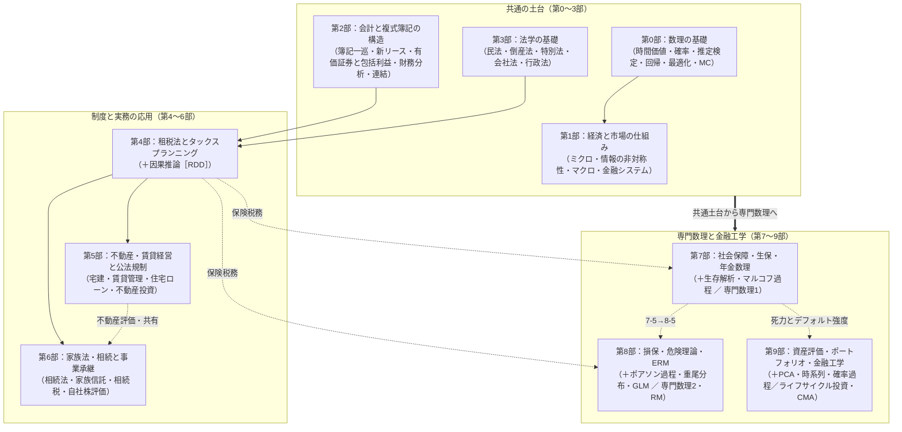

# 現代の会計・法務・リスク・金融を読み解くための数理と制度（全10部）

## このノートは何を目指すのか

家計や事業のお金の管理、住宅ローンや賃貸契約、相続や事業承継、さらに保険・年金・資産運用といった実務には、数学（確率・統計・最適化）、経済学、会計、法律、不動産、金融工学といった複数の分野が関わります。

本ノートは、これらを資格試験ごとの暗記項目として分断せず、次の3つの視点から横断的に読み解く学習ノートです。

1. **共通する数理の仕組み：** データの当てはめ（回帰分析）を空間への垂線として捉える見方や、複式簿記の貸借一致の仕組み、人間の死亡率と企業の倒産率を同じ関数で表す考え方など、分野をまたいで繰り返し現れる構造を重視する。
2. **法制度の趣旨と判例：** 条文の要件・効果だけでなく、「なぜそのルールが作られたのか」「条文だけでは解決できない紛争を判例がどう補っているのか」を押さえる。
3. **限界と補正の仕組み：** 理論モデルや法制度が現実の場面で機能しにくくなる条件（前提の崩れ、情報の偏り、制度の副作用など）と、それに対する実務上・制度上の対応を確認する。

各節は「1節＝1テーマ」の流れで読めるよう設計しています。高度な数理手法（因果推論、生存解析、マルコフ過程、ポアソン過程、一般化線形モデル、主成分分析、時系列解析、ブラウン運動と伊藤の補題の直感など）は第0部に詰め込まず、**実際に使う直前の部・節で導入する**構成をとります。

| 対象 | 領域 | 主な内容 |
| --- | --- | --- |
| **第0〜1部** | 数理の基礎と経済の仕組み | お金の時間価値（ローンの基本式と6つの係数）、確率とベイズ更新、代表的な確率分布、推定・検定、回帰分析、最適化、シミュレーションを基礎から整理。続けて市場の価格決定、情報の偏り（逆選択・モラルハザード）、マクロ経済・為替・金融システムを押さえる。 |
| **第2部** | 会計と複式簿記の構造 | 2026年4月適用の期中財務諸表基準および2027年4月施行・強制適用予定の新簿記区分表・新リース会計基準を踏まえ、簿記一巡と商品売買、複式簿記の仕組み、固定資産・資産除去債務、有価証券と包括利益、キャッシュ・フロー計算書と財務分析、連結会計、発生主義の限界を整理する。 |
| **第3部** | 法学の基礎 | 法律の前提知識を置かず、民法（契約・不法行為・保証・相殺・債権譲渡・物権・登記・抵当権・相続・信託の最小骨格）、民事訴訟と倒産法、労働・知財・個人情報、消費者保護法・金商法、会社法、行政法を条文の趣旨と判例から整理する。 |
| **第4〜6部** | 税制・不動産・家族法と相続 | 超過累進税率の仕組みと「年収の壁（因果推論の導入）」、土地の公法規制・売買・賃貸経営・住宅ローン・不動産投資数理、相続・遺産分割・家族法（婚姻・離婚・親子・養子縁組）と財産評価・事業承継を、実務上の紛争と税務の両面から整理する。 |
| **第7〜9部** | 保険・年金・金融の数理と拡張 | 生命表・生存解析・マルコフ過程と生保・年金数理、ポアソン過程・重尾分布・GLM・信頼性理論・破産確率・極値理論・コピュラ・ERM、さらに債券・PCA・株式評価・企業財務・ポートフォリオ・時系列・オプション価格理論・信用リスク・行動ファイナンスまでを扱う。 |

---

### 扱う主な理論と制度のプレビュー

※ここでは全体像のみを示します。第0部〜第9部を通じて、以下の項目を具体例・導出・前提と限界の観点から順に整理します。

1. **会計・法務・税制・不動産・家族法の接続**

    減価償却とデッドクロス、抵当権・倒産手続と優先弁済順位、借地借家法による借主保護と定期借家制度、共有不動産の合意形成の難しさ、普通養子と特別養子の法的・税務的な違い、租税法律主義と通達課税の関係を、共通の会計・法学の基礎から説明する。

2. **保険・年金リスクの数理とモデルの拡張（FP・アクチュアリー専門数理1・2）**

    生命保険の責任準備金の時間変化を表す **Thiele の微分方程式**

    $$\frac{d}{dt} {}_t V_x = \delta \cdot {}_t V_x + \bar{P}_x - \mu_{x+t}\bigl(1 - {}_t V_x\bigr)$$

    および損害保険の破産確率の上界を与える **Lundberg の不等式** $\psi(u) \le e^{-Ru}$、年金財政の **Trowbridge モデル** を導出する。さらに、正規分布や独立性の仮定が成り立ちにくい極端事象（巨大災害・同時デフォルト）に対し、極値理論・コピュラ・TVaR（期待ショートフォール）やERMの枠組みがどのように導入されたかを整理する。

3. **資産評価・無裁定の数理と現実市場との差（CMA・金融工学入門）**

    ラグランジュ乗数法による効率的フロンティアの導出（および推定誤差への対応としてのBlack-Littermanモデル）を経て、ブラウン運動と伊藤の補題の直感・二項モデルの複製ポートフォリオから、ヨーロピアン・コールの **ブラック＝ショールズ公式**（無配当の場合）

    $$C(S, t) = S N(d_1) - K e^{-r(T-t)} N(d_2)$$

    を導出する。あわせて、定数ボラティリティや無摩擦市場といった前提と現実市場の差（ボラティリティ・スマイルや裁定の限界）、期待効用理論からの逸脱を扱うプロスペクト理論、市場マイクロストラクチャー、さらに測度論的確率解析・統計的学習への接続点までを整理する。

---

### 本ノートの読み進め方と編集方針

#### 学習の順序

第0部（数理の基礎）〜第3部（法学の基礎）が共通の土台です。第4部〜第6部で「税・不動産・家族法と相続」の制度と実務を扱い、第7部〜第9部で「生保・年金数理」「損保・危険理論・ERM」「資産評価・金融工学」の専門数理へ進みます。

数理・金融を中心に読みたい場合は、第0〜2部から直接第7〜9部へ進むこともできます（ただし、8-5節で7-5節のマルコフ連鎖を、9-12節で3-6節の倒産隔離と第7部の死力・生存解析を参照するなど、一部で他部の概念を軽く参照する箇所があります）。

#### 各節の構成

各節は次の5項目で統一し、節末の確認問題（計算や事例判定）の解答を次節冒頭に置くことで、前後の繋がりを保ちます。

1. **動機（Why）：** 素朴な考え方では扱いにくい点や、その概念・制度が導入された背景を確認する。
2. **具体例・事例（Toy Model・図解）：** 抽象的な定義の前に、既知の知識だけで最後まで追える小さな計算例・紛争事例・判例・図解を置く。
3. **定義・定理・法構造（What）：** 学部1〜2年水準の証明・導出、または条文の要件・効果と立法趣旨を整理する（適宜補足コラムを配置）。
4. **限界と補正（Critique & Adaptation）：** 数理モデルの前提が現実で成り立たない条件や、法制度が生む副作用・抜け穴と、実務・法改正・判例による対応を検証する。
5. **接続と展望（Bridge）：** 本節の内容が後半のどの部・節にどう繋がるかを示す。

#### 記述の原則

* 初出の専門用語には平易な言い換えや直感的な補足を添え、専門用語を別の専門用語だけで言い換える記述を避けます。
* 各節の本論（1〜4）では、**まだ解説していない後半の部の専門用語を先出ししない**ことを原則とし、後半分野との具体的な接続は「5. 接続と展望（Bridge）」に集約します。

#### 基準時点と扱う範囲の線引き

* **基準時点：** 法令・制度は原則として**2026年時点の現行制度**（2026年4月適用の期中財務諸表基準・改正区分所有法・改正民法、2026年10月施行の社会保険賃金要件撤廃を含む）、および**2027年4月施行・強制適用予定の会計・試験制度（新リース会計基準・日商簿記新区分表・アクチュアリー新1次試験）**を基準とします。所得税の控除額や社会保険の適用要件など改正の頻度が高い数値については、個別数値の暗記よりも制度の境界が生む構造・数理を主軸にします。
* **数理の範囲：** 微積分・線形代数・初等確率論の範囲で自己完結して証明できる命題は飛躍を抑えて導出します。一方、測度論的確率論や伊藤解析の厳密な構成（ブラウン運動の存在証明、ギルサノフの定理の一般証明、コクランの定理やレヴィの連続性定理の証明など）は範囲外とし、証明を省く境界を本文中で明示します。
* **資格範囲の線引き：** 本ノートは構造と背景の理解を目的とし、個別具体的な税務・法務相談は範囲外とします。各資格の受験対策では市販の問題集等で補う前提とし、扱う範囲を次のように線引きします。

    * **日商簿記：** 第2部には3・2級（2027年新基準）に加え、1級・CMA水準の論点（減損会計、資産除去債務、包括利益［OCI］、繰延税金資産の回収可能性、キャッシュ・フロー計算書、持分法、IFRSののれん非償却、財務構成要素アプローチ等）を含みます。一方、2級の工業簿記（原価計算）は範囲外です。
    * **FP：** 業際ルール（税理士法・弁護士法等）、個人BS・キャッシュ・フロー表の作成演習、および最新年度の細かな控除額暗記は対象外です。
    * **宅建・賃貸不動産経営管理士：** 宅建業法等の手続的な暗記項目（免許基準・営業保証金・自ら売主の8種制限・国土利用計画法・盛土規制法・土地区画整理法の細目等）は対象外です。
    * **アクチュアリー（2027年新制度）：** 新1次試験5科目の理論・数理構造を扱い、研修科目（プロフェッショナリズム研修、データとシステム研修）および第2次試験の実務細目は範囲外です。
    * **CMA：** 職業倫理・行為基準、経営戦略論（SWOT・バリューチェーン等）、IPS・LDI・GIPSの運用実務書式、債券のキャリー＆ロールダウン、およびESG・希薄化後EPS・KAM等の細目は対象外（または簡略扱い）とします。

---

### 想定する前提知識と基本記号の早見表

**前提知識：** 大学学部1〜2年レベルの微積分（偏微分・重積分・テイラー展開・常微分方程式の初歩）と線形代数（行列・固有値・内積・2次形式）を前提とします。確率・統計・最適化は第0部で基礎から整理し、経済・会計・法律の前提知識は不要とします。

| 記号 | 読み方・意味 | 初出・詳細 |
| --- | --- | --- |
| $v = (1+i)^{-1},\; \delta$ | 現価率（割引因子）、利力（連続複利の瞬間金利 $\delta = \ln(1+i)$） | [0-1](0/0-1.md)・[7-6](7/7-6.md) |
| $E[X],\; V[X],\; M_X(t)$ | 確率変数 $X$ の期待値、分散、積率母関数 | [0-3](0/0-3.md)・[0-5](0/0-5.md) |
| $\mathbf{w}^T \Sigma \mathbf{w}$ | ポートフォリオの分散（共分散行列 $\Sigma$ による2次形式） | [0-9](0/0-9.md)・[9-5](9/9-5.md) |
| $\mathrm{BS},\; \mathrm{PL},\; \mathrm{CF}$ | 貸借対照表、損益計算書、キャッシュ・フロー計算書 | [2-1](2/2-1.md)・[2-6](2/2-6.md) |
| $T(y),\; T'(y)$ | 課税所得 $y$ に対する税額関数、限界税率（区分線形関数の傾き） | [4-1](4/4-1.md) |
| ${}_t p_x,\; \mu_x,\; {}_t V_x$ | $x$ 歳の $t$ 年生存率、死力（ハザード関数）、$t$ 年後の責任準備金 | [7-3](7/7-3.md)・[7-6](7/7-6.md) |
| $S = \sum_{i=1}^N X_i,\; \psi(u)$ | 複合ポアソン分布による保険金請求（クレーム）総額、初期剰余 $u$ からの破産確率 | [8-3](8/8-3.md)・[8-7](8/8-7.md) |
| $\mathrm{VaR}_\alpha,\; \mathrm{TVaR}_\alpha$ | 信頼水準 $\alpha$ のバリュー・アット・リスク、テールVaR（期待ショートフォール） | [8-8](8/8-8.md) |
| $D_{\mathrm{Mac}},\; D_{\mathrm{Mod}},\; W_t,\; \mathbb{Q}$ | マコーレー／修正デュレーション、標準ブラウン運動、リスク中立確率測度 | [9-1](9/9-1.md)・[9-10](9/9-10.md)・[9-11](9/9-11.md) |

---

## 全体の見取り図（第0部〜第9部の繋がり）

※第0〜2部から直接第7〜9部へ進むルートも可能ですが、一部に他部の軽い参照（`7-5 → 8-5` のマルコフ連鎖、`3-6` の倒産隔離や第7部の死力・生存解析 `→ 9-12` の信用リスク・証券化、第4部の税務 `→ 7-7・8-1` の保険税務など）があります。

---

## 各部の構成と目次（全10部・全83節）

### 第0部：数理の基礎（全10節）

> **立ち位置：** 後半の各部で共通して用いる数学的基盤を、1節1テーマの流れで基礎から丁寧に組み立てます。本論では未学習の金融・保険・法務用語を持ち込まず、日常的な具体例と既知の微積分・線形代数だけで発想から導出まで完結させます。

* [0-1. お金の時間価値と「6つの係数」の導出](0/0-1.md)
* [0-2. 確率のルールとベイズの定理](0/0-2.md)
* [0-3. 確率変数・期待値・分散と離散分布](0/0-3.md)
* [0-4. 連続分布と正規分布・対数正規分布](0/0-4.md)
* [0-5. 積率母関数と2つの極限定理（大数の法則・中心極限定理）](0/0-5.md)
* [0-6. 点推定と標本分布（最尤推定・$\chi^2$・$t$・$F$ 分布）](0/0-6.md)
* [0-7. 区間推定と仮説検定（信頼区間・$p$ 値・多重検定）](0/0-7.md)
* [0-8. 回帰分析（最小二乗法の幾何学とモデルの限界）](0/0-8.md)
* [0-9. 数理最適化（線形計画法・ラグランジュ乗数法・KKT条件）](0/0-9.md)
* [0-10. モンテカルロ・シミュレーションとブートストラップ法](0/0-10.md)

第0部の各節の詳細（概要・限界と補正・補足話題）を開く

#### [0-1. お金の時間価値と「6つの係数」の導出](0/0-1.md)

「今日の100万円と1年後の100万円はなぜそのまま足せないか」という問いから出発し、単利・複利・連続複利（利力 $\delta$ と $e^{\delta t}$）、割引現在価値（DCF）、確定年金の現価と終価を導出する。小さな2年返済の例から、FPの「6つの係数（終価・現価・年金終価・減債基金・資本回収・年金現価）」と元利均等・元金均等返済の基本式が等比数列の和の変形であることを示し、NPVと「等価な複利利回り」としてのIRRを定義する。

* **限界と補正：** キャッシュ・フローの符号が複数回反転するとIRRが複数解や実数解なしになり得る問題と、NPV法・修正IRR（MIRR）による対処。
* **補足話題：** 「72の法則」のテイラー展開による導出と低金利下での近似誤差。

#### [0-2. 確率のルールとベイズの定理](0/0-2.md)

「総面積1の図形の面積ルール」としてコルモゴロフの確率公理を導入し、加法定理・ブールの不等式を導く。条件付確率を「観測情報による標本空間の縮小と再規格化」として視覚化し、独立性（なぜ「排反」と別の概念か）、条件付独立性、全確率の定理、ベイズの定理、およびオッズ表現（ベイズ・ファクター）を検査・くじ引きの数値例から導出する。

* **限界と補正：** 事前確率の設定への依存性、独立性の安易な仮定による過小評価、および基準率の無視を防ぐ自然頻度表記の活用。
* **補足話題：** 医療検査の偽陽性と、裁判における「検察官の誤謬」。

#### [0-3. 確率変数・期待値・分散と離散分布](0/0-3.md)

事象の結果を数値へ写す確率変数を導入し、期待値・分散（なぜ絶対値ではなく2乗をとるのか）・共分散・相関係数（確率変数のコーシー＝シュワルツの不等式）を定義する。「条件付期待値 $E[X \mid Y]$ は定数ではなく確率変数である」という構造を丁寧に確認し、繰り返し期待値の法則と全分散の法則を証明する。離散分布は**ベルヌーイ・二項・幾何・ポアソン**の4つに絞り、確率質量関数と平均・分散の成り立ちを1つずつ導出する。

* **限界と補正：** 無相関（$\operatorname{Cov}=0$）であっても非線形な従属関係があれば独立ではないこと（$Y = X^2$ の具体計算）。
* **補足話題：** ポアソン分布の「少数の法則」（二項分布の極限導出とボルトキエヴィッチの逸話）。

#### [0-4. 連続分布と正規分布・対数正規分布](0/0-4.md)

連続型確率変数における確率密度関数（PDF）と累積分布関数（CDF）の関係（1点の確率は $0$ であり、面積＝積分で確率を測る）を整理する。連続分布は**一様・指数・正規・対数正規**の4つに絞り、指数分布の無記憶性、正規分布の標準化、対数正規分布の密度関数に $1/x$ が現れる理由（変数変換の微分）、および平均が中央値より大きくなる仕組み（イェンセンの不等式と平方完成）を導出する。

* **限界と補正：** 対数正規分布のように右に裾を引く分布では平均値と中央値が大きく乖離する点、および裾の厚い分布（コーシー分布など）では平均や分散が存在しなくなる限界。
* **補足話題：** 指数分布の無記憶性と、連続分布で1点の確率がゼロになる理由。

#### [0-5. 積率母関数と2つの極限定理（大数の法則・中心極限定理）](0/0-5.md)

独立な確率変数の和 $X + Y$ の分布を直接求める**たたみ込み（Convolution）**の煩雑さから出発し、「指数法則 $e^{t(X+Y)} = e^{tX}e^{tY}$ で和を掛け算に分解する」発想として積率母関数 $M_X(t) = E[e^{tX}]$ とキュムラント母関数 $K_X(t) = \ln M_X(t)$ を導入する。$K_X''(0) = V[X]$ やポアソン・正規分布の再生性を計算したうえで、チェビシェフの不等式から**大数の弱法則**を証明し、「なぜ和の誤差を $\sqrt{n}$ で割るのか」という直感とともに**中心極限定理**を導出する（測度論を要する一意性・連続性定理の境界は明示）。

* **限界と補正：** 対数正規分布など積率母関数が存在しない分布がある点と、それを回避する特性関数 $\varphi_X(t) = E[e^{itX}]$ の考え方。
* **補足話題：** 標本平均は期待値に収束する一方、和そのものは期待値から $\sqrt{n}$ の幅で広がっていく仕組み。

#### [0-6. 点推定と標本分布（最尤推定・$\chi^2$・$t$・$F$ 分布）](0/0-6.md)

「コインを10回投げて表が7回出たら、表の確率 $p$ はいくつが最も妥当か」という素朴な例から**最尤推定法**を導入する。推定量の性質（**不偏性・一致性**）と**不偏標本分散の $n-1$** の証明を行ったうえで、正規標本から導かれる3大標本分布（**$\chi^2$ 分布・$t$ 分布・$F$ 分布**）の意味と役割を整理する（$\bar{X}$ と $s^2$ の独立性＝**コクランの定理**は厳密証明を省く境界を明示して事実として用いる）。

* **限界と補正：** 小標本では最尤推定量に偏り（バイアス）が生じ得る点、正規性の仮定が崩れたときの標本分布（特に $\chi^2$・$F$ 分布）の頑健性の低さ、および不偏性と分散（平均二乗誤差）のトレードオフ。
* **補足話題：** 平均値への回帰と、母数を固定された未知定数とみる頻度論・確率変数とみるベイズ統計の立場の違い。

#### [0-7. 区間推定と仮説検定（信頼区間・$p$ 値・多重検定）](0/0-7.md)

0-6節の標本分布をもとに、推定の不確実性を幅で示す**信頼区間（区間推定）**と、「確率版の背理法」としての**仮説検定**（帰無仮説・対立仮説、**第1種・第2種の過誤**、検出力、**$p$ 値**）を組み立てる。あわせて、正規性などの分布仮定に依存せず計算機で帰無分布を構成する**並べ替え検定（パーミュテーションテスト）**を導入する。

* **限界と補正：** 「$p < 0.05$」の解釈の誤り、標本サイズ増大による**統計的有意性と実務的有意性の乖離**、および**多重検定問題（$p$-hacking）**に対する**ボンフェローニ補正**やアウト・オブ・サンプル検証。
* **補足話題：** 両側仮説検定と信頼区間の双対関係（$95\%$ 信頼区間が帰無仮説の値を含むか否かと有意水準 $5\%$ の検定の一致）。

#### [0-8. 回帰分析（最小二乗法の幾何学とモデルの限界）](0/0-8.md)

2変数・3変数の小さな数値例から単回帰・重回帰分析を導入する。設計行列の1列目に $1$ を並べる理由から正規方程式 $\mathbf{X}^T\mathbf{X}\hat{\mathbf{\beta}} = \mathbf{X}^T\mathbf{y}$ を導き、ピタゴラスの定理を用いて「残差ベクトルが説明変数の張る部分空間と直交するときに距離が最小になる」ことを証明する。決定係数 $R^2$（単回帰での $R^2 = r_{xy}^2$ の証明含む）と分散分析（$F$ 検定）の幾何学的意味を整理する。

* **限界と補正：** 多重共線性（$\mathbf{X}^T\mathbf{X}$ の最小固有値が $0$ に近づく悪条件化と、固有値を底上げするリッジ回帰の直感）、過学習とバイアス・バリアンス分解の導出、交絡因子による相関と因果の混同。
* **補足話題：** ガルトンとピアソンの研究における「回帰（Regression）」の語源。

#### [0-9. 数理最適化（線形計画法・ラグランジュ乗数法・KKT条件）](0/0-9.md)

2次元多角形を平行線でなぞる直感から**線形計画法**（最適解は頂点に現れる）を掴む。続いて「制約面上の曲線に沿った微分 $\nabla g \cdot \mathbf{x}' = 0$」から**ラグランジュの未定乗数法**と包絡線定理（乗数 $\lambda$ の意味）、および**2次形式のベクトル微分** $\nabla_{\mathbf{w}}(\mathbf{w}^T\Sigma\mathbf{w}) = 2\Sigma\mathbf{w}$ の成分展開による導出、さらに不等式制約の**KKT条件**（勾配の向きによる非負制約 $\mu_k \ge 0$ と相補性条件）を整理する。

* **限界と補正：** 入力パラメータのわずかな推定誤差が最適解を大きく変える最適化の不安定性（誤差最大化）と、制約条件・正則化による安定化。
* **補足話題：** ラグランジュ乗数が表す「制約を1単位緩めたときの限界価値（シャドウ・プライス）」。

#### [0-10. モンテカルロ・シミュレーションとブートストラップ法](0/0-10.md)

解析解が閉じない期待値の積分を乱数の標本平均で近似する**モンテカルロ法**を導入する。一様乱数から任意の分布を生成する**逆関数法**の証明、大数の法則・中心極限定理に基づく収束速度 $O(1/\sqrt{N})$ と必要試行回数の見積りを整理し、さらに分布を仮定せず手元の標本からの復元抽出で不確実性を測る**ブートストラップ法**（なぜ非復元抽出では機能しないかを含む）を扱う。

* **限界と補正：** モンテカルロ法の収束の遅さに対する分散低減法（対称変量法の分散公式による検証、および制御変量法の最適係数 $c^*$ が0-8節の単回帰の傾きと一致することの導出）。
* **補足話題：** 高次元積分におけるモンテカルロ法の利点（次元の呪いの回避）と、疑似乱数の再現性。

---

### 第1部：経済と市場の仕組み（全5節）

> **立ち位置：** 第0部の最適化と確率の最初の応用として経済学の基本モデルを扱い、法律・規制・保険・金融市場が必要になる背景を整理します。完全競争市場のモデルを出発点とし、その前提が成り立たない場面（市場の失敗・情報の非対称性・金融危機）を順に検証します。

* [1-1. 消費者行動・生産者行動と市場均衡（ミクロ経済学）](1/1-1.md)
* [1-2. 市場の失敗と情報の非対称性](1/1-2.md)
* [1-3. マクロ経済と金利・物価の決定](1/1-3.md)
* [1-4. 外国為替と国際金融](1/1-4.md)
* [1-5. 金融システムと証券市場の構造](1/1-5.md)

第1部の各節の詳細（概要・限界と補正・補足話題）を開く

#### [1-1. 消費者行動・生産者行動と市場均衡（ミクロ経済学）](1/1-1.md)

効用関数と無差別曲線（ラグランジュ乗数法による限界代替率＝価格比の導出）、需要・供給の価格弾力性、消費者余剰・生産者余剰（厚生経済学の基本定理）、完全競争・独占・寡占とゲーム理論の基礎。

* **限界と補正：** 完全合理性や完全競争の仮定が現実と乖離する点、独占による死重損失と競争政策の役割。
* **補足話題：** サンクトペテルブルクのパラドックスと限界効用逓減（リスク回避度の背景）。

#### [1-2. 市場の失敗と情報の非対称性](1/1-2.md)

外部性（コースの定理とピグー税）、公共財とフリーライダー、情報の非対称性による**逆選択（レモン市場）**と**モラルハザード**、プリンシパル＝エージェント問題。

* **限界と補正：** 情報の偏りによって市場取引が縮小・成立しなくなる条件と、スクリーニング・シグナリング・インセンティブ契約による緩和策。
* **補足話題：** 保険の告知義務、賃貸の敷金、ストックオプションに共通する情報の非対称性への対応。

#### [1-3. マクロ経済と金利・物価の決定](1/1-3.md)

GDP三面等価と貯蓄・投資バランス、**資金循環統計**（家計・企業・政府・海外の資金過不足と日本の現預金偏重・国債消化の構造）、IS-LM分析・AD-AS分析、インフレとフィッシャー方程式（名目金利と実質金利）、フィリップス曲線、金融政策（中央銀行・テイラールール）と財政政策（乗数効果）。

* **限界と補正：** ゼロ金利制約下の流動性の罠、スタグフレーションとフィリップス曲線の関係変化、政策変更が人々の期待自体を変えるというルーカス批判。
* **補足話題：** ソロー成長モデルの定常状態と、資本蓄積だけでは成長率が維持できない理由。

#### [1-4. 外国為替と国際金融](1/1-4.md)

国際収支統計、購買力平価（PPP）、カバー付き金利平価（CIP）とカバーなし金利平価（UIP）、マンデル＝フレミングモデル、**国際金融のトリレンマ**（為替安定・金融政策の独立・自由な資本移動のうち同時に両立できるのは2つまでという制約）。

* **限界と補正：** 実証的にはUIPが成り立ちにくいフォワード・プレミアム・パズル（キャリー取引の背景）と、固定相場制の維持が難しくなる局面（アジア通貨危機・欧州通貨危機）。
* **補足話題：** ビッグマック指数と、一物一価から乖離を生む要因（非貿易財・バラッサ＝サミュエルソン効果）。

#### [1-5. 金融システムと証券市場の構造](1/1-5.md)

直接金融と間接金融、金融仲介の満期変換・リスク変換機能、中央銀行・証券取引所・監督機関、**短期金融市場（コール市場・レポ取引）**と金融政策の波及経路、発行市場と流通市場（板とオーダードリブン方式）、**投資信託の基本構造（公募／私募、契約型／会社型、ETF）**、およびセーフティネット（**預金保険**に加え、証券会社の**分別管理・投資者保護基金**、保険会社の**保険契約者保護機構**）。

* **限界と補正：** 満期変換に伴う銀行取り付けの構造（ダイヤモンド＝ディビッグ・モデル）と、公的保護が生むモラルハザードに対する自己資本規制。
* **補足話題：** 中央銀行が「最後の貸し手」と呼ばれる理由。

---

### 第2部：会計と複式簿記の構造（全7節）

> **立ち位置：** 2026年4月適用の期中財務諸表に関する会計基準（企業会計基準第37号）、および2027年4月施行・強制適用予定の商工会議所簿記検定新区分表・新リース会計基準（企業会計基準第34号）とCMA財務分析に対応し、個人事業から上場企業まで共通して使われる会計の仕組みを整理します。日商簿記3・2級の範囲に加え、実務・CMAの理解に直結する1級水準の論点もあわせて確認します。

* [2-1. 複式簿記の原理・簿記一巡と代数構造](2/2-1.md)
* [2-2. 決済・債権・商品売買の会計（2027年新基準対応）](2/2-2.md)
* [2-3. 固定資産・減価償却と新リース会計基準](2/2-3.md)
* [2-4. 金融商品（有価証券）・純資産と包括利益の会計](2/2-4.md)
* [2-5. 発生主義・決算整理・引当金・税効果会計](2/2-5.md)
* [2-6. キャッシュ・フロー計算書と財務分析](2/2-6.md)
* [2-7. 連結会計・外貨建取引と企業結合](2/2-7.md)

第2部の各節の詳細（概要・限界と補正・補足話題）を開く

#### [2-1. 複式簿記の原理・簿記一巡と代数構造](2/2-1.md)

資産・負債・純資産・収益・費用の5要素、取引の8要素と貸借平均の原理、**簿記一巡の手続**（期中仕訳 $\to$ 総勘定元帳 $\to$ 試算表 $\to$ 決算整理仕訳 $\to$ 貸借対照表［BS］・損益計算書［PL］）。

* **数理的視点：** 複式簿記を「負の数を使わず減算を反対側への加算で表す代数構造（非負の数のペア $(a,b)$ によるグロタンディーク群の構成と仕訳例の対応）」および「ストック（BS）とフロー（PL）の関係」として整理する。
* **限界と補正：** 貨幣額で客観的に測定しにくい無形資産（ブランド・人的資本等）はBSに計上されないという会計測定上の制約。
* **補足話題：** ルカ・パチョーリによる複式簿記の記述と貸借一致の保存構造。

#### [2-2. 決済・債権・商品売買の会計（2027年新基準対応）](2/2-2.md)

普通預金・当座預金とペイオフ、紙の手形・小切手の廃止に伴う電子記録債権・債務、キャッシュレス決済（クレジット売掛金）、売掛債権の譲渡（2社間・3社間ファクタリングと債権譲渡登記）。商品売買では、**三分法**（期末の棚卸振替）と2027年に3級へ移行する**売上原価対立法**（販売のつど売上原価振替）を対比し、先入先出法・移動平均法を整理する。

* **限界と補正：** 債権譲渡に買戻権や遡求（リコース）義務が付く場合、支配の移転により金融資産の消滅を認識しつつ、残存する買戻権・遡求義務といった構成要素を時価で切り出して新たに資産・負債として計上する**財務構成要素アプローチ**（日商簿記では1級範囲であり、2級は買取型［2社間・3社間、2社間は債権譲渡登記済み］の簡易な出題に限られる）。
* **補足話題：** 紙の手形から電子記録債権への移行に伴う決済実務と信用リスクの変化。

#### [2-3. 固定資産・減価償却と新リース会計基準](2/2-3.md)

取得原価と除却・廃棄、減価償却の計算構造（定額法・定率法・生産高比例法；有形固定資産の除却・廃棄および簡易な定率法は2027年4月に3級へ移行）、固定資産の減損会計を整理する。あわせて、将来の解体・原状回復費用を割引現在価値（0-1節）で負債計上する**資産除去債務（ARO：日商簿記1級範囲）**と、2027年4月強制適用の**新リース会計基準（企業会計基準第34号）**（借手側の使用権資産・リース負債オンバランス化、短期・少額リースの例外、貸手側の2区分存続、不動産賃借の勘定科目扱い）を共通の数理構造から整理する。

* **限界と補正：** 従来の借手側オペレーティング・リースによるオフバランス処理への批判を受けた強制オンバランス化と、実務負担への配慮として残された短期・少額リースの例外、および借手と貸手で会計処理が非対称になる構造。
* **補足話題：** 減価償却が「時価の下落の測定」ではなく「取得原価の期間配分」であることの意味。

#### [2-4. 金融商品（有価証券）・純資産と包括利益の会計](2/2-4.md)

有価証券の4区分（売買目的・満期保有・子会社／関連会社・その他有価証券）と評価差額の処理（時価法・償却原価法・全部純資産直入法）、純資産の部の構造（資本金・資本剰余金・利益剰余金・自己株式・配当）、および**包括利益とその他の包括利益（OCI）**・**クリーン・サープラス関係**（第9部 9-3節の残余利益モデルの前提）を整理する。

* **限界と補正：** 種類株式・転換社債・劣後債などにおける**「負債と資本の境界問題」**（第3部 3-9節の会社法・第9部の金融商品と交差）、およびその他有価証券評価差額金が金融機関・保険会社の純資産やALMを変動させる構造。
* **補足話題：** なぜその他有価証券の評価差額は損益計算書（PL）を通さず純資産へ直入されるのか（リサイクリングの論点を含む）。

#### [2-5. 発生主義・決算整理・引当金・税効果会計](2/2-5.md)

期中の取引記録を期末および**期中財務諸表**（企業会計基準第37号）の作成における発生主義（ストックとフローの整合）へ整える決算整理を軸に、収益認識基準（履行義務の充足）、見越し・繰延べ、各種引当金（貸倒・修繕・退職給付）、会計利益と課税所得の差異（永久差異・一時差異）、税効果会計（繰延税金資産・負債）を整理する。

* **限界と補正：** 発生主義は期間損益の把握に適する一方、引当金や繰延税金資産の回収可能性といった見積りを通じて利益操作の余地が生じる点と、会計監査の役割。
* **補足話題：** 引当金の計上（費用認識）と現金の積立て（資金繰り）の違い。

#### [2-6. キャッシュ・フロー計算書と財務分析](2/2-6.md)

間接法による営業・投資・財務キャッシュ・フローの導出とフリー・キャッシュ・フロー（FCF）、運転資本とキャッシュ・コンバージョン・サイクル（CCC）、収益性・安全性指標（ROA・ROEのデュポン分解およびその延長としての**サステイナブル成長率** $g = \mathrm{ROE} \times (1 - \text{配当性向})$ ：9-3節の配当割引モデルへ接続）、損益分岐点分析（CVP分析）と営業・財務レバレッジを整理する。

* **限界と補正：** ROEは借入の増加（財務レバレッジ）でもかさ上げできるためROAや自己資本比率とセットで評価する必要がある点と、アクルーアル（純利益と営業CFの差）による利益の質の点検。
* **補足話題：** 企業のライフサイクルと3つのキャッシュ・フローの符号パターン。

#### [2-7. 連結会計・外貨建取引と企業結合](2/2-7.md)

支配力基準（子会社）と影響力基準（関連会社・持分法）、資本連結（投資と資本の相殺消去・非支配株主持分・のれん）と成果連結（内部取引・未実現利益の消去）、パーチェス法における日本基準とIFRSののれん処理の違い、および外貨建取引の換算ルール（HR・CR・為替差損益）を整理する。

* **限界と補正：** IFRSにおけるのれんの「遅すぎる減損」リスク（有形純資産による安全余裕度の点検）と、特別目的会社（SPE）を用いた「連結外し」を防ぐための支配力基準による補正。
* **補足話題：** 「のれん（Goodwill）」の経済的本質と、日本基準（定期償却）対IFRS（非償却・減損テスト）の論争。

---

### 第3部：法学の基礎（民法・倒産法・特別法・会社法・行政法）（全10節）

> **立ち位置：** 法律の前提知識がない状態から、租税法・不動産・相続・保険・金融規制を条文と趣旨で読むための基盤を1テーマずつ整備します。特に登記（3-4節）や相続・信託（3-5節）では、**民法・信託法上の権利義務の最小骨格（定義と構造）**に絞って扱い（実務上の紛争・共有問題・家族信託の設計・税務との交差は第5・6部で展開）、抽象的な条文だけでは個別の紛争を処理しきれない場面で判例・一般条項・特別法がどう補っているかを確認します。

* [3-1. 法体系・民法総則・権利義務の構造](3/3-1.md)
* [3-2. 契約・債権債務と債務不履行・不法行為](3/3-2.md)
* [3-3. 債権の担保・保証・相殺・債権譲渡](3/3-3.md)
* [3-4. 物権・所有権・登記・抵当権](3/3-4.md)
* [3-5. 家族法・相続・遺言・信託の基礎](3/3-5.md)
* [3-6. 民事紛争の解決と倒産法](3/3-6.md)
* [3-7. 労働法・知的財産法・個人情報保護法](3/3-7.md)
* [3-8. 消費者保護法・金融商品取引法](3/3-8.md)
* [3-9. 会社法とコーポレート・ガバナンス](3/3-9.md)
* [3-10. 行政法の基礎（許認可・通達・計画・調査）](3/3-10.md)

第3部の各節の詳細（概要・限界と補正・補足話題）を開く

#### [3-1. 法体系・民法総則・権利義務の構造](3/3-1.md)

法の階層構造（憲法・法律・政令省令・条例）と公法・私法、法解釈の技法（「推定する」と「みなす」）、権利能力・意思能力・行為能力、意思表示の瑕疵（心裡留保・通謀虚偽表示・錯誤・詐欺・強迫）と無効・取消し、代理（無権代理・表見代理）および時効（援用・完成猶予・更新）。

* **限界と補正：** 形式的な契約自由が生む情報・交渉力格差に対し、民法1条の一般条項（信義則・権利濫用の禁止）・公序良俗（90条）および特別法で実質的平等を補う仕組み。
* **補足話題：** なぜ法律は「権利の上に眠る者は保護しない」のか（時効制度の3つの合理性）。

#### [3-2. 契約・債権債務と債務不履行・不法行為](3/3-2.md)

契約の成立と典型契約（売買・賃貸借・請負・委任・準委任）、債務不履行の3類型と損害賠償の範囲・法定利率（3年ごとの変動制；2026年4月見直し後も年3%据え置き）、2020年施行の改正民法の**契約不適合責任**（追完・代金減額・解除・損害賠償）、不法行為（民法709条）と使用者責任（715条）。

* **限界と補正：** 過失責任の原則だけでは被害者救済が難しい領域への特別法（PL法・自賠法）による修正、および約款取引の普及に対応した2020年施行の改正民法の定型約款ルール。
* **補足話題：** 債務不履行責任と不法行為責任で立証責任・時効・遅延損害金の起算点がどう異なるか（請求権競合）。

#### [3-3. 債権の担保・保証・相殺・債権譲渡](3/3-3.md)

債権者平等の原則のもとで回収リスクに備える3手法として、保証契約・連帯保証（催告・検索の抗弁権、分別の利益の有無）、倒産時に優先回収機能を果たす**相殺**の要件、および**債権譲渡**の対抗要件（確定日付・債権譲渡登記）と譲渡制限特約の改正ルールを整理する。

* **限界と補正：** 個人保証による生活破綻を防ぐ2020年施行の改正民法の保護規制（個人根保証の極度額義務化・事業用融資の公正証書要件・経営者保証ガイドライン）と、危機時期における相殺権濫用の禁止。
* **補足話題：** 保証人を頼まれたときに契約書で確認すべき3つの実務ポイント。

#### [3-4. 物権・所有権・登記・抵当権](3/3-4.md)

物権と債権の違い、所有権と物権的請求権、共有（保存・管理・変更と2023年施行の軽微変更）、不動産の対抗要件（民法177条・二重売買・背信的悪意者）と動産の即時取得、物的担保としての**抵当権**（非占有担保・競売配当順位・物上代位・法定地上権）、不動産登記簿の3区分（表題部・甲区・乙区）の最小骨格を整理する。

* **限界と補正：** 所有者不明土地問題を受けた不動産登記の義務化（2024年4月施行の相続登記義務化・2026年4月施行の住所氏名変更登記義務化）と、抵当権の担保割れに対する任意売却。
* **補足話題：** 日本の不動産登記に公信力がないことの意味と、司法書士立会いによる決済実務。

#### [3-5. 家族法・相続・遺言・信託の基礎](3/3-5.md)

民法・信託法上の権利義務の最小骨格として、法定相続人の順位と法定相続分・代襲相続、相続の3つの選択肢（単純承認・相続放棄・限定承認）、遺言の方式（自筆証書遺言の法務局保管制度・公正証書遺言）と**遺留分侵害額請求権**、および所有権の管理権と受益権を分離する**信託**の基本構造（委託者・受託者・受益者と倒産隔離機能）を整理する。

* **限界と補正：** 成年後見制度における財産凍結の制約を補う家族信託の活用と限界（身上監護権・取消権がないため任意後見と併用）、および受益者連続型信託と遺留分の調整。
* **補足話題：** 2020年施行の配偶者居住権に見る所有権の分解発想。

#### [3-6. 民事紛争の解決と倒産法](3/3-6.md)

実体法と手続法、自力救済の禁止、紛争解決ルート（交渉・ADR・民事調停・民事訴訟の三審制）、民事保全（仮差押え）と民事執行（強制執行）、および**倒産法**の4類型（清算型の破産・特別清算、再建型の民事再生・会社更生）、別除権・財団債権・否認権と倒産隔離。

* **限界と補正：** 通常訴訟の費用・時間コストを補う支払督促・少額訴訟（60万円以下）、および法的整理の信用毀損を抑える私的整理（事業再生ADR・ガイドライン）。
* **補足話題：** 民事裁判（高度の蓋然性）と刑事裁判（合理的な疑いを容れない程度）の立証ハードルの違い。

#### [3-7. 労働法・知的財産法・個人情報保護法](3/3-7.md)

現代の企業活動に直結する3つの特別法として、**労働法**（労働基準法の強行効・36協定と上限規制・解雇権濫用法理・無期転換ルール）、**知的財産法**（産業財産権の登録主義と著作権の無方式主義・職務著作・職務発明）、および**個人情報保護法**（利用目的特定・要配慮個人情報・第三者提供・漏えい報告義務）の骨格を整理する。

* **限界と補正：** 雇用の枠外にある働き方を保護するフリーランス保護法（2024年11月施行）、および生成AIの学習・出力と著作権法30条の4、匿名・仮名加工情報によるデータ利活用の調整。
* **補足話題：** 著作権は「アイデア」を守らず「具体的な表現」だけを守るという特許権との守備範囲の違い。

#### [3-8. 消費者保護法・金融商品取引法](3/3-8.md)

情報の非対称性のもとで民法の契約自由を修正する特別法として、**消費者契約法**（不実告知・断定的判断の提供・不利益事実の不告知による取消権と不当条項無効）、**特定商取引法**（クーリング・オフ期間と通信販売の扱い）、**金融商品取引法**の3本柱（開示規制［2024年4月施行の改正金商法による四半期報告書廃止と半期報告書・期中財務諸表への移行］・行為規制［適合性原則等］・不公正取引規制［インサイダー取引等］）、および**金融サービス提供・利用環境整備法（金融サービスの提供及び利用環境の整備等に関する法律）**（説明義務違反の無過失責任・損害額推定）を整理する。

* **限界と補正：** 説明義務の形骸化に対する顧客本位の業務運営と誠実公正義務の導入（2023年改正・2024年11月施行）、およびダークパターン・SNS型投資詐欺への対応。
* **補足話題：** 通信販売に法定のクーリング・オフ制度が設けられていない理由（不意打ち性の違い）。

#### [3-9. 会社法とコーポレート・ガバナンス](3/3-9.md)

株主有限責任と所有・経営の分離が生む3つの利害対立（株主 vs 経営者、支配株主 vs 少数株主、会社・株主 vs 債権者）、株式会社と合同会社（LLC）の違い、株主総会の普通決議・特別決議と種類株式、上場企業の機関設計3類型と取締役の善管注意義務・忠実義務・株主代表訴訟、および債権者保護（分配可能額規制・組織再編手続）と資金調達の法務（募集株式の有利発行・新株予約権・社債）。

* **限界と補正：** ガバナンスの形骸化を補うコーポレートガバナンス・コード（コンプライ・オア・エクスプレイン）、親子上場・政策保有株式の是正、および有限責任の濫用・形骸化に対する判例法理（法人格否認の法理）。
* **補足話題：** 結果論で取締役の挑戦を委縮させない「経営判断の原則」。

#### [3-10. 行政法の基礎（許認可・通達・計画・調査）](3/3-10.md)

公法の中核として、法律による行政の原理（法律の留保・比例原則・平等原則）、行政行為の4類型（**許可・特許・認可・届出**の違い）と**公定力**、委任命令と**通達（行政規則）**の法的性質の違い、行政計画（都市計画決定）と行政調査（税務調査）、事前手続（聴聞・弁明・理由の提示）および事後救済（審査請求・取消訴訟・国家賠償）を整理する。

* **限界と補正：** 専門技術的な領域で認められる行政裁量の恣意的な運用を抑える裁量基準公表・理由提示・判断過程審査、および行政指導の透明化ルール。
* **補足話題：** 法律ではない国税庁の「通達」が実務で強い影響力を持つ背景（通達課税と租税法律主義の関係）。

---

### 第4部：租税法とタックスプランニング（全6節）

> **立ち位置：** 第2部（会計）と第3部（法学の基礎）を土台に、FP2級のタックスプランニングを数式とインセンティブの観点から整理します。4-4節では、税制と社会保険の境界を題材に**因果推論（RCT・DID・RDD）**を導入し、制度が人々の行動に与える影響を定量的に捉えます。

* [4-1. 租税法律主義と所得税の関数構造](4/4-1.md)
* [4-2. 10種類の所得と損益通算・繰越控除](4/4-2.md)
* [4-3. 所得控除・税額控除と確定申告・青色申告](4/4-3.md)
* [4-4. 「年収の壁」の数理と因果推論（RCT・DID・RDD）](4/4-4.md)
* [4-5. 法人税と「個人 vs 法人」の分岐点](4/4-5.md)
* [4-6. 消費税と金融・不動産の課税関係](4/4-6.md)

第4部の各節の詳細（概要・限界と補正・補足話題）を開く

#### [4-1. 租税法律主義と所得税の関数構造](4/4-1.md)

租税法律主義（憲法84条）と租税公平主義（垂直的・水平的公平）、直接税と間接税、総合課税と分離課税、超過累進税率の数学的表現（不連続な階段関数ではなく連続な区分線形関数 $T(y)$）、限界税率 $T'(y)$ と実効税率 $T(y)/y$ の関係。

* **限界と補正：** 累進課税による所得再分配機能と、高い限界税率が労働・投資のインセンティブに与える影響（最適課税論のトレードオフ）。
* **補足話題：** ラッファー曲線と租税による死重損失。

#### [4-2. 10種類の所得と損益通算・繰越控除](4/4-2.md)

10所得の計算構造と所得を分類する理由（担税力の違いと一時的所得の平準化）、損益通算できる4所得とその制限、純損失・雑損失の繰越控除と繰戻還付。

* **限界と補正：** 借入金で土地を取得して不動産所得の赤字を作り給与所得と相殺する手法に対応して導入された「土地取得借入金利子の損益通算制限」など、節税手法と法改正の対応関係。
* **補足話題：** 退職所得が「$(\text{収入} - \text{控除}) \times \frac{1}{2}$」かつ分離課税で軽減される数理的な背景。

#### [4-3. 所得控除・税額控除と確定申告・青色申告](4/4-3.md)

16種の所得控除と税額控除の効果の違い（所得控除は限界税率に応じて減税額が変わる構造）、源泉徴収・年末調整と確定申告、青色申告の要件（複式簿記）と特典、住民税と事業税。

* **限界と補正：** 所得控除の恩恵が高所得者ほど大きくなる逆進的な側面と、税額控除や給付付き税額控除による補正の考え方。
* **補足話題：** 源泉徴収と申告納税における所得捕捉の差（いわゆる「クロヨン」問題）。

#### [4-4. 「年収の壁」の数理と因果推論（RCT・DID・RDD）](4/4-4.md)

税制と社会保険制度の継ぎ目で生じる**「年収の壁」**（閾値で関数に不連続な段差［ノッチ］が生じ、手取りが一時的に逆転する構造）を数理的に整理する。あわせて、第0部で予告した計量経済学の**因果推論（ランダム化比較試験［RCT］・差分の差分法［DID］・回帰不連続デザイン［RDD］）**をここで導入し、閾値近傍のデータから制度変更の因果効果を識別する仕組みを学ぶ。

* **限界と補正：** 制度の閾値が就業調整（労働供給の歪み）を招く構造的課題（2026年10月の賃金要件［旧・106万円の壁］撤廃後も週20時間・130万円等のノッチ構造が残る点）と、RDDにおいて閾値直前への「操作（バンチング）」が生じる場合の注意点。
* **補足話題：** 相関と因果を切り分けるための「反事実（もし制度が違っていたら）」という発想。

#### [4-5. 法人税と「個人 vs 法人」の分岐点](4/4-5.md)

会計利益と課税所得の調整（別表四）、減価償却・資本的支出と修繕費の境界、役員給与の損金算入要件、同族会社の特別規定（留保金課税・**行為計算の否認**）、個人事業主と法人成りの税率・社会保険・経費範囲の比較モデル。

* **限界と補正：** 合法的な節税と法の趣旨を潜脱する租税回避の境界線、および予測可能性（租税法律主義）との関係で議論される行為計算否認規定の適用範囲（最高裁判例）。
* **補足話題：** 法人税の最終的な負担帰着（株主・労働者・消費者の誰が負担するかという租税帰着の議論）。

#### [4-6. 消費税と金融・不動産の課税関係](4/4-6.md)

付加価値税としての消費税（多段階累積控除）、課税・免税・非課税・不課税の違い、原則課税（仕入税額控除とインボイス制度）と簡易課税、居住用賃貸（非課税）と事業用賃貸（課税）の境界、金融商品の課税（申告分離・NISA・iDeCoの複利効果比較）。

* **限界と補正：** 消費税の逆進性、益税の解消を目的としたインボイス制度に伴う小規模事業者の事務負担、および居住用賃貸のオーナーが建築費の消費税を控除できない「損税」の構造。
* **補足話題：** 金融所得への一律分離課税が所得階層別の実効税率に与える影響（いわゆる「1億円の壁」の構造）。

---

### 第5部：不動産・賃貸経営と公法規制（全7節）

> **立ち位置：** 第3部で整理した物権・契約・登記の最小骨格を土台に、宅建・賃貸不動産経営管理士・FP不動産・CMA不動産投資の内容を、**実務上の紛争・賃貸管理トラブル・公法規制と税務・投資数理との交差**の観点から整理します。個別性が高く流動性が低い不動産市場において、公法と私法、さらに住宅ローン実務と投資数理がどう噛み合うかを確認します。

* [5-1. 不動産登記・権利調査と「一物四価」・鑑定評価](5/5-1.md)
* [5-2. 土地の公法規制（都市計画法・建築基準法・農地法・区分所有法）](5/5-2.md)
* [5-3. 不動産売買の法務と宅建業法](5/5-3.md)
* [5-4. 賃貸借の法務と借地借家法](5/5-4.md)
* [5-5. 賃貸管理の実務・トラブル対応・建物保全](5/5-5.md)
* [5-6. 住宅ローン実務と不動産の税務（デッドクロスを含む）](5/5-6.md)
* [5-7. 不動産投資の数理と証券化・REIT](5/5-7.md)

第5部の各節の詳細（概要・限界と補正・補足話題）を開く

#### [5-1. 不動産登記・権利調査と「一物四価」・鑑定評価](5/5-1.md)

不動産登記簿（表題部・甲区・乙区）と公図・地積測量図を用いた権利調査の実務、一物四価（公示価格・基準地価・路線価・固定資産税評価額）、不動産鑑定評価の3手法（原価法・取引事例比較法・収益還元法）。

* **限界と補正：** 同じ土地に目的別の4つの公的価格が存在する行政上の背景と、取引事例が少ない不動産の価格推定を補う計量手法（第0部の重回帰を用いた**ヘドニック法**）。
* **補足話題：** 駅徒歩分数や築年数と賃料の関係を回帰係数で読み解く見方。

#### [5-2. 土地の公法規制（都市計画法・建築基準法・農地法・区分所有法）](5/5-2.md)

都市計画区域（市街化区域・市街化調整区域）と開発許可、用途地域（13類型）、建築基準法の集団規定（**接道義務とセットバック**、建ぺい率・容積率と緩和規定、斜線制限・日影規制）、農地法と生産緑地、区分所有法。

* **限界と補正：** 防災や住環境を守る公法規制の結果として生じる再建築不可物件・既存不適格建築物、および分譲マンション老朽化における建替え決議要件（原則4/5以上）の厳格さと、2026年4月施行の改正区分所有法による補正（出席者多数決・3/4への要件緩和・所在等不明所有者の母数除外）。
* **補足話題：** 日本の用途地域規制で用途混在が一定程度許容される背景と欧米のゾーニングとの違い。

#### [5-3. 不動産売買の法務と宅建業法](5/5-3.md)

媒介契約の3類型（一般・専任・専属専任）と仲介手数料上限、宅建士の3つの独占業務（重要事項説明・35条/37条書面）、手付金の効力、公簿売買と実測売買、危険負担と**契約不適合責任**。

* **限界と補正：** 売主・買主双方から手数料を受領できる両手仲介が利益相反（囲い込み＝第1部のエージェンシー問題）を生みやすい構造と、レインズやインスペクション（建物状況調査）による情報の非対称性の緩和。
* **補足話題：** 「現状有姿（契約不適合責任免責）」特約の有効範囲と消費者契約法との関係。

#### [5-4. 賃貸借の法務と借地借家法](5/5-4.md)

民法の特別法としての借地借家法（借主の居住権を保護する趣旨）、普通借家契約（法定更新・**正当事由と立退料**・造作買取請求権）と定期借家契約、普通借地権と定期借地権、賃料増減額請求権の判例構造。

* **限界と補正：** 強い借主保護がファミリー向け賃貸の供給抑制や老朽建物の建替え停滞を招くという指摘と、その補正として2000年に導入された**定期借家制度**の役割および普及上の課題。
* **補足話題：** 戦時下の住宅難を背景に導入された正当事由制度と現代の空き家問題の関係。

#### [5-5. 賃貸管理の実務・トラブル対応・建物保全](5/5-5.md)

賃貸住宅管理業法（200戸以上の登録義務・業務管理者・分別管理）、管理受託契約と**サブリース契約（特定賃貸借契約）**のリスク構造、入居者対応（家賃滞納・連帯保証の極度額規制・家賃債務保証会社）、退去時の**原状回復ガイドラインと判例**（通常損耗・経年変化と特別損耗、特約の有効要件）、建物構造・設備（給排水・電気・消防）の維持保全と長期修繕計画。

* **限界と補正：** 長期一括借上げ・家賃保証の契約でも借地借家法32条（賃料減額請求権）が働き得る点と、勧誘規制や重要事項説明を定めた2020年成立・2021年6月全面施行の賃貸住宅管理業法。
* **補足話題：** 指数分布を用いた入居期間と空室率の簡単な確率モデリング。

#### [5-6. 住宅ローン実務と不動産の税務（デッドクロスを含む）](5/5-6.md)

0-1節の基本式を踏まえた住宅・アパートローンの実務数理（変動金利の**5年ルール・125%ルールと未払利息**、繰上返済の期間短縮型と返済額軽減型の比較、借換えの損益分岐）。あわせて、不動産の取得・保有・譲渡の税金（長期・短期譲渡所得と特例）と、元金返済額が減価償却費を上回り課税所得が税引前キャッシュ・フローを超過することで、税負担が資金繰りを圧迫する**デッドクロス**（黒字でも手元資金が減りやすくなる構造）を整理する。

* **限界と補正：** 変動金利の返済額据置ルールは金利上昇リスクを消すのではなく将来へ繰り延べる仕組みである点と、デッドクロスが資金繰りを圧迫する仕組みへの事前対策。
* **補足話題：** 住宅ローン控除と繰上返済のどちらを優先すべきかの金利比較。

#### [5-7. 不動産投資の数理と証券化・REIT](5/5-7.md)

土地の有効活用手法の比較（自己建設・等価交換・事業用定期借地・信託方式）、不動産投資の収益評価（NOI・DCF/NPV/IRR・キャップレート・イールドギャップ・借入によるレバレッジ効果）、不動産証券化の仕組み（倒産隔離［3-6節］・TMK・GK-TKスキーム）とREIT。

* **限界と補正：** 表面利回りだけではNOI・空室・修繕費・出口価格が反映されない点と、金利上昇や空室拡大によって借入レバレッジが逆に作用する（逆レバレッジ）リスクの感度分析。
* **補足話題：** 実物不動産の流動性の低さを証券化で補うREITの仕組みと、株式市場との連動性が高まる側面。

---

### 第6部：家族法・相続と事業承継（全7節）

> **立ち位置：** 第3部で整理した相続・信託の最小骨格と第4・5部（税・不動産）を踏まえ、**実務上の紛争・共有問題・家族信託の設計・養子縁組や事業承継における税務との交差**を整理します。画一的な法定ルールと多様な家族形態・資産構成（不動産や自社株）との間で生じる課題と、それを補う法的・実務的手法を確認します。

* [6-1. 民法の相続制度（法定相続・遺言・遺留分）](6/6-1.md)
* [6-2. 遺産分割の法務・共有不動産・成年後見と家族信託](6/6-2.md)
* [6-3. 婚姻・離婚・事実婚と親子関係の法務](6/6-3.md)
* [6-4. 普通養子縁組と特別養子縁組（法務・実務・税務）](6/6-4.md)
* [6-5. 贈与の法務と贈与税の仕組み](6/6-5.md)
* [6-6. 相続税の計算アルゴリズムと財産評価](6/6-6.md)
* [6-7. 非上場株式の評価と事業承継対策](6/6-7.md)

第6部の各節の詳細（概要・限界と補正・補足話題）を開く

#### [6-1. 民法の相続制度（法定相続・遺言・遺留分）](6/6-1.md)

相続人の範囲・順位、法定相続分と代襲相続、欠格と廃除、単純承認・限定承認・相続放棄、遺言の方式と効力（自筆証書・公正証書・法務局保管制度）、**遺留分と遺留分侵害額請求**、配偶者居住権の実務展開。

* **限界と補正：** 遺言の自由と遺族の生活保障（遺留分）の調整、および2018年改正・2019年施行の相続法で遺留分が共有持分の帰属から金銭債権へ改められた実務上の理由。
* **補足話題：** 限定承認の利用件数が実務で少ない背景（手続の煩雑さとみなし譲渡所得課税）。

#### [6-2. 遺産分割の法務・共有不動産・成年後見と家族信託](6/6-2.md)

遺産分割の手続と3手法（現物・換価・代償分割）、特別受益と寄与分（および特別の寄与）、共有不動産の合意形成の難しさと相続登記の義務化、認知症対策としての成年後見制度（法定後見・任意後見）と民事信託（**家族信託の設計と実務**）。

* **限界と補正：** 本人の財産保全を優先する法定後見制度のもとでは賃貸物件の修繕や資産運用が硬直化しやすい点と、その補完として利用される**家族信託**の仕組みと制約。
* **補足話題：** 共有不動産の売却・建替えにおけるホールドアウト問題（最後の一人の拒否権）と公平分割の考え方。

#### [6-3. 婚姻・離婚・事実婚と親子関係の法務](6/6-3.md)

親族の範囲と扶養義務、婚姻の成立と夫婦財産制、離婚（協議・調停・裁判、財産分与と課税関係、年金分割）、事実婚（内縁）の法的保護と相続権の有無、実子（嫡出推定・嫡出否認の訴え・認知と**2022年改正・2024年4月施行の改正民法**）、親権と監護権（**2024年改正・2026年4月施行の改正民法**による離婚後共同親権・法定養育費・先取特権）。

* **限界と補正：** 法律婚を前提とした相続権・税制優遇と、事実婚や多様な家族形態のあいだで生じる保護のギャップ、および遺言・公正証書による補完。
* **補足話題：** 離婚に伴う財産分与に原則として贈与税がかからない理由と、譲渡所得課税が生じる場合。

#### [6-4. 普通養子縁組と特別養子縁組（法務・実務・税務）](6/6-4.md)

**普通養子縁組**（実親との親族関係存続・届出成立・離縁可）と**特別養子縁組**（実親との法的親子関係終了・家庭裁判所の審判・2020年施行の改正後の原則15歳未満・6か月以上の試験養育期間・原則離縁不可）の要件・効果の対比、児童相談所と民間あっせん機関による実務手続、養子の相続権・代襲相続（縁組前の子か縁組後の子かの区別）、および相続税法上の「法定相続人に含める養子数の制限」と「実子とみなされる例外（特別養子等）」の趣旨を整理する。

* **限界と補正：** 節税目的の養子増加を防ぐ税法上の人数制限と、特別養子等を不利に扱わないための例外設計、さらに出自を知る権利と戸籍・相続法との調整課題。
* **補足話題：** 家制度の文脈に由来する普通養子と、子の福祉を目的に1987年に創設された特別養子の制度的位置づけの違い。

#### [6-5. 贈与の法務と贈与税の仕組み](6/6-5.md)

贈与契約の性質と類型（単純・定期・負担付・死因贈与）、**みなし贈与**（低額譲渡・債務免除・無利子貸付・使用貸借）、**暦年課税**と**相続時精算課税制度**（2024年施行の年110万円基礎控除を含む）、生前贈与加算（3年から7年への段階延長）。

* **限界と補正：** 相続税の累進回避を防ぐ高い税率設計や生前贈与加算の延長が世代間の資産移転を抑える側面と、教育資金・住宅取得資金等の特例による政策的な調整。
* **補足話題：** 名義預金が税務調査で問題となる理由（民法上の贈与契約の成立要件）。

#### [6-6. 相続税の計算アルゴリズムと財産評価](6/6-6.md)

課税価格・債務控除・非課税財産（死亡保険金・退職金の非課税枠）、**法定相続分課税方式**（遺産分割の割合によらず相続税総額を一定に保つ計算構造）、2割加算と配偶者の税額軽減、宅地評価（路線価・各種補正・借地権・**貸家建付地**・**小規模宅地等の特例**）、建物の評価、**不動産以外の相続財産評価（上場株式・公社債・生命保険契約に関する権利）**、および延納・物納。

* **限界と補正：** 財産評価基本通達による画一的評価と市場価格の乖離を利用した不動産節税に対し、最高裁が総則6項（例外的な時価評価）の適用を認めた判決の背景と実務への影響、および2024年施行のマンション評価ルール（区分所有補正率）改正。
* **補足話題：** 一次相続で配偶者の税額軽減を最大限に適用した場合に二次相続を含めた合計税額が増える数理的構造。

#### [6-7. 非上場株式の評価と事業承継対策](6/6-7.md)

取引相場のない株式の評価方式（会社規模の判定、**類似業種比準方式・純資産価額方式・配当還元方式**、特定の評価会社）、自社株評価の引下げと納税資金対策（役員退職金・生命保険の活用）、種類株式（第3部）と**事業承継税制（非上場株式の納税猶予）**、**遺留分に関する民法の特例（除外合意・固定合意）**、M&Aによる第三者承継。

* **限界と補正：** 換金性の低い自社株に多額の相続税が課されることで事業継続が困難になる問題と、納税猶予を維持するための継続届出・代表者要件等の打切りリスク。
* **補足話題：** 非上場株式の「換金性の欠如（非流動性ディスカウント）」と、類似業種比準方式の斟酌率（0.7・0.6・0.5）。

---

### 第7部：社会保障・生命保険・年金の制度と数理（全8節）

> **立ち位置：** FPで扱う社会保障・障害・介護・生命保険・年金の制度知識を、アクチュアリーの「生保数理・年金数理（2027年新制度：専門数理1）」の数理モデルと接続します。7-1〜7-2節で公的制度と法務・税務・資産設計の全体像を押さえたうえで、7-3節以降で**ノンパラメトリック生存解析**、**マルコフ過程**、および**累加・累減年金**を導入し、生命表と大数の法則に基づく数理体系と、長寿化・低金利・人口減少への対応を確認します。

* [7-1. 社会保険と公的年金の制度設計](7/7-1.md)
* [7-2. 障害・介護とセーフティネットの法務・税務・資産設計](7/7-2.md)
* [7-3. 生命表・生存関数と死力の数理](7/7-3.md)
* [7-4. ノンパラメトリック生存解析とハザード推定](7/7-4.md)
* [7-5. マルコフ過程と多重状態モデル（健康・要介護・死亡）](7/7-5.md)
* [7-6. 生命保険の保険料と責任準備金の数理](7/7-6.md)
* [7-7. 生命保険の実務・税務・収益性分析](7/7-7.md)
* [7-8. 年金数理と財政方式（公的年金・企業年金）](7/7-8.md)

第7部の各節の詳細（概要・限界と補正・補足話題）を開く

#### [7-1. 社会保険と公的年金の制度設計](7/7-1.md)

社会保険の5本柱（医療・介護・労災・雇用・年金）、高額療養費制度と傷病手当金、国民年金と厚生年金の給付体系（老齢・障害・遺族、併給調整、離婚時年金分割）、賦課方式と**マクロ経済スライド**。

* **限界と補正：** 少子高齢化のもとで賦課方式が直面する世代間負担の偏りと、保険料率の上限固定および給付水準の自動調整（マクロ経済スライド）、デフレ下で発動できない制約に対するキャリーオーバー制度。
* **補足話題：** 公的年金を「長生きリスクに対する終身年金保険」として捉える見方。

#### [7-2. 障害・介護とセーフティネットの法務・税務・資産設計](7/7-2.md)

先天・中途・加齢を問わず生じ得る障害・要介護リスクに対する横断セーフティネットとして、3種の手帳と障害者総合支援法（自立支援医療・補装具費支給等）、障害年金と介護保険の認定構造（手帳等級との違い）、障害者雇用促進法（2026年7月〜法定雇用率 $2.7\%$）と2024年4月施行の改正障害者差別解消法（**合理的配慮の提供義務化**）、および税制優遇（所得・相続税の障害者控除、**特定障害者扶養信託**、マル優）と親なき後の財産管理を整理する。

* **限界と補正：** 窓口の縦割りと申請主義による捕捉漏れ、65歳到達時の介護保険優先原則が生む**「65歳の壁」**に対する高額障害福祉サービス等給付費による償還補正、および合理的配慮における過重な負担と建設的対話。
* **補足話題：** 手帳がなくても要介護認定に基づき市区町村の認定書で適用できる税務上の障害者控除。

#### [7-3. 生命表・生存関数と死力の数理](7/7-3.md)

国民表と経験表（選択表・終局表）、生存関数 $S(x)$・生存率 ${}_t p_x$・死亡率 ${}_t q_x$・**死力（ハザード関数）** $\mu_x = -\frac{d}{dx}\ln S(x)$、完全平均余命と略算平均余命、古典的死亡法則（ド・モアブル、ゴムパーツ、メーカム）、開集団の定常人口、連合生命モデル。

* **限界と補正：** 過去データに基づく静的生命表では医療進歩による長寿化（長寿リスク）を過小評価しやすい点と、コーホート生命表・確率的死亡率モデル（Lee-Carterモデル等）による拡張。
* **補足話題：** 1693年のハレーによる生命表の作成と、信頼性工学の故障率（バスタブ曲線）との数学的共通点。

#### [7-4. ノンパラメトリック生存解析とハザード推定](7/7-4.md)

保険の中途解約や観察期間の終了などにより正確なイベント時点が観測できない**打ち切りデータ（センサリング）**の扱いを整理し、パラメトリックな分布を仮定せずに生存関数や累積ハザードを推定する**カプラン＝マイヤー推定量**と**ネルソン＝アーレン推定量**を導出する。さらに、共変量がハザード率に与える影響を評価する**コックス比例ハザードモデル**、および分布形状を滑らかに推定する**カーネル密度推定量**を扱う。

* **限界と補正：** 打ち切りがイベント発生と独立であるという「非情報的打ち切り」の仮定が破れる場合のバイアス、比例ハザード性が成り立たない場合の層別化・時間依存共変量による対処、およびカーネル密度推定におけるバンド幅選択のバイアス・バリアンス・トレードオフ。
* **補足話題：** 生命表の死力推定から医学の生存曲線・企業のデフォルト解析（9-12節）まで、同じ打ち切りデータ付き生存解析が横断的に用いられる背景。

#### [7-5. マルコフ過程と多重状態モデル（健康・要介護・死亡）](7/7-5.md)

ここで**マルコフ過程**を基礎から導入する。まず1年ごとの**離散時間マルコフ連鎖**（推移確率行列とチャップマン＝コルモゴロフ方程式）で直感を掴み、時間幅を極限にとる形で**連続時間マルコフ過程**（推移力 $\mu_{x}^{ij}$ とコルモゴロフの前進・後退方程式）を構成する。その応用として、健康・要介護・死亡の多重状態モデルにおける状態確率の計算と推移力の最尤推定を扱う。

* **限界と補正：** 将来の推移が現在の状態のみに依存する「マルコフ性（無記憶性）」が、発病からの経過期間に依存する現実の治癒率・死亡率とずれる場合のセミ・マルコフモデルへの拡張。
* **補足話題：** 状態空間を「生存・死亡」の2状態に限定すると、7-3節の生存モデルと完全に一致することの確認。

#### [7-6. 生命保険の保険料と責任準備金の数理](7/7-6.md)

定期・終身・養老保険および生命年金（**累加・累減年金**および住宅ローン残債連動の**団体信用生命保険＝逓減定期保険**を含む）の給付現価を確率変数として定式化（期待値と分散）、**収支相等の原則**による純保険料の導出、計算基数と連続払近似（Woolhouse・Euler-Maclaurinの公式）、純保険料式責任準備金（将来法と過去法の一致、**Thiele の微分方程式**、危険保険料と貯蓄保険料への分解、および**計算基礎［予定利率・死亡率］変更時の感応度＝リッドストーンの定理の直感**）。

* **限界と補正：** 収支相等の原則は期待値（1次モーメント）のみを一致させるため、契約数が少ない場合やパンデミック等の相関リスクでは大数の法則が働きにくい点と、安全割増・分散評価の必要性。
* **補足話題：** 年齢とともに死亡率が上がるにもかかわらず平準保険料を採用することで責任準備金が生じる理由。

#### [7-7. 生命保険の実務・税務・収益性分析](7/7-7.md)

付加保険料と営業保険料、**チルメル式責任準備金**（新契約費の償却）、解約返戻金と契約変更（払済・延長）、剰余金の利源分析（死差益・利差益・費差益）と配当、プロフィット・テスト、**第三分野の保険（医療・がん・介護・生前給付）**、**共済・少額短期保険**、**保険法・保険業法の基礎**（告知義務・重大事由解除・募集規制等）、および生命保険の税務（契約者・被保険者・受取人の関係による所得税・相続税・贈与税の区分、法人保険の経理処理）。

* **限界と補正：** 予定利率と市場金利の逆転による「逆ざや」（1990〜2000年代の生保破綻の主因）と、予定利率の引下げ・変額保険・外貨建保険への移行、および法人節税保険をめぐる国税庁通達の改正経緯。
* **補足話題：** 貯蓄型保険の経済的評価（付加保険料・予定利率・税制優遇の比較）。

#### [7-8. 年金数理と財政方式（公的年金・企業年金）](7/7-8.md)

確定給付（DB）と確定拠出（DC・iDeCo）の制度とリスク分担、**給付設計の4類型（定額・最終給与比例・累計給与比例・元利合計）**、定常状態における **Trowbridge モデル** と各種財政方式（賦課・退職時年金現価積立・加入年齢・単位積立・予測単位積立方式）の比較、**極限方程式** $B = C + dF$（$d$ は割引率）、予定脱退率・予定昇給率と未積立債務の償却、**財政決算・財政再計算・制度変更計算**、および退職給付会計。

* **限界と補正：** 運用リスクを企業が負うDBから個人へ移転するDCへの流れ、定常人口・一定予定利率の仮定が崩れた際に生じる積立不足、およびキャッシュバランスプラン等の折衷設計。
* **補足話題：** 賦課方式と積立方式の収益率比較（人口成長率＋賃金上昇率 $n+g$ と利子率 $r$ の大小関係：アーロンの条件）。

---

### 第8部：損害保険・危険理論・リスク管理の数理（全9節）

> **立ち位置：** FPの損害保険と、アクチュアリー2027年新1次試験の「専門数理2（損保数理・危険理論・旧数学モデリング要素を含む）」の領域（8-1〜8-8節）、および「リスクマネジメント・投資理論」科目のうち全社的リスク管理（ERM）と資本管理の領域（8-9節）を整理します。ここで**ポアソン過程**、**ガンマ・ベータ・負の二項・重尾分布**、および**一般化線形モデル（GLM）**を順に導入し、正規分布の仮定が当てはまりにくい重尾・極端事象・従属リスクの数理とガバナンス・資本管理の枠組みを確認します。

* [8-1. 損害保険の制度と法的構造](8/8-1.md)
* [8-2. ポアソン過程とクレーム頻度・重尾分布（ガンマ・負の二項・パレート）](8/8-2.md)
* [8-3. 複合ポアソン分布と免責額・支払限度額の数理](8/8-3.md)
* [8-4. 一般化線形モデル（GLM）によるクラス料率の算定](8/8-4.md)
* [8-5. 経験料率の数理（ボーナス・マルスとベイズ信頼性理論）](8/8-5.md)
* [8-6. 支払備金とロスディベロップメント](8/8-6.md)
* [8-7. 危険理論（破産確率）と再保険の数理](8/8-7.md)
* [8-8. 極値理論・コピュラ・リスク尺度と確率順序](8/8-8.md)
* [8-9. エンタープライズ・リスクマネジメント（ERM）と資本管理](8/8-9.md)

第8部の各節の詳細（概要・限界と補正・補足話題）を開く

#### [8-1. 損害保険の制度と法的構造](8/8-1.md)

**実損填補の原則**と利得禁止（超過保険・一部保険・重複保険）、火災・地震（政府再保険）・自動車・賠償責任保険（第3部の不法行為・失火責任法・自賠法と接続）、**積立型損害保険の数理的特徴**（掛け捨ての危険保険料と満期返戻金のための積立保険料への分解、予定利率による運用要素と積立責任準備金）、および損害保険の税金と法人経理。

* **限界と補正：** 巨大地震のように損害が広域で同時発生して大数の法則が成り立ちにくいリスクに対する民間保険の限界と、政府が再保険を引き受ける地震保険制度（総支払限度額を含む）の設計。
* **補足話題：** 自宅からの失火で隣家に延焼しても重過失がなければ賠償責任を負わない「失火責任法」の背景。

#### [8-2. ポアソン過程とクレーム頻度・重尾分布（ガンマ・負の二項・パレート）](8/8-2.md)

ここで**ポアソン過程**（季節変動など発生率が時間変動する非斉次ポアソン過程を時間軸の伸縮で定常過程へ変換する**オペレーショナル・タイム**の発想を含む）、**ガンマ関数とガンマ分布**、**負の二項分布**、および損害額を表す**重尾分布（パレート分布・ワイブル分布等）**を基礎から導入する。事故発生件数（頻度）と1件あたり損害額（強度）それぞれの確率モデルを導出し、パレート分布で分散や平均が発散する条件（裾の重さ）を確かめる。

* **限界と補正：** 実際の事故件数が「分散＞平均（過分散）」となりポアソン分布に収まらない問題と、リスクの不均一性をガンマ分布で混合して**負の二項分布**を導出する手法。
* **補足話題：** 重尾分布において平均損害額だけでは保険会社の支払リスクを測れない理由。

#### [8-3. 複合ポアソン分布と免責額・支払限度額の数理](8/8-3.md)

クレーム件数 $N$ と個別損害額 $X_i$ を組み合わせた**複合ポアソン分布** $S = \sum_{i=1}^N X_i$ を定式化し、0-3節の繰り返し期待値の法則・全分散の法則と0-5節の積率母関数を用いて、$S$ の平均・分散・歪度・積率母関数および再生性を導出する。さらに、契約条件である**免責額（フランチャイズ・エクセス）**と**支払限度額**が支払額分布に与える影響を解析する。

* **限界と補正：** 複合ポアソン分布の確率分布は解析的に閉じた形で書けないことが多いため、正規近似・NP近似・Panjerの再帰公式・モンテカルロ法を使い分ける実務上の対応。
* **補足話題：** 支払限度額の導入が、数学的には重尾分布の裾を切断してモーメントを有限化する操作に対応している点。

#### [8-4. 一般化線形モデル（GLM）によるクラス料率の算定](8/8-4.md)

まず伝統的な複合分類リスクの料率算定手法（**Bailey-Simon法、Minimum Bias法、Jung法**）の考え方を確認したうえで、0-8節の線形回帰（正規誤差・線形予測子）を拡張した**一般化線形モデル（GLM：指数型分布族とリンク関数）**を導入する。事故件数を扱う**ポアソン回帰（対数リンク）**と1件あたり損害額を扱う**ガンマ回帰**の仕組みを整理し、年齢・車種・地域などの属性からクラス料率を算定する手順を学ぶ。

* **限界と補正：** 属性で料率を細分化しすぎると1セルあたりのデータ量が減って過学習・推定誤差の拡大を招く点と、統計的な公平性と保険の連帯性（リスク共有）の兼ね合い。
* **補足話題：** リンク関数に対数関数を選ぶことで、各属性の係数（料率倍率）が乗法モデルとして自然に解釈できる理由。

#### [8-5. 経験料率の数理（ボーナス・マルスとベイズ信頼性理論）](8/8-5.md)

契約者個人の過去の事故実績を翌年以降の保険料へ反映する経験料率を扱う。まず7-5節の**離散時間マルコフ連鎖**を自動車保険の**無事故割引（ボーナス・マルス制度）**へ応用して定常分布を求める。続いて**ベータ分布（共役事前分布）**を導入し、個別実績と集団平均を最適に重み付け平均する有限信頼性理論と**ベイズ信頼性理論（Bühlmann・Bühlmann-Straubモデル）**を導出する。

* **限界と補正：** 過去の事故歴を強く反映しすぎると1回の偶然の事故で保険料が急変し保険の本来の役割（リスク移転）が弱まる点と、信頼性係数 $Z$ による調整。
* **補足話題：** ベイズ信頼性理論と統計学における縮小推定（スタインのパラドックス）の関連。

#### [8-6. 支払備金とロスディベロップメント](8/8-6.md)

IBNR（既発生未報告損害）と支払備金、ロスディベロップメント三角形、**チェインラダー法**（進展係数とインフレ調整）、**ボーンヒュッター＝ファーガソン（BF）法**、決定論的モデルと確率論的モデル（Mackモデル等）。

* **限界と補正：** チェインラダー法では直近事故年のわずかな実績のブレが大きな進展係数で増幅されやすく、事前期待損害率を組み合わせて安定化させるBF法と使い分ける必要がある点。
* **補足話題：** 事故発生から請求確定まで何年もかかるロングテール・リスク（アスベスト訴訟・大災害等）。

#### [8-7. 危険理論（破産確率）と再保険の数理](8/8-7.md)

保険料算出原理（純保険料・期待値・分散・標準偏差・指数原理と公理的性質）、危険過程 $U(t) = u + ct - S(t)$、**クラメール＝ルンドベリ（Lundberg）モデル**における調整係数 $R$ と破産確率の上界 $\psi(u) \le e^{-Ru}$、**再保険**（比例再保険・超過損害額再保険）が調整係数 $R$ に与える効果。

* **限界と補正：** パレート分布などの重尾分布では積率母関数が発散して調整係数 $R$ が存在せず、破産確率が指数減衰（$e^{-Ru}$）より遅いべき乗の速度でしか下がらない点と、超過損害額再保険によって裾を切断する効果。
* **補足話題：** 安全割増 $\theta > 0$ がない場合、期待収支が釣り合っていても確率1で破産に至るランダムウォークの性質。

#### [8-8. 極値理論・コピュラ・リスク尺度と確率順序](8/8-8.md)

稀な大損害を扱う**極値理論**（**ブロック最大値［GEV］**・**閾値超過［GPD］**）、**コピュラ（スクラーの定理）**による周辺分布と従属構造の分離、**コヒーレント・リスク尺度**（**VaRが劣加法性を満たさない反例**と **TVaR／期待ショートフォール**）、およびリスクの大小を分布全体で比較する**確率順序**（1次・2次確率優位、ストップロス順序等）を整理する。

* **限界と補正：** 危機時の同時下落（テール依存性）を捉えにくい**ガウス・コピュラ**が2008年金融危機の一因となった経緯、およびVaRの劣加法性違反を補うTVaRと **$t$-コピュラ** の導入。
* **補足話題：** 相関係数が同一であっても、コピュラの構造次第で極端事象の同時発生確率が大きく異なる仕組み。

#### [8-9. エンタープライズ・リスクマネジメント（ERM）と資本管理](8/8-9.md)

アクチュアリー2027年新1次試験「リスクマネジメント・投資理論」のリスク管理領域に対応し、**アクチュアリアル・コントロールサイクル**、**リスクアペタイトとリスクカルチャー**、**リスク分類（保険・金融・気候変動・オペレーショナル等）**を整理する。さらに、**規制資本と経済資本**の役割の違い、**ALM・経済価値ベース・ソルベンシー規制**、および **ORSA・ストレステスト**の枠組みを扱う。

* **限界と補正：** 過去統計に基づく静的な資本規制だけではレジーム変化や気候変動・システミックリスクを捉えきれない点と、フォワードルッキングなシナリオ分析・ORSAおよびガバナンス体制による補完。
* **補足話題：** 個別部門ごとの縦割りリスク管理（サイロ型管理）から、企業全体のリスクと資本を統合評価するERMへ移行した背景。

---

### 第9部：資産評価・ポートフォリオ・デリバティブ（全14節）

> **立ち位置：** 第0〜3部の内容を合流させ、証券アナリスト（CMA 1次・2次）およびアクチュアリー2027年新1次試験「リスクマネジメント・投資理論」の投資理論領域から、金融工学の入門水準、さらにモデルリスク管理とバーゼルIII規制による全10部の総括までを扱います。9-8節で**時系列解析とボラティリティ（ARMA・GARCH）**を、9-10節で**確率解析と伊藤の補題・幾何ブラウン運動**を独立節として導入し、直後のブラック＝ショールズ方程式や信用リスクへ飛躍を抑えて接続します。

* [9-1. 債券数理とデュレーション・イミュナイゼーション](9/9-1.md)
* [9-2. 金利の期間構造（イールドカーブ・スポットレート・フォワードレート）](9/9-2.md)
* [9-3. 株式価値評価（DDM・DCF・マルチプル）](9/9-3.md)
* [9-4. コーポレート・ファイナンス（WACC・MM命題・資本構成）](9/9-4.md)
* [9-5. 現代ポートフォリオ理論とCAPM・ファクターモデル](9/9-5.md)
* [9-6. ライフサイクル投資・オルタナティブ投資と資産運用実務](9/9-6.md)
* [9-7. 行動ファイナンスと市場の効率性](9/9-7.md)
* [9-8. 時系列解析とボラティリティ（ARMA・GARCH）](9/9-8.md)
* [9-9. デリバティブの基礎（先物・フォワード・スワップ・オプション）](9/9-9.md)
* [9-10. 確率解析と伊藤の補題・幾何ブラウン運動](9/9-10.md)
* [9-11. ブラック＝ショールズ方程式とグリークス](9/9-11.md)
* [9-12. 信用リスクと構造型モデル（マートンモデル）・誘導型モデル・証券化](9/9-12.md)
* [9-13. アルゴリズム取引・クオンツ運用と市場マイクロストラクチャー](9/9-13.md)
* [9-14. モデルリスク管理と金融規制・全10部の総括](9/9-14.md)

第9部の各節の詳細（概要・限界と補正・補足話題）を開く

#### [9-1. 債券数理とデュレーション・イミュナイゼーション](9/9-1.md)

利付債の価格と最終利回り（YTM）、**マコーレー／修正デュレーション（1階微分による半弾力性）**と**コンベクシティ（2階微分によるテイラー展開の補正）**、および資産と負債の金利リスクを相殺する**レディントンのイミュナイゼーション（ALM）**の数理を整理する。

* **限界と補正：** 通常のデュレーションはイールドカーブが全満期で一様に平行移動する仮定に依存しており、傾きや曲率の変化（ねじれ）や期限前償還条項が生むネガティブ・コンベクシティを捉えきれない点（次節でイールドカーブとキーレート・デュレーションへ接続）。
* **補足話題：** 債券価格と利回りの関係が下に凸であるため、コンベクシティが大きい債券ほど金利上昇時の下落幅が小さく、金利低下時の上昇幅が大きくなる構造。

#### [9-2. 金利の期間構造（イールドカーブ・スポットレート・フォワードレート）](9/9-2.md)

満期ごとの金利の並び（イールドカーブ）について、**割引債価格 $P(0,t)$・スポットレート・パー・イールド・フォワードレート**の無裁定関係と**ブートストラップ法**による逐次算出を整理する。あわせて期間構造の伝統的3仮説（純粋期待・流動性プレミアム・市場分断）、および共分散行列の固有値分解としての**主成分分析（PCA）**（水準・傾き・曲率の3因子）と**キーレート・デュレーション**、さらに短期金利モデル（Vasicek・CIR・HJM）への展望を扱う。

* **限界と補正：** 市場の観測点が離散的であるため補間手法に依存する点や、過去データの共分散行列から推定した主成分が金融政策転換時に変化しやすい点。
* **補足話題：** 逆イールド（長短金利の逆転）が景気後退の先行指標として注目される経済学的背景。

#### [9-3. 株式価値評価（DDM・DCF・マルチプル）](9/9-3.md)

**配当割引モデル（DDM・ゴードン成長モデル）**とサステイナブル成長率 $g = \mathrm{ROE}\times(1 - \text{配当性向})$（2-6節デュポン分解と接続）、企業全体の価値を測る **DCF法（FCFF・ターミナルバリュー）**、事業価値（EV）と時価総額（E）の関係、および**マルチプル（PER・PBR・EV/EBITDA・EV/売上高・PSR）**と PBR＝PER×ROE の代数構造、さらに**残余利益モデル（RIM）**との理論的等価性を整理する。

* **限界と補正：** DCF法は永久成長率 $g$ や割引率 WACC のわずかな前提変更で評価額が大きくぶれる点、および赤字成長企業や OCI の影響が大きい企業での評価上の注意点。
* **補足話題：** 理論上は等価な DDM・DCF・残余利益モデルを実務で使い分ける理由。

#### [9-4. コーポレート・ファイナンス（WACC・MM命題・資本構成）](9/9-4.md)

加重平均資本コスト（**WACC**）と **モディリアーニ＝ミラー（MM）命題**（完全市場での資本構成無関連・自家製レバレッジ・法人税の節税効果［タックス・シールド］）、および**ペイアウト政策（配当 vs 自社株買い）**の理論と実務を整理する。

* **限界と補正：** MM命題の完全市場仮定が倒産コスト・情報の非対称性・エージェンシーコストで崩れることから導かれる**トレードオフ理論**（最適資本構成）と**ペッキングオーダー理論**（資金調達の優先順位）。
* **補足話題：** 増配・減配や自社株買いの発表が株価を動かす背景（シグナリング効果とフリー・キャッシュ・フロー仮説）。

#### [9-5. 現代ポートフォリオ理論とCAPM・ファクターモデル](9/9-5.md)

平均・分散モデルと相関係数 $\rho$ によるリスク削減効果、**ラグランジュ乗数法による効率的フロンティアの導出**、**資本市場線（CML）・証券市場線（SML）と CAPM**（ベータ $\beta$ とジェンセンの $\alpha$、システマティック・リスクの分解）、さらに裁定価格理論（APT）と**ファーマ＝フレンチのマルチファクターモデル**を整理する。

* **限界と補正：** 平均・分散最適化では期待リターンの推定誤差が極端な配分に増幅されやすい問題（0-9節の誤差最大化）と、それを抑える **Black-Litterman モデル**（ベイズ更新による市場均衡との統合）および**リスク・パリティ**。
* **補足話題：** 相関係数 $\rho = -1$ のときに2資産の組み合わせでリスクを理論上ゼロにできる数理的構造。

#### [9-6. ライフサイクル投資・オルタナティブ投資と資産運用実務](9/9-6.md)

将来の労働所得（**人的資本**）を債券的資産とみなすライフサイクル投資、積立期と取り崩し期の非対称性（**リターン配列のリスク**と4%ルール）、アクティブ運用の限界（シャープの算術）とパフォーマンス評価指標（シャープ・レシオ、情報レシオ、最大ドローダウン）、および**オルタナティブ投資**（不動産・J-REIT・PE・ヘッジファンドの報酬構造）を整理する。

* **限界と補正：** 取り崩し期には下落が序盤に来るだけで資産が枯渇する非対称性、未上場資産の見かけの低ボラティリティ（平滑化バイアス）と非流動性リスク、およびヘッジファンドの成功報酬が生むモラルハザード（ハイ・ウォーター・マークによる補正）。
* **補足話題：** 信託報酬の年率 $1\%$ の差が30年の複利で資産額の約 $25\%$ を削る構造。

#### [9-7. 行動ファイナンスと市場の効率性](9/9-7.md)

価格が情報を反映する度合いを分類する**効率的市場仮説（3形態：ウィーク・セミストロング・ストロング）**と、実証的に観測される**アノマリー**および**裁定の限界**（シュライファー＝ヴィシュニー）を整理する。続いて、期待効用理論からの系統的な逸脱を記述する**プロスペクト理論**（参照点・損失回避・感応度逓減・確率加重関数）と代表的な**行動バイアス**（気質効果・過信・アンカリング・群集行動等）を扱う。

* **限界と補正：** 行動バイアスによる価格の歪みが観測されても、空売り制約・ノイズトレーダーリスク・資金制約のために即座には裁定されにくい点、および後付け説明とアノマリー消滅のリスク。
* **補足話題：** 2013年のノーベル経済学賞が効率的市場のファーマ、計量手法のハンセン、行動ファイナンスのシラーの3人に同時授与された意義。

#### [9-8. 時系列解析とボラティリティ（ARMA・GARCH）](9/9-8.md)

時間順に観測される金融データの自己依存構造を扱う離散時間の時系列モデルを導入する。**弱定常性・自己相関**、**AR/MA/ARMA モデル**、時間変動する分散（ボラティリティ・クラスタリング）を捉える **GARCH(1,1) モデル**と非対称効果（GJR-GARCH）、さらに非定常な**単位根過程**、無関係な系列同士で見かけ上の有意な相関が生じる**見せかけの回帰**と長期均衡関係を表す**共和分**を整理する。

* **限界と補正：** 金融時系列は独立同一分布（i.i.d.）を満たさないため通常の回帰分析をそのまま適用すると $t$ 値や決定係数が歪む点と、階差・単位根検定・共和分および GARCH 型分散モデルによる対処。
* **補足話題：** 共和分を利用したペア・トレーディング（統計的裁定）の基本発想と、構造変化で関係が崩れるリスク。

#### [9-9. デリバティブの基礎（先物・フォワード・スワップ・オプション）](9/9-9.md)

**無裁定の原理（一物一価の法則）**に基づく価格決定から出発し、**フォワード（先渡）と先物**（証拠金・清算値段による日次値洗い・保有コストモデル・為替フォワード）、**プレイン・バニラ金利スワップ**の理論固定金利 $s^*$、そして**オプション（コール・プット）の非対称ペイオフ**と**プット・コール・パリティ**、代表的な合成戦略を整理する。

* **限界と補正：** 取引コストゼロ・空売り自由・信用リスクなしといった前提が危機時の流動性枯渇や相手方破綻で崩れる現象、および証拠金・中央清算機関（CCP）・CVA（信用評価調整）による実務上の補正。
* **補足話題：** 先物価格が将来の予想価格ではなく、現在の現物価格と保有コスト（金利・配当等）の無裁定関係で決まる仕組み。

#### [9-10. 確率解析と伊藤の補題・幾何ブラウン運動](9/9-10.md)

連続時間ファイナンスの道具として、ランダムウォークのスケール極限としての**標準ブラウン運動 $W_t$**（2次変分 $(dW_t)^2 = dt$）、**伊藤積分**の直感、テイラー展開による**伊藤の補題**の発見的導出（厳密な測度論的構成の省略境界を明示）、および株価の標準モデルである**幾何ブラウン運動（GBM）**の厳密解と対数リターンに現れる**ボラティリティ・ドラッグ（$-\frac{1}{2}\sigma^2$）**を整理する。

* **限界と補正：** 実際の株価リターンは正規分布より裾が厚く（ファットテール）、ボラティリティが時間変動し、不連続なジャンプを伴う点と、確率的ボラティリティモデル（Heston 等）・ジャンプ拡散モデルによる拡張。
* **補足話題：** 幾何ブラウン運動の算術平均リターンが正でも、ボラティリティが大きいと中央値やレバレッジ型 ETF の長期複利リターンが目減りする仕組み。

#### [9-11. ブラック＝ショールズ方程式とグリークス](9/9-11.md)

**1期間二項モデル**における複製ポートフォリオとリスク中立確率（期待リターン $\mu$ が価格式から消える構造）から出発し、9-10節の伊藤の補題を用いたダイナミック・デルタヘッジにより**ブラック＝ショールズ偏微分方程式・公式**を導出する。さらに**5大グリークス**（デルタ・ガンマ・ベガ・セータ・ロー）とガンマ・セータのトレードオフ、**インプライド・ボラティリティ（IV）**を整理する。

* **限界と補正：** 定数ボラティリティの仮定が現実市場で成り立たず、市場価格に**ボラティリティ・スマイル／スキュー**として表れる点、および取引コスト・満期直前のピン・リスクと拡張モデルによる対応。
* **補足話題：** ブラック＝ショールズ偏微分方程式が変数変換によって物理学の「1次元熱伝導方程式」と一致する構造。

#### [9-12. 信用リスクと構造型モデル（マートンモデル）・誘導型モデル・証券化](9/9-12.md)

企業のデフォルト（債務不履行）を評価する2大枠組みとして、企業資産価値と負債の関係をオプションで捉える**構造型モデル（マートンモデル）**と、デフォルト発生率を直接モデル化する**誘導型モデル（ハザード率：第7部の死力 $\mu$ と同じ数理構造）**を対比する。さらに信用デリバティブ（**CDS**）と、証券化商品（**ABS/MBS/CDO**・3-6節の倒産隔離・トランチングによる優先劣後構造）を整理する。

* **限界と補正：** 2008年金融危機で明らかになった、トランチングによるリスク分散の過信と同時デフォルト相関の過小評価、およびリスク・リテンション規制や多因子コピュラによる対応。
* **補足話題：** 企業のデフォルトと人間の死亡がいずれも同じ生存時間解析（ハザード関数）で記述される点。

#### [9-13. アルゴリズム取引・クオンツ運用と市場マイクロストラクチャー](9/9-13.md)

取引執行の現場とコストを扱う**市場マイクロストラクチャー**（板［LOB］・ビッド・アスク・スプレッド・マーケットインパクト・インプリメンテーション・ショートフォール［IS］）、**Almgren-Chriss の最適執行モデル**（TWAP・VWAP・IS型アルゴリズム）、**Kyle モデル**と高頻度取引（HFT）、およびクオンツ運用の実務リスクを整理する。

* **限界と補正：** バックテストの過学習と多重検定（0-7・0-8節）、アルファの減衰・クラウディング（クオンツ・クエイク）、および危機時の流動性蒸発（フラッシュ・クラッシュ）に対するサーキットブレーカー等の制度的対応。
* **補足話題：** 大口注文を急いで執行するとマーケットインパクトが増え、ゆっくり執行すると価格変動リスクが増えるトレードオフが2次関数最適化で解ける構造。

#### [9-14. モデルリスク管理と金融規制・全10部の総括](9/9-14.md)

数理モデルの前提崩れが引き起こす**モデルリスク**とその管理枠組み（**SR 11-7・3つの防衛線・実効的チャレンジ**）、銀行に対する**バーゼルIII規制**（CET1 比率・総自己資本比率・アウトプット・フロア $72.5\%$・レバレッジ比率・LCR/NSFR）および保険の ICS との対比を整理する。最後に、**第0部〜第9部の全10部・83節を貫く「数理モデル・法制度の趣旨・限界と補正」の3視点**を総括する。

* **限界と補正：** 規制の網をくぐるシャドーバンキングへのリスク移転（規制アービトラージ）、および AI・機械学習モデルにおけるブラックボックス化とデータドリフトに対する説明可能 AI（SHAP 値等）と継続監視。
* **補足話題：** 内部モデルでリスクウェイトを過小評価しても、総資産ベースのレバレッジ比率とアウトプット・フロアが安全装置（バックストップ）として機能する仕組み。

---

## 分野を横断する構造と資格範囲との対応

### 1. 分野をまたいで現れる共通の構造

| 共通する数理・構造 | 領域Aでの現れ方 | 領域Bでの現れ方 |
| --- | --- | --- |
| **時間価値と割引現在価値（DCF）** | 第0・2・5部（0-1・2-3・5-7節）：6つの係数、新リース負債・資産除去債務の現在価値、不動産の収益還元法 | 第7・9部（7-6・7-8・9-1・9-3節）：生命保険の給付現価、退職給付債務（PBO）、債券価格、株式の配当割引モデル（DDM） |
| **ハザード関数（瞬間発生率）と生存解析** | 第7部（7-3・7-4節）：生命保険の死力 $\mu_x$、打ち切りデータのカプラン＝マイヤー推定量とコックス回帰 | 第5・9部（5-5・9-12節）：賃貸入居者の退去率（チャーン分析）、信用リスク誘導型モデルのデフォルト強度 $\lambda_t$ |
| **ベイズ更新と縮小推定（加重平均）** | 第0部（0-2・0-8節）：事前分布から事後分布への更新、リッジ回帰の正則化による推定値の縮小 | 第8・9部（8-5・8-6・9-5節）：Bühlmann信頼性理論、ボーンヒュッター＝ファーガソン（BF）法の支払備金、Black-Littermanモデル |
| **最適化と双対構造（ラグランジュ・KKT）** | 第0・1部（0-9・1-1節）：制約付き最適化とシャドウ・プライス、消費者の効用最大化（限界代替率＝価格比） | 第9部（9-2・9-5・9-13節）：主成分分析（固有値問題）、平均分散ポートフォリオ最適化（効率的フロンティア）、最適執行（Almgren-Chriss） |
| **マルコフ連鎖と状態推移** | 第7部（7-5節）：健康・要介護・死亡の多重状態モデル（チャップマン＝コルモゴロフ方程式） | 第8・9部（8-5・9-12節）：自動車保険のボーナス・マルス等級遷移と定常分布、企業の信用格付遷移行列 |
| **オプション／切断された非線形ペイオフ** | 第8部（8-3・8-7節）：損害保険のエクセス免責 $(X - d)_+$、支払限度額 $X \wedge u$、超過損害額再保険 | 第3・9部（3-9・9-6・9-9・9-11・9-12節）：コール・オプション $\max(S - K, 0)$、株主有限責任（マートンモデル）、ヘッジファンド成功報酬 |
| **微分・テイラー展開による感応度** | 第7部（7-6・7-8節）：予定利率・死亡率変更への責任準備金の感応度（Thieleの微分方程式・リッドストーンの定理） | 第9部（9-1・9-11節）：債券のデュレーション・コンベクシティ、オプションのグリークス（デルタ・ガンマ） |
| **情報の非対称性（逆選択・モラルハザード）** | 第1・7・8部（1-2・7-1・7-7・8-1・8-5節）：市場のレモン問題、保険の告知義務・免責額・無事故割引 | 第3・5・9部（3-3・3-8・5-3・5-5・9-6節）：賃貸の敷金・連帯保証、消費者契約法・金商法・宅建業法、ハイ・ウォーター・マーク |
| **共有資源・外部性と合意形成の非効率** | 第1部（1-1・1-2・1-5節）：公共財のフリーライダー問題、外部不経済（ピグー税）、銀行取り付け | 第5・6部（5-2・6-2節）：共有不動産のホールドアウト問題（売却・建替えの停滞）、遺産分割の紛争 |

### 2. モデル・制度の限界と実務上の対応

| 分野 | 基本となるモデル・原則 | 現実で生じる限界・課題 | 実務・理論・制度による対応 |
| --- | --- | --- | --- |
| **統計・回帰**（第0・4部） | 正規分布・最小二乗法・$p$ 値 | 重尾分布、多重共線性、交絡因子、多重検定 | 並べ替え検定、ボンフェローニ補正、GLM、因果推論（DID/RDD）、ブートストラップ |
| **会計・簿記**（第2部） | 取得原価主義・発生主義・賃貸借処理 | オフバランス化、見積りによる利益操作、負債と資本の境界、黒字倒産 | 新リース基準（借手オンバランス化）、ARO、OCI、CF計算書、財務構成要素アプローチ、監査 |
| **法学・不動産**（第3・5部） | 契約自由・過失責任・強い借主保護 | 情報格差、公害・事故、優良賃貸の供給減・サブリース問題 | 消費者契約法・業法、無過失責任、定期借家制度、賃貸住宅管理業法 |
| **税制・相続**（第4・6部） | 累進課税・画一的財産評価・法定後見 | 年収の壁、過度な不動産・養子節税、認知症による資産凍結 | 総則6項・評価改正、養子数制限と特別養子例外、家族信託 |
| **保険・リスク**（第7・8部） | 収支相等の原則・VaR・ガウス・コピュラ | 逆ざや、重尾リスク、VaRの劣加法性違反、テール依存性無視 | 超過損害額再保険、TVaR・極値理論・$t$-コピュラ、経済価値ベース規制・ORSA・ERM |
| **資産評価・金融**（第9部） | 平均分散最適化・ブラック＝ショールズ・EMH | 推定誤差の増幅、リターン配列のリスク、ボラティリティ・スマイル、裁定の限界、モデルリスク | Black-Litterman、確率ボラティリティ、プロスペクト理論、アウトプット・フロア、モデルリスク管理（MRM） |

### 3. 主な資格・試験領域との対応

| 対象資格・試験領域 | 本ノートで主に対応する部・節 | 本ノートでの扱いと別途補完が必要な領域 |
| --- | --- | --- |
| **日商簿記（3・2級 2027年新基準＋1級水準の一部）** | 第2部（全体）、第4部（4-3・4-5節） | 簿記一巡・三分法・売上原価対立法・新リース基準に加え、1級・CMA水準（減損会計、資産除去債務、包括利益［OCI］、繰延税金資産の回収可能性、CF計算書、持分法、IFRSのれん非償却、財務構成要素アプローチ等）までを構造として整理。※2級の工業簿記（原価計算）と仕訳・計算演習は対象外。 |
| **FP技能検定（3・2級・1級基礎）** | 0-1節、第1部、第4〜7部、8-1節、9-1・9-3・9-5〜9-7節 | 6つの係数・住宅ローンから6分野の制度・投資信託・保険法制・財産評価・ライフサイクル投資までを法学・数理の背景とあわせて整理。※業際ルール（税理士法・弁護士法等）、個人BS・キャッシュ・フロー表の作成演習、最新年度の細かな控除額暗記は対象外。 |
| **宅建士・賃貸不動産経営管理士** | 第3部（3-1〜3-6・3-8・3-10節）、第5部（全体）、6-1〜6-2節 | 民法・行政法の基礎から借地借家法・公法規制・原状回復・サブリースを判例とあわせて整理。※宅建業法等の手続的暗記項目（免許基準・営業保証金・自ら売主の8種制限等）は対象外。 |
| **アクチュアリー試験（2027年新1次・全5科目）** | ①数学：第0部（0-2〜0-10節） ②専門数理1：第7部（7-3〜7-8節） ③専門数理2（旧数学モデリング含む）：第8部（8-1〜8-8節） ④会計・経済・金融システム：第1〜2部 ⑤リスクマネジメント・投資理論：8-9節、第9部（9-1〜9-14節） | 生命表・生存解析・マルコフ過程・Trowbridge・複合ポアソン・GLM・信頼性理論・Lundberg・極値理論・コピュラ・ERM・債券・株式・ポートフォリオ・デリバティブ・行動ファイナンス・モデルリスク管理までを制度と接続して整理。※研修科目（プロフェッショナリズム研修、データとシステム研修）、第2次試験の実務細目、実戦的な計算演習は対象外。 |
| **証券アナリスト（CMA 1次・2次）・金融工学入門** | 第0部（数量分析）、第1〜2部（経済・財務）、3-8〜3-9節（金商法・会社法）、第9部（全体） | 財務・OCI・経済・最適化・イールドカーブ・コーポレート・ファイナンス・ライフサイクル投資・オルタナティブ・行動ファイナンス・時系列・確率解析の直感から効率的フロンティア・ブラック＝ショールズ公式・信用リスク・市場マイクロストラクチャー・金融規制までを整理。※職業倫理・行為基準、経営戦略論（SWOT・バリューチェーン等）、IPS・LDI・GIPSの運用実務書式、債券のキャリー＆ロールダウン、ESG・希薄化後EPS・KAM等の細目は対象外（または簡略扱い）。 |

### 4. 日常語と意味がズレる専門用語ミニ辞典（混同注意リスト）

法学・会計・税務・統計・保険には、日常会話の印象そのままに読むと意味が逆転しやすい用語が数多くあります。学習中に引っかかりやすい代表的な用語を分野別にまとめています。

日常語と意味がズレる専門用語ミニ辞典を開く（16項目）

| 分野 | 用語（主な初出） | 日常語からの誤解 | 本来の専門的な意味 |
| --- | --- | --- | --- |
| **法学** | **善意・悪意**（3-1・3-4節） | 良い心・悪い心（道徳的評価） | ある事実を「知らなかった（善意）」「知っていた（悪意）」という認識の有無だけを指します。 |
| **法学** | **対抗する**（3-3・3-4節） | 相手と言い争う・張り合う | すでに成立した自分の権利を、当事者以外の第三者に対しても法的に主張できること（登記・引渡し等の要件）を指します。 |
| **法学** | **無効 vs 取消し**（3-1節） | どちらも同じ「なかったこと」 | 無効は最初から効力が一切生じない状態、取消しは取り消されるまで一応有効で、取消権の行使により遡って無効になる仕組みです。 |
| **法学** | **過失 vs 故意**（3-2節） | 過失は「悪気がないから免責」 | 過失は注意義務違反（「うっかり」）、故意は結果の認識・認容（「わざと」）。民事の不法行為では軽過失でも原則として賠償責任を負います。 |
| **会計** | **引当金**（2-5節） | 現金を別口座へ積み立てること | 将来の支出に備えて当期に計上する**費用**と対応する**負債**の見積りであり、手元の現金が増えるわけではありません。 |
| **会計** | **減価償却**（2-3節） | 資産の時価下落を記録すること | 取得原価を使用期間にわたって規則的に費用配分する手続であり、現金支出を伴わない費用です。 |
| **会計** | **資本・純資産（利益剰余金）**（2-1・2-4節） | 会社が金庫に保管している現金 | 貸借対照表の右側にある「返済不要の調達源泉・累積利益の記録（計算上の残高）」であり、現金残高とは一致しません。 |
| **税務** | **所得控除 vs 税額控除**（4-3節） | どちらも同じ金額だけ税金が減る | 所得控除は「税率を掛ける前の課税所得」を減らす（節税額＝控除額×限界税率）、税額控除は「計算後の税額そのもの」から直接引く仕組みです。 |
| **税務** | **非課税 vs 免税 vs 不課税**（4-6節） | どれも同じ「税金が掛からない」 | 不課税は課税対象外、非課税は対象だが政策上課税せず（仕入税額控除不可）、免税は $0\%$ 課税扱い（輸出等・仕入税額控除による還付あり）です。 |
| **税務** | **みなし相続財産**（6-6・7-7節） | 遺産分割協議で分け合う財産 | 民法上は受取人固有の財産（遺産分割の対象外）である死亡保険金等を、相続税の計算上だけ相続財産とみなして課税対象に含める扱いです。 |
| **統計** | **排反 vs 独立**（0-2節） | 無関係だからどちらも同じ | 排反は「同時には起きない（$P(A \cap B)=0$）」、独立は「一方が起きても他方の確率が変わらない」。確率が正の排反事象どうしはむしろ独立ではありません。 |
| **統計** | **無相関 vs 独立**（0-3節） | 相関係数 $0$ なら関係がない | 無相関は「直線的な関係がない」だけで、$Y = X^2$ のような非線形の強い関係が残る場合があります。独立は無相関より強い条件です。 |
| **統計** | **統計的有意 vs 実務的有意**（0-7節） | $p < 0.05$ なら大きな効果がある | 統計的有意は「差がゼロという帰無仮説と両立しにくい」ことだけを意味し、標本サイズ $n$ が大きければ実務上無意味な微小差でも有意になります。 |
| **保険** | **責任準備金**（7-6・7-7・8-1節） | 保険会社の儲けや余剰資金 | 将来の保険金・給付金の支払いに充てるため、契約者から預かって積み立てる**負債**（貸借対照表の負債の部）です。 |
| **保険** | **保険価額 vs 保険金額**（8-1節） | どちらも契約で決めた上限額 | 保険価額は対象物（建物等）の客観的評価額、保険金額は契約書上の支払上限額です。両者の比で超過保険・一部保険が決まります。 |
| **保険** | **免責（エクセス vs フランチャイズ）**（8-3節） | 免責額を超えたら全額支払われる | エクセス免責は免責額 $d$ を超えた超過分 $(X - d)_+$ のみ支払い、フランチャイズ免責は $X > d$ なら最初から全額 $X$ を支払う条件です。 |

